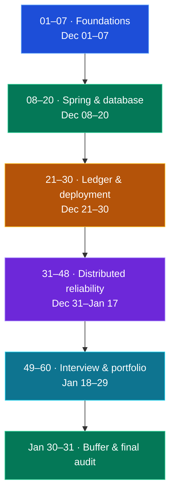
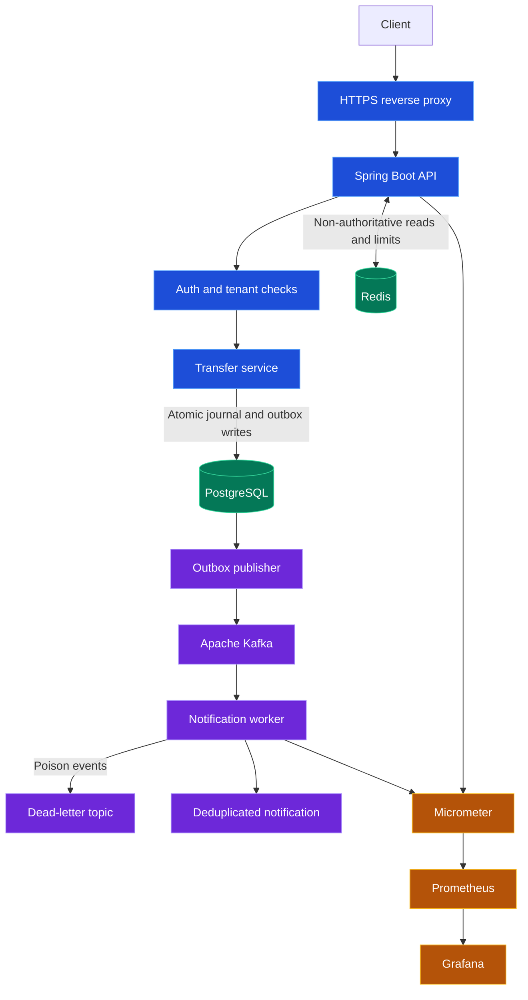

<div align="center">


# 🚀 Backend Engineer 2027 — Project Forge27

### Java 21 · Spring Boot · PostgreSQL · Distributed Systems


   

[](https://github.com/Abhishek-09-Tomar)
[](https://leetcode.com/u/Abhishek_Tomar_99/)
[](https://codeforces.com/profile/Abhishek_Tomar)

**A public engineering journal by Abhishek Tomar**

_Build systems that remain correct under concurrency, retries and infrastructure failures._

[Mission](#mission) • [Stack](#stack) • [Roadmap](#roadmap) • [Projects](#projects) • [Labs](#labs)

[Daily system](#execution) • [Interviews](#interviews) • [Progress](#progress) • [Resources](#resources) • [Repository](#repository) • [Activity](#activity)

</div>

---

<a id="mission"></a>

## 🎯 01 / Mission & scope

I'm **Abhishek Tomar**, a B.Tech Computer Science and Engineering student (2023–2027) at **Galgotias University, India**. Project Forge27 is my public proof-of-work journal for becoming a job-ready backend engineer. My primary targets are **Java Developer, Backend Engineer and Software Development Engineer** roles.

This sprint replaces the previous eight-month execution plan with the current **60-day Backend Engineer Command Center** curriculum. C++ remains a language for DSA interview practice; Java 21 is the primary implementation language for backend and machine-coding exercises. Applied AI is not a required deliverable of this sprint.

> [!IMPORTANT]
> This repository documents planned work, not completed achievements. All progress begins unchecked for the sprint. I will publish only measured results and verifiable evidence.

<div align="center">

| 🗓 Learning units | 🧪 Practical labs | 🧠 MCQs | 🏁 Proof milestones | 🎤 Mock interviews |
| :---------------: | :---------------: | :-----: | :-----------------: | :----------------: |
|      **60**       |      **16**       | **20**  |        **8**        |       **2**        |

</div>

**Success criteria:** build a tested REST API, implement a correct double-entry ledger, demonstrate event delivery and recovery, publish reproducible performance and incident evidence, and defend engineering decisions in interviews.

<a id="stack"></a>

## 🛠️ 02 / Engineering arsenal

<div align="center">

<a href="https://dev.java/learn/"></a>


</div>

| Layer                  | Tools and competencies                                                |
| ---------------------- | --------------------------------------------------------------------- |
| ☕ Language & runtime  | Java 21, collections, generics, records, virtual threads, concurrency |
| 🌱 Backend             | Spring Boot, Spring Security, REST, OpenAPI, Maven, Actuator          |
| 🗄️ Persistence         | PostgreSQL, SQL, JPA/Hibernate, Flyway, HikariCP                      |
| ⚡ Distributed systems | Redis, Apache Kafka, transactional outbox, retries, DLT, idempotency  |
| 🧪 Verification        | JUnit, Mockito, MockMvc, Testcontainers, k6                           |
| 🐳 Delivery            | Linux, Git, GitHub Actions, Docker, Compose, reverse proxy, TLS       |
| 📈 Observability       | Micrometer, Prometheus, Grafana, structured logs, trace correlation   |
| 🧩 Design & interviews | SOLID, LLD, HLD, C++ DSA, SQL, Python API smoke tests                 |

<a id="roadmap"></a>

## 🗺️ 03 / The 60-day roadmap

**Start:** Tuesday, 01 December 2026 · **Day 60:** Friday, 29 January 2027 · **Final date:** Sunday, 31 January 2027.

The window is **62 calendar days inclusive**: 60 curriculum days plus two reserved review/catch-up days. Dates below are planned; if a learning unit slips, the deliverable remains the completion criterion.



|               Phase                | Dates           | Days | Target output                                                             |
| :--------------------------------: | --------------- | :--: | ------------------------------------------------------------------------- |
|    🟦 **1 · Foundation sprint**    | 01 Dec – 07 Dec |  7   | Money object, concurrency exercise, SQL, runbooks and design exercises    |
|    🟩 **2 · Spring & database**    | 08 Dec – 20 Dec |  13  | Tested, tenant-aware REST API with PostgreSQL and CI                      |
|   🟧 **3 · Ledger & deployment**   | 21 Dec – 30 Dec |  10  | Correct ledger, staging deployment and v1.0 release                       |
| 🟪 **4 · Distributed reliability** | 31 Dec – 17 Jan |  18  | Event-driven reliability, observability, security and production evidence |
|  🟦 **5 · Interview & portfolio**  | 18 Jan – 29 Jan |  12  | Six LLD exercises, three HLD designs, two mocks and portfolio audit       |
|      🏁 **Buffer & closure**       | 30–31 Jan       |  2   | Catch-up, final regression and release/portfolio review                   |

### 📆 Daily execution checklist

Expand each phase. Check a day only when its artifact is implemented, tested or documented.

<details>
<summary><strong>🟦 PHASE 01 — FOUNDATION SPRINT | 01 Dec – 07 Dec | 7 days</strong></summary>


**Focus:** Java, concurrency, SQL, Linux, networking and design.

- [ ] **Day 01 · 01 Dec 2026 — Java 21 fundamentals**
  - 📘 Learn: Records, sealed classes, generics, equals/hashCode, collections.
  - 🛠️ Deliver: Implement immutable Money value object with tests.
- [ ] **Day 02 · 02 Dec 2026 — Concurrency**
  - 📘 Learn: volatile vs atomicity, locks, executor, virtual threads.
  - 🛠️ Deliver: Implement bounded producer-consumer queue; reproduce/fix deadlock.
- [ ] **Day 03 · 03 Dec 2026 — Advanced PostgreSQL**
  - 📘 Learn: CTEs, windows, isolation, indexes, EXPLAIN.
  - 🛠️ Deliver: Write 10 SQL queries and compare query plans.
- [ ] **Day 04 · 04 Dec 2026 — Linux and OS**
  - 📘 Learn: processes, file descriptors, signals, memory, ss, lsof.
  - 🛠️ Deliver: Diagnose a process holding a port; write runbook.
- [ ] **Day 05 · 05 Dec 2026 — Networking**
  - 📘 Learn: DNS, TCP, TLS, HTTP versions, proxies.
  - 🛠️ Deliver: Trace an HTTP request through reverse proxy with curl.
- [ ] **Day 06 · 06 Dec 2026 — System design**
  - 📘 Learn: queues, consistency, caching, sharding, capacity.
  - 🛠️ Deliver: Draw a URL shortener with bottlenecks and tradeoffs.
- [ ] **Day 07 · 07 Dec 2026 — LLD and Python refresh**
  - 📘 Learn: SOLID, patterns, Python requests/asyncio.
  - 🛠️ Deliver: Implement parking lot in Java and a Python API smoke test.

**Exit artifact:** Money object, concurrency exercise, SQL, runbooks and design exercises.

</details>

<details>
<summary><strong>🟩 PHASE 02 — SPRING & DATABASE | 08 Dec – 20 Dec | 13 days</strong></summary>


**Focus:** Production REST service, persistence, auth and testing.

- [ ] **Day 08 · 08 Dec 2026 — Spring Boot skeleton**
  - 📘 Learn: Maven, profiles, auto-config, actuator.
  - 🛠️ Deliver: Create task API skeleton, health endpoint and README.
- [ ] **Day 09 · 09 Dec 2026 — REST contracts**
  - 📘 Learn: DTOs, records, HTTP semantics, errors.
  - 🛠️ Deliver: Design CRUD endpoints, consistent validation and errors.
- [ ] **Day 10 · 10 Dec 2026 — Dependency injection**
  - 📘 Learn: bean scopes, lifecycle, constructor injection.
  - 🛠️ Deliver: Refactor service for mocking and testability.
- [ ] **Day 11 · 11 Dec 2026 — Validation & paging**
  - 📘 Learn: Bean Validation, sorting, pagination.
  - 🛠️ Deliver: Add request validation and safe pagination.
- [ ] **Day 12 · 12 Dec 2026 — API documentation**
  - 📘 Learn: OpenAPI, versioning, idempotent HTTP.
  - 🛠️ Deliver: Publish OpenAPI; run curl contract checks.
- [ ] **Day 13 · 13 Dec 2026 — JPA model**
  - 📘 Learn: entities, transactions, dirty checking.
  - 🛠️ Deliver: Map tenant/task/audit entities with constraints.
- [ ] **Day 14 · 14 Dec 2026 — Hibernate performance**
  - 📘 Learn: N+1, fetch strategies, batching.
  - 🛠️ Deliver: Reproduce N+1 and fix with query verification.
- [ ] **Day 15 · 15 Dec 2026 — SQL indexing**
  - 📘 Learn: composite indexes, selectivity, query plans.
  - 🛠️ Deliver: Seed realistic data and benchmark 3 queries.
- [ ] **Day 16 · 16 Dec 2026 — Migrations**
  - 📘 Learn: Flyway, schema evolution, rollback strategy.
  - 🛠️ Deliver: Create repeatable startup migration test.
- [ ] **Day 17 · 17 Dec 2026 — Connection pools**
  - 📘 Learn: HikariCP, timeout, limits, slow queries.
  - 🛠️ Deliver: Tune pool under bounded load with observations.
- [ ] **Day 18 · 18 Dec 2026 — Authentication**
  - 📘 Learn: password hashing, JWT validation, refresh rotation.
  - 🛠️ Deliver: Implement login, expiry and revoked refresh flow.
- [ ] **Day 19 · 19 Dec 2026 — Authorization**
  - 📘 Learn: RBAC, tenant isolation, ownership.
  - 🛠️ Deliver: Prove tenant A cannot read tenant B data.
- [ ] **Day 20 · 20 Dec 2026 — Testing pyramid**
  - 📘 Learn: JUnit, Mockito, MockMvc, Testcontainers.
  - 🛠️ Deliver: Run unit + Postgres integration tests in CI.

**Exit artifact:** Tested, tenant-aware REST API with PostgreSQL and CI.

</details>

<details>
<summary><strong>🟧 PHASE 03 — LEDGER & DEPLOYMENT | 21 Dec – 30 Dec | 10 days</strong></summary>


**Focus:** Correct money movement, contention, cache and release.

- [ ] **Day 21 · 21 Dec 2026 — Ledger schema**
  - 📘 Learn: double-entry invariants, decimal precision.
  - 🛠️ Deliver: Build immutable journal, entries and balance query.
- [ ] **Day 22 · 22 Dec 2026 — Atomic transfers**
  - 📘 Learn: DB transactions, balances, rollback.
  - 🛠️ Deliver: Transfer funds atomically; prove sum(entries)=0.
- [ ] **Day 23 · 23 Dec 2026 — Concurrency correctness**
  - 📘 Learn: row locking, deterministic ordering.
  - 🛠️ Deliver: Hammer shared wallet; confirm no negative balances.
- [ ] **Day 24 · 24 Dec 2026 — Idempotent transfers**
  - 📘 Learn: unique keys, payload fingerprints, DB persistence.
  - 🛠️ Deliver: Retry identical transfer; return same outcome.
- [ ] **Day 25 · 25 Dec 2026 — Failure recovery**
  - 📘 Learn: timeouts, unknown outcomes, reconciliation.
  - 🛠️ Deliver: Simulate request timeout after commit and safely retry.
- [ ] **Day 26 · 26 Dec 2026 — Redis use cases**
  - 📘 Learn: cache-aside, TTL, invalidation.
  - 🛠️ Deliver: Cache non-authoritative reads and invalidate appropriately.
- [ ] **Day 27 · 27 Dec 2026 — Rate limiting**
  - 📘 Learn: token buckets, Redis Lua, fairness.
  - 🛠️ Deliver: Implement limits; verify bursts and expiry.
- [ ] **Day 28 · 28 Dec 2026 — Performance**
  - 📘 Learn: load profiles, p95/p99, bottlenecks.
  - 🛠️ Deliver: Run k6 steady load; publish baseline and methodology.
- [ ] **Day 29 · 29 Dec 2026 — Containers & TLS**
  - 📘 Learn: multi-stage Docker, Compose, secrets, reverse proxy.
  - 🛠️ Deliver: Deploy staging with HTTPS and health checks.
- [ ] **Day 30 · 30 Dec 2026 — Release v1**
  - 📘 Learn: CI, rollback, budget, portfolio.
  - 🛠️ Deliver: Tag v1.0, publish reproducible demo and resume evidence.

**Exit artifact:** Correct ledger, staging deployment and v1.0 release.

</details>

<details>
<summary><strong>🟪 PHASE 04 — DISTRIBUTED RELIABILITY | 31 Dec – 17 Jan | 18 days</strong></summary>


**Focus:** Kafka, outbox, observability, debugging and chaos.

- [ ] **Day 31 · 31 Dec 2026 — Kafka fundamentals**
  - 📘 Learn: topics, partitions, offsets, consumer groups.
  - 🛠️ Deliver: Consume notification event in separate worker.
- [ ] **Day 32 · 01 Jan 2027 — Outbox schema**
  - 📘 Learn: transactional event persistence.
  - 🛠️ Deliver: Write transfer + outbox record in same DB transaction.
- [ ] **Day 33 · 02 Jan 2027 — Outbox publisher**
  - 📘 Learn: polling or CDC, retry, duplicates.
  - 🛠️ Deliver: Publish pending events; recover after crash.
- [ ] **Day 34 · 03 Jan 2027 — Consumer correctness**
  - 📘 Learn: at-least-once delivery, deduplication.
  - 🛠️ Deliver: Ensure duplicate event does not duplicate notification.
- [ ] **Day 35 · 04 Jan 2027 — Retries & DLT**
  - 📘 Learn: poison messages, backoff, replay.
  - 🛠️ Deliver: Route poison message to DLT and replay intentionally.
- [ ] **Day 36 · 05 Jan 2027 — Event contracts**
  - 📘 Learn: schema evolution, correlation IDs.
  - 🛠️ Deliver: Version event schema and test backwards compatibility.
- [ ] **Day 37 · 06 Jan 2027 — Event-driven integration**
  - 📘 Learn: eventual consistency, ordering.
  - 🛠️ Deliver: Demonstrate event lag without corrupting ledger.
- [ ] **Day 38 · 07 Jan 2027 — Metrics**
  - 📘 Learn: Micrometer, Prometheus, RED metrics.
  - 🛠️ Deliver: Expose rate, errors, duration and database pool metrics.
- [ ] **Day 39 · 08 Jan 2027 — Dashboards**
  - 📘 Learn: Grafana, p95/p99, SLOs.
  - 🛠️ Deliver: Create latency/error/saturation dashboard.
- [ ] **Day 40 · 09 Jan 2027 — Logging & traces**
  - 📘 Learn: structured logs, MDC, trace correlation.
  - 🛠️ Deliver: Follow one request across HTTP, DB and Kafka.
- [ ] **Day 41 · 10 Jan 2027 — Memory debugging**
  - 📘 Learn: heap dump, GC, MAT/VisualVM.
  - 🛠️ Deliver: Reproduce memory retention and document root cause.
- [ ] **Day 42 · 11 Jan 2027 — Thread debugging**
  - 📘 Learn: jcmd, thread dumps, deadlocks.
  - 🛠️ Deliver: Capture deadlock and remediate with proof.
- [ ] **Day 43 · 12 Jan 2027 — Fault injection**
  - 📘 Learn: Redis unavailability and fallbacks.
  - 🛠️ Deliver: Kill Redis; preserve ledger correctness.
- [ ] **Day 44 · 13 Jan 2027 — Kafka outage**
  - 📘 Learn: outbox persistence and catch-up.
  - 🛠️ Deliver: Stop Kafka during transfers, restore and drain outbox.
- [ ] **Day 45 · 14 Jan 2027 — DB degradation**
  - 📘 Learn: timeouts, retry policy, pool exhaustion.
  - 🛠️ Deliver: Prove controlled error handling under DB slowdown.
- [ ] **Day 46 · 15 Jan 2027 — Large-table optimization**
  - 📘 Learn: indexes, partitioning tradeoffs.
  - 🛠️ Deliver: Explain query plans before/after optimization.
- [ ] **Day 47 · 16 Jan 2027 — Security hardening**
  - 📘 Learn: secrets, OWASP APIs, input limits, audits.
  - 🛠️ Deliver: Run authorization regression and dependency scan.
- [ ] **Day 48 · 17 Jan 2027 — Final production evidence**
  - 📘 Learn: chaos reports, load profile, RCA.
  - 🛠️ Deliver: Publish reproducible benchmark + incident report.

**Exit artifact:** Event-driven reliability, observability, security and production evidence.

</details>

<details>
<summary><strong>🟦 PHASE 05 — INTERVIEW & PORTFOLIO | 18 Jan – 29 Jan | 12 days</strong></summary>


**Focus:** LLD machine coding, HLD and evidence-backed interviews.

- [ ] **Day 49 · 18 Jan 2027 — LLD: limiter**
  - 📘 Learn: thread-safe token bucket and sliding window.
  - 🛠️ Deliver: Code limiter from blank file in 75 minutes.
- [ ] **Day 50 · 19 Jan 2027 — LLD: booking**
  - 📘 Learn: seat reservation, expiry and contention.
  - 🛠️ Deliver: Code reservation flow with conflict tests.
- [ ] **Day 51 · 20 Jan 2027 — LLD: expenses**
  - 📘 Learn: split and debt minimization.
  - 🛠️ Deliver: Code Splitwise with edge-case tests.
- [ ] **Day 52 · 21 Jan 2027 — LLD: cache**
  - 📘 Learn: LRU/LFU and concurrency.
  - 🛠️ Deliver: Code O(1) LRU with tests.
- [ ] **Day 53 · 22 Jan 2027 — LLD: elevators**
  - 📘 Learn: scheduling/state transitions.
  - 🛠️ Deliver: Code elevator state machine and tests.
- [ ] **Day 54 · 23 Jan 2027 — LLD: pub-sub**
  - 📘 Learn: topics, consumers, delivery.
  - 🛠️ Deliver: Code in-memory pub-sub with shutdown tests.
- [ ] **Day 55 · 24 Jan 2027 — HLD: URL shortener**
  - 📘 Learn: keys, storage, cache, scale.
  - 🛠️ Deliver: Present capacity estimates and failure analysis.
- [ ] **Day 56 · 25 Jan 2027 — HLD: messaging**
  - 📘 Learn: ordering, fanout, delivery semantics.
  - 🛠️ Deliver: Design notification/chat service tradeoffs.
- [ ] **Day 57 · 26 Jan 2027 — HLD: location**
  - 📘 Learn: geospatial indexing and freshness.
  - 🛠️ Deliver: Design nearby-drivers service under constraints.
- [ ] **Day 58 · 27 Jan 2027 — Mock interview I**
  - 📘 Learn: DSA + SQL + coding.
  - 🛠️ Deliver: Complete timed interview and write gap analysis.
- [ ] **Day 59 · 28 Jan 2027 — Mock interview II**
  - 📘 Learn: system design + incident debugging.
  - 🛠️ Deliver: Present whiteboard and defend tradeoffs.
- [ ] **Day 60 · 29 Jan 2027 — Portfolio audit**
  - 📘 Learn: resume claims, demo, docs and next 90 days.
  - 🛠️ Deliver: Verify all numbers; ship final README and plan.

**Exit artifact:** Six LLD exercises, three HLD designs, two mocks and portfolio audit.

</details>

<details>
<summary><strong>🏁 BUFFER & FINAL CLOSURE | 30–31 Jan 2027</strong></summary>

- [ ] **30 Jan 2027 — Catch-up and regression:** finish pending learning units; rerun ledger, authorization, idempotency and outbox recovery tests; document unresolved failures.
- [ ] **31 Jan 2027 — Final portfolio review:** verify README claims, demo, release tags, benchmarks and resume bullets; publish final sprint retrospective and next 90-day plan.

These two days are an added scheduling buffer, not new numbered units in the original curriculum.

</details>

<a id="projects"></a>

## 🏗️ 04 / Signature engineering projects

### 🌱 Project 01 — Multi-tenant Task Management API

 

**Target:** a maintainable REST backend with DTOs, validation, pagination, OpenAPI, migrations, login, refresh-token handling, RBAC and tenant isolation. Verify query counts, indexes and connection-pool behavior; run unit and PostgreSQL integration tests in CI.

**Evidence:** API contract, migrations, negative authorization tests, CI results and documented setup.

### 💳 Project 02 — Reliable Wallet & Double-Entry Ledger

 

**Target:** a learning-oriented financial backend that preserves accounting invariants under contention and failures. Not a real-money payment system.

- [ ] Immutable journal and decimal-safe money representation using `BigDecimal`.
- [ ] Atomic transfers, deterministic row locking and insufficient-funds handling.
- [ ] Persistent idempotency keys and payload fingerprints; safe retry/reconciliation.
- [ ] Non-authoritative Redis caching and token-bucket rate limiting.
- [ ] Staging with HTTPS, health checks, CI, rollback plan and reproducible v1.0 demo.
- [ ] Transactional outbox, Kafka notifications, consumer deduplication, DLT and replay.
- [ ] Metrics, dashboards, correlated logs, fault-injection reports and security regression.

#### 🧬 Proposed architecture — target design, not deployed state



PostgreSQL is the authoritative ledger. Event delivery and caching must never compromise ledger correctness. The outbox records the business event in the same database transaction as the transfer; duplicate deliveries are handled by consumers.

#### 🔒 Non-negotiable regression scenario

```text
Given: wallet A = 100.00, wallet B = 0.00
When:  100 concurrent requests each transfer 10.00 from A to B
Then:  exactly 10 succeed; 90 fail without partial entries
       A = 0.00 and B = 100.00
       every journal balances to zero
       replay of a successful idempotency key creates no extra transfer
```

Run against actual PostgreSQL transactions under the documented retry and failure contract. This is a target assertion, not a measured result.

### 🧩 Project 03 — Distributed Reliability & Design Portfolio

 

A portfolio of outbox recovery evidence, Kafka and Redis outage simulations, database slowdown, JVM memory/thread debugging, six LLD implementations and three HLD design exercises. This extends the ledger and documents reliability rather than inventing a separate mandatory product.

**Evidence:** source code, tests, query plans, incident RCA, benchmark commands and design trade-offs.

<a id="labs"></a>

## 🧪 05 / Engineering lab arena

**16 hands-on labs** with explicit acceptance criteria. Run them in the local IDE or project environment; this README records completion, not automated grading.

<details>
<summary><strong>💻 Coding · 4 labs</strong></summary>

- [ ] **Atomic wallet transfer** — `Ledger`
  - Task: Implement POST /transfers using BigDecimal, a transaction, ordered locks, 2 ledger entries, and insufficient-funds checks.
  - Pass criteria: Two simultaneous transfers never overspend; journal balances; retries do not duplicate.
- [ ] **Bounded blocking queue** — `Java`
  - Task: Implement a generic capacity-N queue using ReentrantLock + Condition or wait/notify.
  - Pass criteria: Blocking put/take, no lost signals, interrupt handling, shutdown policy.
- [ ] **Thread-safe LRU** — `Java`
  - Task: Implement O(1) get/put LRU cache with HashMap + doubly linked list, then synchronize correctly.
  - Pass criteria: Capacity 0/1, overwrite, eviction order, 20-thread contention tests.
- [ ] **SQL window reports** — `SQL`
  - Task: Write per-account running balance and top-3 transactions per tenant using window functions.
  - Pass criteria: Result matches fixture including ties and empty accounts.

</details>

<details>
<summary><strong>🐛 Debugging · 4 labs</strong></summary>

- [ ] **Find N+1** — `Spring`
  - Task: One API endpoint lists 100 orders and performs 101 SQL queries. Diagnose and fix.
  - Pass criteria: Capture query count, compare before/after, avoid unintended cartesian explosion.
- [ ] **Deadlock reproduction** — `Ledger`
  - Task: Two transfers lock account A/B in opposite order. Capture Java thread dump and DB locks.
  - Pass criteria: Reproduce the failure; impose deterministic ordering and rerun test.
- [ ] **Connection pool exhaustion** — `Production`
  - Task: Requests hang under load with Hikari active=max. Isolate slow queries, leaks, or pool sizing.
  - Pass criteria: Attach pool metrics, evidence, root cause, and bounded remediation.
- [ ] **Memory growth** — `Production`
  - Task: A request cache keeps references forever. Reproduce heap growth and inspect a dump.
  - Pass criteria: Document retaining path, fix eviction, compare memory usage.

</details>

<details>
<summary><strong>🧪 Testing · 7 labs</strong></summary>

- [ ] **Unit transfer rules** — `Ledger`
  - Task: Test insufficient funds, self-transfer, invalid amounts and immutable ledger entries.
  - Pass criteria: All tests deterministic and fast.
- [ ] **Integration + Testcontainers** — `SQL`
  - Task: Start PostgreSQL container; apply migrations and verify transaction rollback on partial failure.
  - Pass criteria: Rollback leaves zero partial ledger entries.
- [ ] **Concurrency contention** — `Ledger`
  - Task: Fire 500 simultaneous transfer attempts from one bounded-balance wallet.
  - Pass criteria: No negative balances or double spending; record success/failure counts.
- [ ] **Idempotency replay** — `Ledger`
  - Task: Replay same key and payload 50 times; then same key with altered payload.
  - Pass criteria: Same final transfer result for repeats; altered payload rejected.
- [ ] **Authorization matrix** — `Security`
  - Task: Verify anonymous, user, admin and foreign-tenant access to every endpoint.
  - Pass criteria: No cross-tenant reads or writes, including guessed IDs.
- [ ] **Outbox recovery** — `Kafka`
  - Task: Commit transfers while Kafka is down and then restore it.
  - Pass criteria: No missing business events; consumer side effects deduplicated.
- [ ] **k6 performance baseline** — `Production`
  - Task: Measure 1, 10, 50 and 100 virtual-user profiles with realistic payloads.
  - Pass criteria: Save p50/p95/p99/errors/RPS plus machine specs.

</details>

<details>
<summary><strong>📐 Design · 1 labs</strong></summary>

- [ ] **System design critique** — `Architecture`
  - Task: Design notification delivery; compare polling, queues and streaming.
  - Pass criteria: Provide SLO, capacity math, failure modes and consistency tradeoffs.

</details>

### 🧠 Knowledge checks — 20 MCQs

Attempt each question before checking its answer. Track accuracy honestly; reviewing an answer does not count as a correct attempt.

<details>
<summary><strong>📚 Expand the 20-question practice bank</strong></summary>

**01. [Java] Which is required by the equals/hashCode contract?**

- A. Equal objects must have equal hash codes
- B. Different objects must have different hash codes
- C. hashCode must be stable across JVM runs
- D. equals must compare object identities

<details>
<summary>Answer & explanation</summary>

**A. Equal objects must have equal hash codes** — A hash collision is allowed; equality implies identical hash codes.

</details>

**02. [Java] What does volatile alone guarantee for a shared int counter?**

- A. Atomic increments
- B. Visibility, not atomic increments
- C. Mutual exclusion
- D. Deadlock prevention

<details>
<summary>Answer & explanation</summary>

**B. Visibility, not atomic increments** — counter++ consists of multiple operations.

</details>

**03. [SQL] What typically happens under PostgreSQL READ COMMITTED?**

- A. All statements share one snapshot
- B. Each statement sees a fresh snapshot of committed data
- C. Dirty reads are allowed
- D. Serializable ordering is guaranteed

<details>
<summary>Answer & explanation</summary>

**B. Each statement sees a fresh snapshot of committed data** — Each statement begins with a new committed-data snapshot.

</details>

**04. [SQL] Why use EXPLAIN (ANALYZE, BUFFERS)?**

- A. To create indexes
- B. To execute and inspect actual plan and I/O
- C. To lock all rows permanently
- D. To encrypt result rows

<details>
<summary>Answer & explanation</summary>

**B. To execute and inspect actual plan and I/O** — It measures an executed plan; be mindful of modifying queries.

</details>

**05. [Spring] Why can @Transactional fail on a method called by another method in the same bean?**

- A. SQL is disabled
- B. Self-invocation bypasses the Spring proxy
- C. JPA ignores all annotations
- D. Only public classes support SQL

<details>
<summary>Answer & explanation</summary>

**B. Self-invocation bypasses the Spring proxy** — Proxy interception is skipped when calling this.method directly.

</details>

**06. [Spring] Which HTTP response is usually appropriate for a conflicting resource state?**

- A. 200
- B. 201
- C. 409
- D. 503

<details>
<summary>Answer & explanation</summary>

**C. 409** — 409 Conflict signals that the request cannot complete because of resource state.

</details>

**07. [Security] What should be checked for every tenant-scoped resource request?**

- A. Only a valid JWT
- B. Object-level authorization and tenant ownership
- C. Only TLS availability
- D. Only the request content type

<details>
<summary>Answer & explanation</summary>

**B. Object-level authorization and tenant ownership** — Authenticated does not imply authorized to access every object.

</details>

**08. [Testing] Why use Testcontainers for PostgreSQL integration tests?**

- A. It replaces all unit tests
- B. It tests against real PostgreSQL semantics
- C. It guarantees zero flaky tests
- D. It removes all deployment needs

<details>
<summary>Answer & explanation</summary>

**B. It tests against real PostgreSQL semantics** — Tests execute against a real ephemeral DB instead of H2 substitutions.

</details>

**09. [Ledger] For a journal posting two entries, what invariant must hold?**

- A. Every entry must be positive
- B. Debits and credits sum to zero
- C. Only one account changes
- D. A cache stores canonical balance

<details>
<summary>Answer & explanation</summary>

**B. Debits and credits sum to zero** — Double-entry requires balanced postings.

</details>

**10. [Ledger] Where is the authoritative protection against duplicate money movement?**

- A. Browser localStorage
- B. Application memory
- C. Database unique constraint + transactional idempotency record
- D. Rate limit only

<details>
<summary>Answer & explanation</summary>

**C. Database unique constraint + transactional idempotency record** — Redis may improve speed but cannot be sole durable source of truth.

</details>

**11. [Ledger] Why order locks consistently across accounts?**

- A. Make transactions faster in all cases
- B. Reduce deadlock cycles
- C. Disable isolation
- D. Eliminate every possible timeout

<details>
<summary>Answer & explanation</summary>

**B. Reduce deadlock cycles** — Uniform lock order reduces cyclical waits.

</details>

**12. [Redis] What can cache-aside provide for money balances?**

- A. Guaranteed correctness of a transfer
- B. Faster non-authoritative reads with invalidation policy
- C. Atomic double-entry ledger
- D. Exactly-once Kafka events

<details>
<summary>Answer & explanation</summary>

**B. Faster non-authoritative reads with invalidation policy** — Canonical transfer validation must consult the authoritative database.

</details>

**13. [Kafka] What does an outbox pattern primarily prevent?**

- A. All event duplication
- B. Lost events from a DB-commit/publish crash gap
- C. All consumer lag
- D. All database contention

<details>
<summary>Answer & explanation</summary>

**B. Lost events from a DB-commit/publish crash gap** — Transactional write persists both business state and an event intent.

</details>

**14. [Kafka] What must an at-least-once consumer tolerate?**

- A. No duplicate messages
- B. Duplicate delivery and replay
- C. Only one partition
- D. No failures

<details>
<summary>Answer & explanation</summary>

**B. Duplicate delivery and replay** — Idempotent side effects and durable deduplication are needed.

</details>

**15. [Observability] What does p99 latency represent?**

- A. Average request duration
- B. 99th percentile of observed durations
- C. Maximum possible latency
- D. 99 requests per second

<details>
<summary>Answer & explanation</summary>

**B. 99th percentile of observed durations** — About 99% of observed requests are at or below the p99 value.

</details>

**16. [Debugging] Best first artifact to inspect Java thread deadlock?**

- A. Thread dump
- B. HTML screenshot
- C. Schema migration
- D. CSS source map

<details>
<summary>Answer & explanation</summary>

**A. Thread dump** — Thread dumps show BLOCKED threads, monitors and lock ownership.

</details>

**17. [Testing] An outage test disables Kafka after DB commit. Expected result?**

- A. Reverse committed ledger transfer
- B. Lose event
- C. Persist outbox entry and publish on recovery
- D. Return success without storing anything

<details>
<summary>Answer & explanation</summary>

**C. Persist outbox entry and publish on recovery** — The outbox should be drained after broker recovery.

</details>

**18. [Security] What is appropriate for storing application secrets?**

- A. Commit into Git
- B. Embed in JS bundle
- C. Environment/secret manager with access controls
- D. Put them in API responses

<details>
<summary>Answer & explanation</summary>

**C. Environment/secret manager with access controls** — Keep secrets outside source control and rotate compromised keys.

</details>

**19. [Architecture] When should you add microservices?**

- A. Before a working monolith exists
- B. When measurable team/domain/scaling needs justify complexity
- C. Whenever Redis is installed
- D. For every CRUD entity

<details>
<summary>Answer & explanation</summary>

**B. When measurable team/domain/scaling needs justify complexity** — A modular monolith is often the best starting point.

</details>

**20. [Production] Which benchmark claim is defensible on a resume?**

- A. A hoped-for target
- B. A reproduced measurement with configuration, method and constraints
- C. Competitor benchmark
- D. Any synthetic number

<details>
<summary>Answer & explanation</summary>

**B. A reproduced measurement with configuration, method and constraints** — Publish workload, environment, time period and measurement evidence.

</details>

</details>

<a id="execution"></a>

## ⏱️ 06 / Daily execution system

| 🚀 Intensive track — 10h/day (stretch) | 🌿 Sustainable track — approximately 3–4h/day |
| -------------------------------------- | --------------------------------------------- |
| 2.5h DSA + SQL                         | 45m concepts                                  |
| 5h backend engineering                 | 90m building                                  |
| 1.5h system design                     | 45m debugging/testing                         |
| 1h review and job applications         | 30m recall                                    |
| **10h total**                          | **3h 30m total**                              |

The intensive schedule is optional, not a requirement. Sustainable learning units may take longer than one calendar day; use the buffer or record a revised finish date if needed. Do not mark unfinished work complete to maintain a streak.

### 🔁 Definition of done

- [ ] Understand the concept and explain it without notes.
- [ ] Implement the artifact and test relevant boundaries and failure modes.
- [ ] Document setup, decisions, limitations and what went wrong.
- [ ] Commit readable code or notes and attach evidence.
- [ ] Recall the lesson and record the next action.

### 📝 Daily engineering log

```markdown
# Day XX — YYYY-MM-DD

- Concept studied:
- Artifact implemented:
- DSA / SQL practice:
- Tests / debugging evidence:
- PR or commit link:
- Failure / root cause / fix:
- What I can explain without notes:
- Next action:
```

<a id="interviews"></a>

## 🎤 07 / Interview & job-readiness track

| Track            | Preparation                                                                                                                                  |
| ---------------- | -------------------------------------------------------------------------------------------------------------------------------------------- |
| 🧠 DSA           | C++17/20; arrays, strings, hashing, two pointers, sliding window, binary search, stacks, trees, graphs and DP as parallel interview revision |
| 🗃️ SQL           | Joins, CTEs, window functions, indexes, isolation, query plans                                                                               |
| ☕ Java & Spring | Collections, concurrency, DI, REST, persistence, security, testing                                                                           |
| 🧩 LLD           | Rate limiter, booking, Splitwise, LRU, elevator and pub-sub (Days 49–54)                                                                     |
| 🌐 HLD           | URL shortener, messaging/notifications, nearby-driver service (Days 55–57)                                                                   |
| 🎙️ Mocks         | Day 58: DSA + SQL + coding; Day 59: design + incident debugging                                                                              |
| 💼 Portfolio     | Day 60: audit resume claims, demos, documentation and next 90 days                                                                           |

Apply to suitable campus/off-campus internships and graduate roles throughout the sprint. Keep a truthful one-page resume and prepare project deep dives with real evidence, architecture decisions and failure scenarios.

<a id="progress"></a>

## 📊 08 / Progress command center

<div align="center">

  

</div>

_Initial sprint state; manually update these badges and the tables below after recording evidence._

| Phase                      | Completed / target | Progress        | Status     |
| -------------------------- | :----------------: | --------------- | ---------- |
| 🟦 Foundation sprint       |        0/7         | `░░░░░░░░░░` 0% | ⬜ Planned |
| 🟩 Spring & database       |        0/13        | `░░░░░░░░░░` 0% | ⬜ Planned |
| 🟧 Ledger & deployment     |        0/10        | `░░░░░░░░░░` 0% | ⬜ Planned |
| 🟪 Distributed reliability |        0/18        | `░░░░░░░░░░` 0% | ⬜ Planned |
| 🟦 Interview & portfolio   |        0/12        | `░░░░░░░░░░` 0% | ⬜ Planned |
| **Total learning days**    |      **0/60**      | `░░░░░░░░░░` 0% | ⬜ Planned |

| Metric                             | Sprint actual | Target / evidence              |
| ---------------------------------- | :-----------: | ------------------------------ |
| Learning units                     |       0       | 60                             |
| Labs                               |       0       | 16                             |
| MCQ attempts / accuracy            |     0 / —     | 20-question bank; log attempts |
| Proof milestones                   |       0       | 8                              |
| Mock interviews                    |       0       | 2                              |
| DSA / SQL practice                 |       —       | Record actual count            |
| Applications / interviews received |       —       | Record actual count            |
| Last updated                       |       —       | Enter actual date              |

### 🏆 Eight proof-of-work milestones

- [ ] GitHub repository with architecture diagram and setup steps
- [ ] CI pipeline passes unit + Testcontainers integration tests
- [ ] Double-entry posting invariant and retry test evidence
- [ ] Tenant isolation/authorization regression matrix
- [ ] Reproducible load-test report with p95/p99, errors and hardware
- [ ] Outbox crash/restart recovery demonstration
- [ ] Incident RCA with heap/thread dump evidence
- [ ] Versioned release, sanitized demo and truthful resume bullets

> [!CAUTION]
> Do not claim 24/7 free hosting, 1,000 RPS, five million rows, or a specific p99 latency without evidence. Cloud limits and costs can change. Record workload, dataset, hardware, configuration, p50/p95/p99, error rate and RPS. A reproducible local demo is valuable when a suitable staging deployment is unavailable.

### 📈 Weekly review

Record completed learning units, labs, test results, bugs and fixes, mock feedback, applications and commit links in `progress/weekly/`. Review missed milestones and select the next three priorities. Track quality, not just volume.

<a id="resources"></a>

## 📚 09 / Learning library

**27 curated resources from the current roadmap.** Prioritize official documentation, runnable exercises and verifiable experiments. Access and free-tier limits can change.

| Topic         | Resource                                                                                                       | Why use it?                                           |
| ------------- | -------------------------------------------------------------------------------------------------------------- | ----------------------------------------------------- |
| Java          | [Dev.java — official learning center](https://dev.java/learn/)                                                 | Modern language, collections, concurrency             |
| Java          | [Java 21 API documentation](https://docs.oracle.com/en/java/javase/21/docs/api/)                               | Precise standard library reference                    |
| Spring        | [Spring guides](https://spring.io/guides)                                                                      | Guided, runnable Spring applications                  |
| Spring        | [Spring Boot reference](https://docs.spring.io/spring-boot/reference/)                                         | Official configuration, security/testing entry points |
| Spring        | [Spring Security reference](https://docs.spring.io/spring-security/reference/)                                 | Authentication and authorization patterns             |
| Database      | [PostgreSQL tutorial](https://www.postgresql.org/docs/current/tutorial.html)                                   | SQL and relational fundamentals                       |
| Database      | [PostgreSQL EXPLAIN](https://www.postgresql.org/docs/current/using-explain.html)                               | Interpret query plans                                 |
| Database      | [SQLBolt](https://sqlbolt.com/)                                                                                | Interactive SQL practice                              |
| Database      | [LeetCode SQL 50](https://leetcode.com/studyplan/top-sql-50/)                                                  | SQL exercises; free access may be limited             |
| Testing       | [JUnit 5 user guide](https://junit.org/junit5/docs/current/user-guide/)                                        | Unit and parameterized tests                          |
| Testing       | [Spring Boot testing docs](https://docs.spring.io/spring-boot/reference/testing/spring-boot-applications.html) | Spring app test slices and integration                |
| Testing       | [Testcontainers guides](https://testcontainers.com/guides/)                                                    | Real DB tests with containers                         |
| Testing       | [Grafana k6 quickstart](https://grafana.com/docs/k6/latest/examples/get-started-with-k6/)                      | Load tests, thresholds and metrics                    |
| DevOps        | [Docker getting started](https://docs.docker.com/get-started/)                                                 | Containers and Compose                                |
| DevOps        | [GitHub Actions docs](https://docs.github.com/en/actions)                                                      | CI workflows                                          |
| DevOps        | [Linux Journey](https://linuxjourney.com/)                                                                     | Free Linux fundamentals                               |
| Distributed   | [Apache Kafka documentation](https://kafka.apache.org/documentation/)                                          | Producers, groups, delivery and operations            |
| Distributed   | [Redis documentation](https://redis.io/docs/latest/)                                                           | Caching, commands and Lua                             |
| Observability | [Prometheus docs](https://prometheus.io/docs/introduction/overview/)                                           | Metrics and alerting                                  |
| Observability | [Grafana docs](https://grafana.com/docs/grafana/latest/)                                                       | Dashboards and alerting                               |
| Architecture  | [System Design Primer](https://github.com/donnemartin/system-design-primer)                                    | Free architecture interview preparation               |
| Architecture  | [roadmap.sh backend](https://roadmap.sh/backend)                                                               | Visual skills map                                     |
| Architecture  | [Microsoft system design patterns](https://learn.microsoft.com/en-us/azure/architecture/patterns/)             | Reliability and distributed patterns                  |
| Security      | [OWASP API Security Top 10](https://owasp.org/API-Security/)                                                   | API-specific threat modeling                          |
| Practice      | [Exercism Java track](https://exercism.org/tracks/java)                                                        | Community practice and mentoring                      |
| Practice      | [NeetCode practice roadmap](https://neetcode.io/roadmap)                                                       | DSA patterns; some content paid                       |
| Practice      | [GitHub Skills](https://skills.github.com/)                                                                    | GitHub workflows and version control                  |

<a id="repository"></a>

## 📂 10 / Repository architecture

Suggested organization for this sprint; create folders as work is added. Larger runnable applications can live in independent repositories and be linked from this README.

```text
Project-Forge27/
├── README.md
├── 01-programming-foundations/   # Java, C++, concurrency
├── 02-dsa-and-problem-solving/   # Interview practice
├── 03-core-computer-science/     # OS, Linux, networking
├── 04-backend-engineering/      # Spring, REST, security
├── 05-databases-and-sql/         # SQL, JPA, migrations
├── 06-cloud-and-devops/          # Docker, CI, staging
├── 07-distributed-systems/      # Kafka, Redis, outbox
├── 08-system-design/            # LLD and HLD
├── projects/
│   ├── task-management-api/
│   └── wallet-ledger/
├── labs/                       # Coding, debugging, testing, design
├── evidence/                   # Benchmarks, runbooks, diagrams, RCA
├── interview-preparation/
├── progress/
│   ├── daily/
│   ├── weekly/
│   └── final-review/
└── resources/
```

<a id="activity"></a>

## 🌐 11 / Coding profiles & public activity

<div align="center">

[](https://github.com/Abhishek-09-Tomar)
[](https://leetcode.com/u/Abhishek_Tomar_99/)
[](https://codeforces.com/profile/Abhishek_Tomar)


_These third-party cards reflect public profile activity, not verified sprint totals. External graphics may occasionally fail to load; profile links and the manual tracker remain available._

</div>

## 🧭 12 / Engineering principles

- **Correctness before speed:** protect invariants, isolate tenants and handle retries.
- **Test before claiming reliability:** reproduce failures and preserve evidence.
- **Measure before claiming performance:** publish commands, hardware and workload.
- **Understand before automating:** AI can assist learning and review; I must explain submitted code.
- **Document trade-offs:** explain consistency, availability, latency, security and cost.
- **Never commit secrets:** sanitize logs, backups, screenshots and demos.
- **Build in public responsibly:** report actual progress and acknowledge unfinished work.

## 🤝 13 / Contributions

Corrections, alternative implementations, test cases, reproducible debugging exercises and documentation improvements are welcome. Explain why the change is useful and include verification when applicable. Follow `CONTRIBUTING.md` if present.

---

<div align="center">

### ⚡ Learn deeply. Build correctly. Ship with evidence.

**Maintained by Abhishek Tomar** · [GitHub](https://github.com/Abhishek-09-Tomar)


⭐ If this roadmap helps you learn backend engineering, consider starring the repository.


</div>
