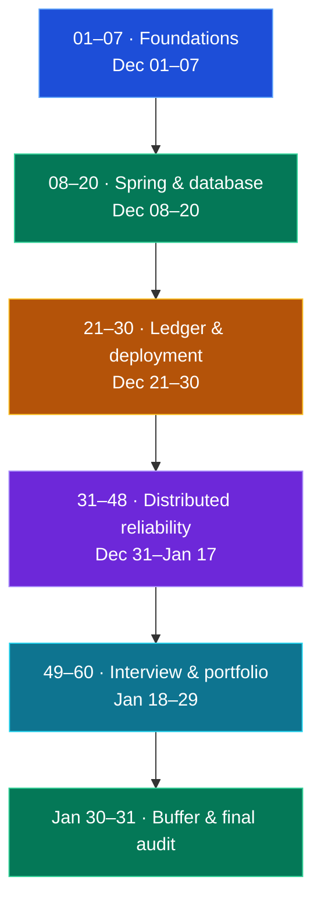
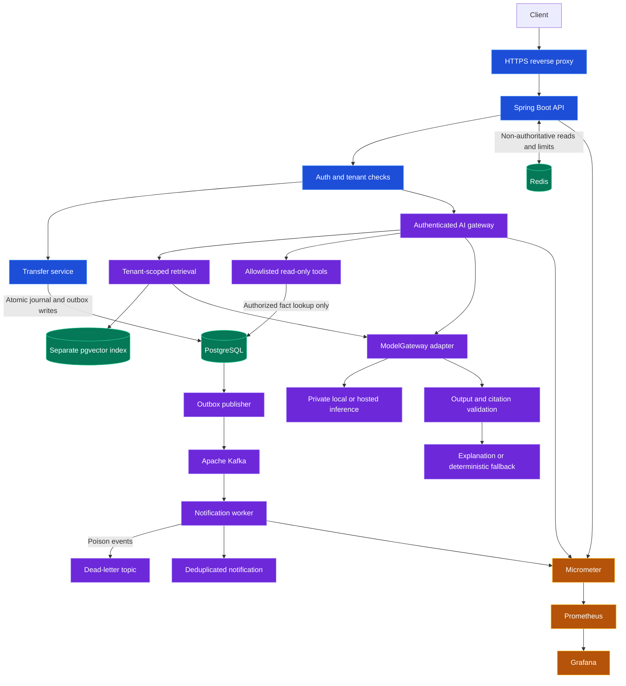

<div align="center">


# 🚀 AI-Integrated Backend Engineer 2027 — Project Forge27

### Java 21 · Spring Boot · PostgreSQL · Distributed Systems · Applied AI


   

[](https://github.com/Abhishek-09-Tomar)
[](https://leetcode.com/u/Abhishek_Tomar_99/)
[](https://codeforces.com/profile/Abhishek_Tomar)

 

**A public engineering journal by Abhishek Tomar**

_Build systems that remain correct under concurrency, retries and infrastructure failures — and add AI without compromising trust._

[Mission](#mission) • [Stack](#stack) • [Roadmap](#roadmap) • [AI track](#ai-track) • [Projects](#projects) • [Labs](#labs)

[Daily system](#execution) • [Interviews](#interviews) • [Progress](#progress) • [Resources](#resources) • [Repository](#repository) • [Activity](#activity)

</div>

---

<a id="mission"></a>

## 🎯 01 / Mission & scope

I'm **Abhishek Tomar**, a B.Tech Computer Science and Engineering student (2023–2027) at **Galgotias University, India**. Project Forge27 is my public proof-of-work journal for becoming a job-ready AI-integrated backend engineer. My primary targets are **Java Developer, Backend Engineer, Software Development Engineer and AI Application Engineer** roles.

This sprint follows the updated **AI-Integrated Backend Engineer — 60-Day Command Center** curriculum: 60 core backend learning units and a parallel 60-activity applied AI track. C++ remains a language for DSA interview practice; Java 21 is the primary backend and machine-coding language. Core engineering comes first; AI activities are optional stretch work until time permits, with independent completion tracking.

> [!IMPORTANT]
> This repository documents planned work, not completed achievements. All progress begins unchecked for the sprint. I will publish only measured results and verifiable evidence.

<div align="center">

| 🗓 Core days | 🤖 AI activities | 🧪 Labs | 🧠 MCQs | 🏁 Milestones | 🎤 Mocks |
| :----------: | :--------------: | :-----: | :-----: | :-----------: | :------: |
|    **60**    |      **60**      | **38**  | **60**  |    **12**     |  **2**   |

</div>

**Success criteria:** build a tested REST API, implement a correct double-entry ledger, demonstrate event delivery and recovery, publish reproducible performance and incident evidence, integrate a read-only AI assistant with tenant-safe RAG, and defend engineering decisions in interviews.

<a id="stack"></a>

## 🛠️ 02 / Engineering arsenal

<div align="center">

<a href="https://dev.java/learn/"></a>


   

</div>

| Layer                  | Tools and competencies                                                                                                      |
| ---------------------- | --------------------------------------------------------------------------------------------------------------------------- |
| ☕ Language & runtime  | Java 21, collections, generics, records, virtual threads, concurrency                                                       |
| 🌱 Backend             | Spring Boot, Spring Security, REST, OpenAPI, Maven, Actuator                                                                |
| 🗄️ Persistence         | PostgreSQL, SQL, JPA/Hibernate, Flyway, HikariCP                                                                            |
| ⚡ Distributed systems | Redis, Apache Kafka, transactional outbox, retries, DLT, idempotency                                                        |
| 🧪 Verification        | JUnit, Mockito, MockMvc, Testcontainers, k6                                                                                 |
| 🐳 Delivery            | Linux, Git, GitHub Actions, Docker, Compose, reverse proxy, TLS                                                             |
| 📈 Observability       | Micrometer, Prometheus, Grafana, structured logs, trace correlation                                                         |
| 🤖 Applied AI          | Spring AI, ChatClient, ModelGateway, Ollama, embeddings, pgvector, RAG, structured outputs, MCP, evaluation                 |
| 🛡️ AI reliability      | Tenant-scoped retrieval, allowlisted read-only tools, prompt injection regression, quotas, fallbacks, versioning, telemetry |
| 🧩 Design & interviews | SOLID, LLD, HLD, C++ DSA, SQL, Python API smoke tests                                                                       |

<a id="roadmap"></a>

## 🗺️ 03 / The 60-day roadmap

**Start:** Tuesday, 01 December 2026 · **Day 60:** Friday, 29 January 2027 · **Final date:** Sunday, 31 January 2027.

The window is **62 calendar days inclusive**: 60 curriculum days plus two reserved review/catch-up days. Dates below are planned; if a learning unit slips, the deliverable remains the completion criterion.



|               Phase                | Dates           | Days | Target output                                                             |
| :--------------------------------: | --------------- | :--: | ------------------------------------------------------------------------- |
|    🟦 **1 · Foundation sprint**    | 01 Dec – 07 Dec |  7   | Money object, concurrency exercise, SQL, runbooks and design exercises    |
|    🟩 **2 · Spring & database**    | 08 Dec – 20 Dec |  13  | Tested, tenant-aware REST API with PostgreSQL and CI                      |
|   🟧 **3 · Ledger & deployment**   | 21 Dec – 30 Dec |  10  | Correct ledger, staging deployment and v1.0 release                       |
| 🟪 **4 · Distributed reliability** | 31 Dec – 17 Jan |  18  | Event-driven reliability, observability, security and production evidence |
|  🟦 **5 · Interview & portfolio**  | 18 Jan – 29 Jan |  12  | Six LLD exercises, three HLD designs, two mocks and portfolio audit       |
|      🏁 **Buffer & closure**       | 30–31 Jan       |  2   | Catch-up, final regression and release/portfolio review                   |

### 📆 Daily execution checklist

Expand each phase for the core checklist. Check a day only when its artifact is implemented, tested or documented. The parallel [AI checklist](#ai-track) has its own completion state and evidence requirement.

<details>
<summary><strong>🟦 PHASE 01 — FOUNDATION SPRINT | 01 Dec – 07 Dec | 7 days</strong></summary>


**Focus:** Java, concurrency, SQL, Linux, networking and design.

- [ ] **Day 01 · 01 Dec 2026 — Java 21 fundamentals**
  - 📘 Learn: Records, sealed classes, generics, equals/hashCode, collections.
  - 🛠️ Deliver: Implement immutable Money value object with tests.
- [ ] **Day 02 · 02 Dec 2026 — Concurrency**
  - 📘 Learn: volatile vs atomicity, locks, executor, virtual threads.
  - 🛠️ Deliver: Implement bounded producer-consumer queue; reproduce/fix deadlock.
- [ ] **Day 03 · 03 Dec 2026 — Advanced PostgreSQL**
  - 📘 Learn: CTEs, windows, isolation, indexes, EXPLAIN.
  - 🛠️ Deliver: Write 10 SQL queries and compare query plans.
- [ ] **Day 04 · 04 Dec 2026 — Linux and OS**
  - 📘 Learn: processes, file descriptors, signals, memory, ss, lsof.
  - 🛠️ Deliver: Diagnose a process holding a port; write runbook.
- [ ] **Day 05 · 05 Dec 2026 — Networking**
  - 📘 Learn: DNS, TCP, TLS, HTTP versions, proxies.
  - 🛠️ Deliver: Trace an HTTP request through reverse proxy with curl.
- [ ] **Day 06 · 06 Dec 2026 — System design**
  - 📘 Learn: queues, consistency, caching, sharding, capacity.
  - 🛠️ Deliver: Draw a URL shortener with bottlenecks and tradeoffs.
- [ ] **Day 07 · 07 Dec 2026 — LLD and Python refresh**
  - 📘 Learn: SOLID, patterns, Python requests/asyncio.
  - 🛠️ Deliver: Implement parking lot in Java and a Python API smoke test.

**Exit artifact:** Money object, concurrency exercise, SQL, runbooks and design exercises.

</details>

<details>
<summary><strong>🟩 PHASE 02 — SPRING & DATABASE | 08 Dec – 20 Dec | 13 days</strong></summary>


**Focus:** Production REST service, persistence, auth and testing.

- [ ] **Day 08 · 08 Dec 2026 — Spring Boot skeleton**
  - 📘 Learn: Maven, profiles, auto-config, actuator.
  - 🛠️ Deliver: Create task API skeleton, health endpoint and README.
- [ ] **Day 09 · 09 Dec 2026 — REST contracts**
  - 📘 Learn: DTOs, records, HTTP semantics, errors.
  - 🛠️ Deliver: Design CRUD endpoints, consistent validation and errors.
- [ ] **Day 10 · 10 Dec 2026 — Dependency injection**
  - 📘 Learn: bean scopes, lifecycle, constructor injection.
  - 🛠️ Deliver: Refactor service for mocking and testability.
- [ ] **Day 11 · 11 Dec 2026 — Validation & paging**
  - 📘 Learn: Bean Validation, sorting, pagination.
  - 🛠️ Deliver: Add request validation and safe pagination.
- [ ] **Day 12 · 12 Dec 2026 — API documentation**
  - 📘 Learn: OpenAPI, versioning, idempotent HTTP.
  - 🛠️ Deliver: Publish OpenAPI; run curl contract checks.
- [ ] **Day 13 · 13 Dec 2026 — JPA model**
  - 📘 Learn: entities, transactions, dirty checking.
  - 🛠️ Deliver: Map tenant/task/audit entities with constraints.
- [ ] **Day 14 · 14 Dec 2026 — Hibernate performance**
  - 📘 Learn: N+1, fetch strategies, batching.
  - 🛠️ Deliver: Reproduce N+1 and fix with query verification.
- [ ] **Day 15 · 15 Dec 2026 — SQL indexing**
  - 📘 Learn: composite indexes, selectivity, query plans.
  - 🛠️ Deliver: Seed realistic data and benchmark 3 queries.
- [ ] **Day 16 · 16 Dec 2026 — Migrations**
  - 📘 Learn: Flyway, schema evolution, rollback strategy.
  - 🛠️ Deliver: Create repeatable startup migration test.
- [ ] **Day 17 · 17 Dec 2026 — Connection pools**
  - 📘 Learn: HikariCP, timeout, limits, slow queries.
  - 🛠️ Deliver: Tune pool under bounded load with observations.
- [ ] **Day 18 · 18 Dec 2026 — Authentication**
  - 📘 Learn: password hashing, JWT validation, refresh rotation.
  - 🛠️ Deliver: Implement login, expiry and revoked refresh flow.
- [ ] **Day 19 · 19 Dec 2026 — Authorization**
  - 📘 Learn: RBAC, tenant isolation, ownership.
  - 🛠️ Deliver: Prove tenant A cannot read tenant B data.
- [ ] **Day 20 · 20 Dec 2026 — Testing pyramid**
  - 📘 Learn: JUnit, Mockito, MockMvc, Testcontainers.
  - 🛠️ Deliver: Run unit + Postgres integration tests in CI.

**Exit artifact:** Tested, tenant-aware REST API with PostgreSQL and CI.

</details>

<details>
<summary><strong>🟧 PHASE 03 — LEDGER & DEPLOYMENT | 21 Dec – 30 Dec | 10 days</strong></summary>


**Focus:** Correct money movement, contention, cache and release.

- [ ] **Day 21 · 21 Dec 2026 — Ledger schema**
  - 📘 Learn: double-entry invariants, decimal precision.
  - 🛠️ Deliver: Build immutable journal, entries and balance query.
- [ ] **Day 22 · 22 Dec 2026 — Atomic transfers**
  - 📘 Learn: DB transactions, balances, rollback.
  - 🛠️ Deliver: Transfer funds atomically; prove sum(entries)=0.
- [ ] **Day 23 · 23 Dec 2026 — Concurrency correctness**
  - 📘 Learn: row locking, deterministic ordering.
  - 🛠️ Deliver: Hammer shared wallet; confirm no negative balances.
- [ ] **Day 24 · 24 Dec 2026 — Idempotent transfers**
  - 📘 Learn: unique keys, payload fingerprints, DB persistence.
  - 🛠️ Deliver: Retry identical transfer; return same outcome.
- [ ] **Day 25 · 25 Dec 2026 — Failure recovery**
  - 📘 Learn: timeouts, unknown outcomes, reconciliation.
  - 🛠️ Deliver: Simulate request timeout after commit and safely retry.
- [ ] **Day 26 · 26 Dec 2026 — Redis use cases**
  - 📘 Learn: cache-aside, TTL, invalidation.
  - 🛠️ Deliver: Cache non-authoritative reads and invalidate appropriately.
- [ ] **Day 27 · 27 Dec 2026 — Rate limiting**
  - 📘 Learn: token buckets, Redis Lua, fairness.
  - 🛠️ Deliver: Implement limits; verify bursts and expiry.
- [ ] **Day 28 · 28 Dec 2026 — Performance**
  - 📘 Learn: load profiles, p95/p99, bottlenecks.
  - 🛠️ Deliver: Run k6 steady load; publish baseline and methodology.
- [ ] **Day 29 · 29 Dec 2026 — Containers & TLS**
  - 📘 Learn: multi-stage Docker, Compose, secrets, reverse proxy.
  - 🛠️ Deliver: Deploy staging with HTTPS and health checks.
- [ ] **Day 30 · 30 Dec 2026 — Release v1**
  - 📘 Learn: CI, rollback, budget, portfolio.
  - 🛠️ Deliver: Tag v1.0, publish reproducible demo and resume evidence.

**Exit artifact:** Correct ledger, staging deployment and v1.0 release.

</details>

<details>
<summary><strong>🟪 PHASE 04 — DISTRIBUTED RELIABILITY | 31 Dec – 17 Jan | 18 days</strong></summary>


**Focus:** Kafka, outbox, observability, debugging and chaos.

- [ ] **Day 31 · 31 Dec 2026 — Kafka fundamentals**
  - 📘 Learn: topics, partitions, offsets, consumer groups.
  - 🛠️ Deliver: Consume notification event in separate worker.
- [ ] **Day 32 · 01 Jan 2027 — Outbox schema**
  - 📘 Learn: transactional event persistence.
  - 🛠️ Deliver: Write transfer + outbox record in same DB transaction.
- [ ] **Day 33 · 02 Jan 2027 — Outbox publisher**
  - 📘 Learn: polling or CDC, retry, duplicates.
  - 🛠️ Deliver: Publish pending events; recover after crash.
- [ ] **Day 34 · 03 Jan 2027 — Consumer correctness**
  - 📘 Learn: at-least-once delivery, deduplication.
  - 🛠️ Deliver: Ensure duplicate event does not duplicate notification.
- [ ] **Day 35 · 04 Jan 2027 — Retries & DLT**
  - 📘 Learn: poison messages, backoff, replay.
  - 🛠️ Deliver: Route poison message to DLT and replay intentionally.
- [ ] **Day 36 · 05 Jan 2027 — Event contracts**
  - 📘 Learn: schema evolution, correlation IDs.
  - 🛠️ Deliver: Version event schema and test backwards compatibility.
- [ ] **Day 37 · 06 Jan 2027 — Event-driven integration**
  - 📘 Learn: eventual consistency, ordering.
  - 🛠️ Deliver: Demonstrate event lag without corrupting ledger.
- [ ] **Day 38 · 07 Jan 2027 — Metrics**
  - 📘 Learn: Micrometer, Prometheus, RED metrics.
  - 🛠️ Deliver: Expose rate, errors, duration and database pool metrics.
- [ ] **Day 39 · 08 Jan 2027 — Dashboards**
  - 📘 Learn: Grafana, p95/p99, SLOs.
  - 🛠️ Deliver: Create latency/error/saturation dashboard.
- [ ] **Day 40 · 09 Jan 2027 — Logging & traces**
  - 📘 Learn: structured logs, MDC, trace correlation.
  - 🛠️ Deliver: Follow one request across HTTP, DB and Kafka.
- [ ] **Day 41 · 10 Jan 2027 — Memory debugging**
  - 📘 Learn: heap dump, GC, MAT/VisualVM.
  - 🛠️ Deliver: Reproduce memory retention and document root cause.
- [ ] **Day 42 · 11 Jan 2027 — Thread debugging**
  - 📘 Learn: jcmd, thread dumps, deadlocks.
  - 🛠️ Deliver: Capture deadlock and remediate with proof.
- [ ] **Day 43 · 12 Jan 2027 — Fault injection**
  - 📘 Learn: Redis unavailability and fallbacks.
  - 🛠️ Deliver: Kill Redis; preserve ledger correctness.
- [ ] **Day 44 · 13 Jan 2027 — Kafka outage**
  - 📘 Learn: outbox persistence and catch-up.
  - 🛠️ Deliver: Stop Kafka during transfers, restore and drain outbox.
- [ ] **Day 45 · 14 Jan 2027 — DB degradation**
  - 📘 Learn: timeouts, retry policy, pool exhaustion.
  - 🛠️ Deliver: Prove controlled error handling under DB slowdown.
- [ ] **Day 46 · 15 Jan 2027 — Large-table optimization**
  - 📘 Learn: indexes, partitioning tradeoffs.
  - 🛠️ Deliver: Explain query plans before/after optimization.
- [ ] **Day 47 · 16 Jan 2027 — Security hardening**
  - 📘 Learn: secrets, OWASP APIs, input limits, audits.
  - 🛠️ Deliver: Run authorization regression and dependency scan.
- [ ] **Day 48 · 17 Jan 2027 — Final production evidence**
  - 📘 Learn: chaos reports, load profile, RCA.
  - 🛠️ Deliver: Publish reproducible benchmark + incident report.

**Exit artifact:** Event-driven reliability, observability, security and production evidence.

</details>

<details>
<summary><strong>🟦 PHASE 05 — INTERVIEW & PORTFOLIO | 18 Jan – 29 Jan | 12 days</strong></summary>


**Focus:** LLD machine coding, HLD and evidence-backed interviews.

- [ ] **Day 49 · 18 Jan 2027 — LLD: limiter**
  - 📘 Learn: thread-safe token bucket and sliding window.
  - 🛠️ Deliver: Code limiter from blank file in 75 minutes.
- [ ] **Day 50 · 19 Jan 2027 — LLD: booking**
  - 📘 Learn: seat reservation, expiry and contention.
  - 🛠️ Deliver: Code reservation flow with conflict tests.
- [ ] **Day 51 · 20 Jan 2027 — LLD: expenses**
  - 📘 Learn: split and debt minimization.
  - 🛠️ Deliver: Code Splitwise with edge-case tests.
- [ ] **Day 52 · 21 Jan 2027 — LLD: cache**
  - 📘 Learn: LRU/LFU and concurrency.
  - 🛠️ Deliver: Code O(1) LRU with tests.
- [ ] **Day 53 · 22 Jan 2027 — LLD: elevators**
  - 📘 Learn: scheduling/state transitions.
  - 🛠️ Deliver: Code elevator state machine and tests.
- [ ] **Day 54 · 23 Jan 2027 — LLD: pub-sub**
  - 📘 Learn: topics, consumers, delivery.
  - 🛠️ Deliver: Code in-memory pub-sub with shutdown tests.
- [ ] **Day 55 · 24 Jan 2027 — HLD: URL shortener**
  - 📘 Learn: keys, storage, cache, scale.
  - 🛠️ Deliver: Present capacity estimates and failure analysis.
- [ ] **Day 56 · 25 Jan 2027 — HLD: messaging**
  - 📘 Learn: ordering, fanout, delivery semantics.
  - 🛠️ Deliver: Design notification/chat service tradeoffs.
- [ ] **Day 57 · 26 Jan 2027 — HLD: location**
  - 📘 Learn: geospatial indexing and freshness.
  - 🛠️ Deliver: Design nearby-drivers service under constraints.
- [ ] **Day 58 · 27 Jan 2027 — Mock interview I**
  - 📘 Learn: DSA + SQL + coding.
  - 🛠️ Deliver: Complete timed interview and write gap analysis.
- [ ] **Day 59 · 28 Jan 2027 — Mock interview II**
  - 📘 Learn: system design + incident debugging.
  - 🛠️ Deliver: Present whiteboard and defend tradeoffs.
- [ ] **Day 60 · 29 Jan 2027 — Portfolio audit**
  - 📘 Learn: resume claims, demo, docs and next 90 days.
  - 🛠️ Deliver: Verify all numbers; ship final README and plan.

**Exit artifact:** Six LLD exercises, three HLD designs, two mocks and portfolio audit.

</details>

<details>
<summary><strong>🏁 BUFFER & FINAL CLOSURE | 30–31 Jan 2027</strong></summary>

- [ ] **30 Jan 2027 — Catch-up and regression:** finish pending core or AI units; rerun ledger, authorization, idempotency, outbox recovery, RAG isolation, tool policy and model-fallback tests; document unresolved failures.
- [ ] **31 Jan 2027 — Final portfolio review:** verify README claims, demo, release tags, benchmarks, AI evaluation evidence and resume bullets; publish final sprint retrospective and next 90-day plan.

These two days are an added scheduling buffer, not new numbered units in the original curriculum.

</details>

<a id="ai-track"></a>

### 🤖 Parallel applied AI track — 60 activities


Add 30–60 minutes per learning day when feasible, or extend the schedule. Complete core work first. Track AI independently; use a fake model when local inference is unavailable.

| Checkpoint      | AI evidence                                            |
| --------------- | ------------------------------------------------------ |
| Day 20 · 20 Dec | Fake-model tests in CI                                 |
| Day 30 · 30 Dec | Read-only wallet help demo (real or explicitly mocked) |
| Day 37 · 06 Jan | Authorized read-only tool calling                      |
| Day 48 · 17 Jan | Evaluation report and failure drill                    |
| Day 60 · 29 Jan | AI portfolio audit and tagged release                  |

<details>
<summary><strong>🟦 AI PHASE 01 — FOUNDATION SPRINT | 01 Dec 2026 – 07 Dec 2026</strong></summary>


- [ ] **AI Day 01 · 01 Dec 2026 — AI workflow baseline**
  - 🤖 Activity: Ask a model to critique your Money object after writing it yourself; verify every suggestion with javac and JUnit.
  - 🧾 Proof: Record one accepted and one rejected suggestion with evidence.
- [ ] **AI Day 02 · 02 Dec 2026 — Concurrency pair programming**
  - 🤖 Activity: Ask for interleavings and a minimal reproducible deadlock; inspect the proposed lock order yourself.
  - 🧾 Proof: Run a bounded stress test and document the actual thread dump.
- [ ] **AI Day 03 · 03 Dec 2026 — AI-assisted SQL**
  - 🤖 Activity: Generate alternative window queries on a synthetic schema; compare EXPLAIN ANALYZE and result sets.
  - 🧾 Proof: Show identical results and measured plans, not model guesses.
- [ ] **AI Day 04 · 04 Dec 2026 — Log analysis**
  - 🤖 Activity: Sanitize process logs; ask AI for three hypotheses ranked by evidence.
  - 🧾 Proof: Verify using ss/lsof/journalctl and write a confirmed RCA.
- [ ] **AI Day 05 · 05 Dec 2026 — Network troubleshooting**
  - 🤖 Activity: Ask AI to propose a diagnostic tree for a failing TLS connection.
  - 🧾 Proof: Check curl verbose output and distinguish DNS, TCP and certificate errors.
- [ ] **AI Day 06 · 06 Dec 2026 — Design critique**
  - 🤖 Activity: Use AI as an adversarial architecture reviewer for your URL shortener.
  - 🧾 Proof: Write two ADRs with explicit workload assumptions and alternatives.
- [ ] **AI Day 07 · 07 Dec 2026 — Prompting and context**
  - 🤖 Activity: Practice task, context, constraints, examples and output contracts; have AI review your LLD without solving first.
  - 🧾 Proof: Compare two prompts against a fixed rubric; explain what improved.

</details>

<details>
<summary><strong>🟩 AI PHASE 02 — SPRING & DATABASE | 08 Dec 2026 – 20 Dec 2026</strong></summary>


- [ ] **AI Day 08 · 08 Dec 2026 — LLM fundamentals**
  - 🤖 Activity: Study tokens, context window, sampling, hallucination and inference; run a small local model if hardware permits.
  - 🧾 Proof: Document model/version, latency and one incorrect response; otherwise use a mock.
- [ ] **AI Day 09 · 09 Dec 2026 — Model API contract**
  - 🤖 Activity: Design POST /ai/explain with bounded input and structured error responses; inspect Ollama chat request/response.
  - 🧾 Proof: Save an OpenAPI contract and a curl smoke test or recorded fixture.
- [ ] **AI Day 10 · 10 Dec 2026 — Spring AI adapter**
  - 🤖 Activity: Introduce a ModelGateway interface and Spring AI ChatClient implementation using a compatible release train.
  - 🧾 Proof: Unit-test service with a fake gateway; model integration remains replaceable.
- [ ] **AI Day 11 · 11 Dec 2026 — Structured outputs**
  - 🤖 Activity: Map model output to an Explanation record; validate enum, lengths and required fields.
  - 🧾 Proof: Test malformed JSON, refusal, extra fields and invalid business values.
- [ ] **AI Day 12 · 12 Dec 2026 — Prompt registry**
  - 🤖 Activity: Version prompt templates alongside OpenAPI; separate trusted instructions from untrusted data.
  - 🧾 Proof: Commit a prompt version and regression fixtures for two variants.
- [ ] **AI Day 13 · 13 Dec 2026 — Data boundaries**
  - 🤖 Activity: Create synthetic wallet support documents with tenant, document ID and version; keep account PII out.
  - 🧾 Proof: Write a data-flow diagram and classify every data field.
- [ ] **AI Day 14 · 14 Dec 2026 — Embeddings**
  - 🤖 Activity: Compare exact keyword retrieval with embedding similarity; understand vector dimension and model version.
  - 🧾 Proof: Create five queries, expected document IDs and a baseline retrieval score.
- [ ] **AI Day 15 · 15 Dec 2026 — PostgreSQL vector search**
  - 🤖 Activity: Create a separate pgvector table; compare exact search and an optional HNSW index on synthetic data.
  - 🧾 Proof: Record recall@k and query plans; use tenant filters before results leave the service.
- [ ] **AI Day 16 · 16 Dec 2026 — Document ingestion**
  - 🤖 Activity: Chunk public FAQ text, attach metadata, deduplicate by hash and version embedding migrations.
  - 🧾 Proof: Reingestion is idempotent and old versions are removable.
- [ ] **AI Day 17 · 17 Dec 2026 — Model client resilience**
  - 🤖 Activity: Configure timeouts, bounded concurrency and backpressure around inference.
  - 🧾 Proof: Fake a slow provider; health and ordinary API traffic remain responsive.
- [ ] **AI Day 18 · 18 Dec 2026 — AI identity and secrets**
  - 🤖 Activity: Use server-managed credentials and scoped application auth; never put provider keys in client JS.
  - 🧾 Proof: Unauthorized requests fail; CI checks synthetic secret patterns.
- [ ] **AI Day 19 · 19 Dec 2026 — Tenant-safe RAG**
  - 🤖 Activity: Enforce authorization in retrieval and tool execution using authenticated tenant context.
  - 🧾 Proof: Cross-tenant search and citation tests return no foreign records.
- [ ] **AI Day 20 · 20 Dec 2026 — AI testing pyramid**
  - 🤖 Activity: Add fixtures for timeouts, refusal, malformed JSON and injection; use fake model in CI.
  - 🧾 Proof: Deterministic unit/integration suite passes without internet.

</details>

<details>
<summary><strong>🟧 AI PHASE 03 — LEDGER & DEPLOYMENT | 21 Dec 2026 – 30 Dec 2026</strong></summary>


- [ ] **AI Day 21 · 21 Dec 2026 — AI boundary for fintech**
  - 🤖 Activity: Design a read-only ledger explanation service. LLM never decides balance or authorizes transfers.
  - 🧾 Proof: Document trust boundary and verify no write-capable model tools exist.
- [ ] **AI Day 22 · 22 Dec 2026 — Safe transaction explanation**
  - 🤖 Activity: Format deterministic SQL-derived transaction facts and ask AI to explain them in plain language.
  - 🧾 Proof: All amounts and IDs come from verified facts; invalid output falls back to a template.
- [ ] **AI Day 23 · 23 Dec 2026 — AI concurrency review**
  - 🤖 Activity: Ask model to review transaction interleavings and identify lost updates; compare with actual tests.
  - 🧾 Proof: Run simultaneous transfers with AI service disabled; invariants still hold.
- [ ] **AI Day 24 · 24 Dec 2026 — AI request deduplication**
  - 🤖 Activity: Design a tenant-scoped cache key including prompt/model/document versions; separate it from transfer idempotency.
  - 🧾 Proof: Test no cross-tenant cache hit; retries never duplicate a ledger write.
- [ ] **AI Day 25 · 25 Dec 2026 — Model outage fallback**
  - 🤖 Activity: Simulate timeout and provider errors; return a clearly labeled deterministic explanation.
  - 🧾 Proof: Core ledger remains available, with no partial state change.
- [ ] **AI Day 26 · 26 Dec 2026 — RAG endpoint**
  - 🤖 Activity: Implement /ai/help with document retrieval, grounded context and document ID citations.
  - 🧾 Proof: Reject unsupported claims or return an abstention; only allowed IDs appear.
- [ ] **AI Day 27 · 27 Dec 2026 — AI quotas**
  - 🤖 Activity: Add per-tenant request and token budgets, maximum output and rate limiting.
  - 🧾 Proof: Exceed quota and verify controlled 429 or documented alternative.
- [ ] **AI Day 28 · 28 Dec 2026 — AI performance baseline**
  - 🤖 Activity: Measure time to first token, total latency, token counts and concurrency separately from ledger RPS.
  - 🧾 Proof: Report model/hardware and p50/p95; no fabricated benchmarks.
- [ ] **AI Day 29 · 29 Dec 2026 — AI deployment boundary**
  - 🤖 Activity: Run model locally or in private network; expose only authenticated gateway; keep model port private.
  - 🧾 Proof: Docker config and threat model show no publicly exposed inference port.
- [ ] **AI Day 30 · 30 Dec 2026 — AI release v1**
  - 🤖 Activity: Demo wallet plus read-only AI help, or mock-backed demo if model unavailable.
  - 🧾 Proof: README lists real vs mocked features, privacy policy and reproducible steps.

</details>

<details>
<summary><strong>🟪 AI PHASE 04 — DISTRIBUTED RELIABILITY | 31 Dec 2026 – 17 Jan 2027</strong></summary>


- [ ] **AI Day 31 · 31 Dec 2026 — Async AI workloads**
  - 🤖 Activity: Design Kafka jobs for document indexing, not core money writes.
  - 🧾 Proof: Version job schema and handle duplicate job delivery.
- [ ] **AI Day 32 · 01 Jan 2027 — AI indexing outbox**
  - 🤖 Activity: Record document updates and indexing intent in one transaction.
  - 🧾 Proof: Crash after commit and recover without losing indexing intent.
- [ ] **AI Day 33 · 02 Jan 2027 — Indexing worker**
  - 🤖 Activity: Implement bounded batch worker with retry and embedding model metadata.
  - 🧾 Proof: Repeated work produces the same logical index state.
- [ ] **AI Day 34 · 03 Jan 2027 — Stale document handling**
  - 🤖 Activity: Invalidate old chunks and scope retrieval to active versions.
  - 🧾 Proof: Search after update or delete excludes stale content.
- [ ] **AI Day 35 · 04 Jan 2027 — Provider retry policy**
  - 🤖 Activity: Classify 429, timeout, 5xx, invalid request and refusal; set bounded retry budget.
  - 🧾 Proof: Fake provider demonstrates no retry storm and dead-letter handling.
- [ ] **AI Day 36 · 05 Jan 2027 — Prompt and model versions**
  - 🤖 Activity: Version evaluation dataset, prompt, model ID and embedding model with release artifacts.
  - 🧾 Proof: One rollback restores a known configuration; incompatible vectors require reindexing.
- [ ] **AI Day 37 · 06 Jan 2027 — Tool calling**
  - 🤖 Activity: Define allowlisted read-only tools getTransactionStatus and searchHelp; validate parameters and auth in Java.
  - 🧾 Proof: Unauthorized ID and unknown tool calls fail before execution.
- [ ] **AI Day 38 · 07 Jan 2027 — AI observability**
  - 🤖 Activity: Instrument model request count, errors, tokens and latency; avoid raw prompt logging by default.
  - 🧾 Proof: Dashboard metrics use bounded cardinality and redact synthetic secrets.
- [ ] **AI Day 39 · 08 Jan 2027 — Evaluation dashboard**
  - 🤖 Activity: Build 30+ labeled queries including answerable, unanswerable, cross-tenant and adversarial examples.
  - 🧾 Proof: Record recall@k, groundedness rubric, abstention and latency; explain limitations.
- [ ] **AI Day 40 · 09 Jan 2027 — Tracing AI requests**
  - 🤖 Activity: Correlate API, retrieval and model spans; use request IDs and sanitized attributes.
  - 🧾 Proof: One trace pinpoints slow retrieval versus inference without storing raw PII.
- [ ] **AI Day 41 · 10 Jan 2027 — Memory pressure**
  - 🤖 Activity: Profile large prompts, buffering and many simultaneous requests with heap metrics.
  - 🧾 Proof: Cap payload size and demonstrate reduced retained objects.
- [ ] **AI Day 42 · 11 Jan 2027 — Thread and cancellation**
  - 🤖 Activity: Simulate stalled inference and disconnected streaming clients.
  - 🧾 Proof: Observe cancellation, bounded executor saturation and no leaked tasks.
- [ ] **AI Day 43 · 12 Jan 2027 — Prompt injection defense**
  - 🤖 Activity: Treat retrieved text as untrusted; test direct/indirect injection in synthetic docs.
  - 🧾 Proof: Model cannot bypass authorization or invoke non-allowlisted tools.
- [ ] **AI Day 44 · 13 Jan 2027 — Provider outage drill**
  - 🤖 Activity: Disable inference provider mid-load and measure fallback and recovery.
  - 🧾 Proof: Ledger p95 and correctness remain within your declared target.
- [ ] **AI Day 45 · 14 Jan 2027 — Vector database outage**
  - 🤖 Activity: Simulate unavailable vector store; do not invent a factual answer.
  - 🧾 Proof: Endpoint returns explicit degraded/unknown response; ledger is unaffected.
- [ ] **AI Day 46 · 15 Jan 2027 — Retrieval tuning**
  - 🤖 Activity: Sweep chunk size, top-k and similarity threshold against frozen queries; compare lexical baseline.
  - 🧾 Proof: Report recall, latency and answer quality trade-offs; keep held-out data separate.
- [ ] **AI Day 47 · 16 Jan 2027 — AI threat model**
  - 🤖 Activity: Review OWASP GenAI risks, output validation, sensitive disclosure, model supply chain and quotas.
  - 🧾 Proof: Add security regression checks and document residual risks.
- [ ] **AI Day 48 · 17 Jan 2027 — AI release v2**
  - 🤖 Activity: Compare baseline vs revised retrieval and prompts; measure quality and operating cost or local compute.
  - 🧾 Proof: Publish evaluation report, failure cases, architecture and demo with synthetic data.

</details>

<details>
<summary><strong>🟦 AI PHASE 05 — INTERVIEW & PORTFOLIO | 18 Jan 2027 – 29 Jan 2027</strong></summary>


- [ ] **AI Day 49 · 18 Jan 2027 — AI code-review drill**
  - 🤖 Activity: Write limiter unaided for 45 minutes; ask AI to find boundary cases after time ends.
  - 🧾 Proof: Use tests to validate each finding; log time saved and errors introduced.
- [ ] **AI Day 50 · 19 Jan 2027 — Agent workflow design**
  - 🤖 Activity: Model a bounded booking assistant with read-only lookup and human approval for writes (design only).
  - 🧾 Proof: Show approval state machine, timeouts, audit trail and denial path.
- [ ] **AI Day 51 · 20 Jan 2027 — MCP fundamentals**
  - 🤖 Activity: Study tool discovery, transport and schema; expose a synthetic read-only help tool via Java MCP SDK or Spring AI.
  - 🧾 Proof: Inspect capability list; authentication and tenant checks remain server-side.
- [ ] **AI Day 52 · 21 Jan 2027 — Cache correctness for LLMs**
  - 🤖 Activity: Compare prompt cache, exact response cache and semantic cache; do not cache sensitive user responses across tenants.
  - 🧾 Proof: Test invalidation on prompt/model/doc version change.
- [ ] **AI Day 53 · 22 Jan 2027 — Agent budgets**
  - 🤖 Activity: Design a bounded tool loop with max steps, deadline, per-tool policy and stop reason.
  - 🧾 Proof: Simulate repeated tool requests and prove termination.
- [ ] **AI Day 54 · 23 Jan 2027 — Evaluation automation**
  - 🤖 Activity: Create CI gate using fixtures and optional manually triggered local inference tests.
  - 🧾 Proof: Fail on deterministic regression; separately report stochastic eval variance.
- [ ] **AI Day 55 · 24 Jan 2027 — AI HLD: knowledge assistant**
  - 🤖 Activity: Whiteboard gateway, retrieval, reranking, inference, telemetry and failure domains.
  - 🧾 Proof: Capacity estimate, latency budget, security boundaries and fallback are explicit.
- [ ] **AI Day 56 · 25 Jan 2027 — AI HLD: model gateway**
  - 🤖 Activity: Design multi-provider adapter, routing, quotas, circuit breakers, versioning and data residency.
  - 🧾 Proof: Compare local vs hosted options and cost/latency/quality trade-offs.
- [ ] **AI Day 57 · 26 Jan 2027 — AI HLD: safe agent**
  - 🤖 Activity: Design read-only tools, scoped identity, human approvals, audit and bounded retries.
  - 🧾 Proof: Identify trust boundaries and demonstrate fail-closed behavior in a sequence diagram.
- [ ] **AI Day 58 · 27 Jan 2027 — AI mock interview**
  - 🤖 Activity: Use mentor to ask one question at a time, withholding solutions until you answer.
  - 🧾 Proof: Explain RAG, embeddings, idempotency, and how you tested failure modes without AI help.
- [ ] **AI Day 59 · 28 Jan 2027 — AI debugging interview**
  - 🤖 Activity: Ask mentor for a synthetic incident involving slow inference, leaked context or wrong retrieval.
  - 🧾 Proof: Diagnose with evidence; propose a test and rollback, then verify independently.
- [ ] **AI Day 60 · 29 Jan 2027 — AI portfolio audit**
  - 🤖 Activity: Document AI-assisted decisions and actual AI features; show before/after eval results and costs.
  - 🧾 Proof: Ship tagged release, reproducible test commands, sanitized demo and honest resume claims.

</details>

> [!IMPORTANT]
> Retain Java 21 and Spring Boot 3.x for core work. Choose a compatible Spring AI release train using the official compatibility guidance. If a different Boot major is required, isolate the AI service or migrate deliberately. Never mix incompatible versions.

<a id="projects"></a>

## 🏗️ 04 / Signature engineering projects

### 🌱 Project 01 — Multi-tenant Task Management API

 

**Target:** a maintainable REST backend with DTOs, validation, pagination, OpenAPI, migrations, login, refresh-token handling, RBAC and tenant isolation. Verify query counts, indexes and connection-pool behavior; run unit and PostgreSQL integration tests in CI.

**Evidence:** API contract, migrations, negative authorization tests, CI results and documented setup.

### 💳 Project 02 — Wallet Intelligence Service (flagship)

**Core:** Reliable Wallet & Double-Entry Ledger · **AI:** read-only transaction explanations and tenant-safe support RAG.

 

**Target:** a learning-oriented financial backend that preserves accounting invariants under contention and failures. Not a real-money payment system. The model must never participate in financial decisions, writes or authorization.

- [ ] Immutable journal and decimal-safe money representation using `BigDecimal`.
- [ ] Atomic transfers, deterministic row locking and insufficient-funds handling.
- [ ] Persistent idempotency keys and payload fingerprints; safe retry/reconciliation.
- [ ] Non-authoritative Redis caching and token-bucket rate limiting.
- [ ] Staging with HTTPS, health checks, CI, rollback plan and reproducible v1.0 demo.
- [ ] Transactional outbox, Kafka notifications, consumer deduplication, DLT and replay.
- [ ] Metrics, dashboards, correlated logs, fault-injection reports and security regression.

#### 🤖 AI integration deliverables

- [ ] `POST /ai/explain` explains verified transaction facts; amounts and IDs come from deterministic data.
- [ ] `/ai/help` retrieves synthetic FAQ documents with authorized citations and abstention.
- [ ] Replaceable `ModelGateway` and compatible Spring AI `ChatClient`, with fake-model tests.
- [ ] Separate pgvector index with tenant filters, versioned prompts/documents/embeddings and deletion handling.
- [ ] Allowlisted `getTransactionStatus` and `searchHelp` tools; server-side ownership and parameter checks.
- [ ] Bounded inference concurrency, timeouts, token quotas, retries and deterministic fallback.
- [ ] Frozen 30+ query evaluation set; recall@k, groundedness, abstention, latency and cost/local compute.
- [ ] Injection, cross-tenant access, provider outage and malformed-output regression evidence.

#### 🧬 Proposed architecture — target design, not deployed state



PostgreSQL is the authoritative ledger. Event delivery and caching must never compromise ledger correctness. The outbox records the business event in the same database transaction as the transfer; duplicate deliveries are handled by consumers. The AI branch is outside the critical transaction path; ordinary wallet traffic must remain correct when inference or retrieval fails. Provider outputs are untrusted; authorization is enforced by application code, not prompts.

#### 🔒 Non-negotiable regression scenario

```text
Given: wallet A = 100.00, wallet B = 0.00
When:  100 concurrent requests each transfer 10.00 from A to B
Then:  exactly 10 succeed; 90 fail without partial entries
       A = 0.00 and B = 100.00
       every journal balances to zero
       replay of a successful idempotency key creates no extra transfer
```

Run against actual PostgreSQL transactions under the documented retry and failure contract. This is a target assertion, not a measured result.

### 🧩 Project 03 — Distributed Reliability & Design Portfolio

 

A portfolio of outbox recovery evidence, Kafka and Redis outage simulations, database slowdown, JVM memory/thread debugging, six LLD implementations and three HLD design exercises, with parallel AI design work for a knowledge assistant, model gateway and bounded safe agent. This extends the ledger and documents reliability rather than inventing a separate mandatory product.

**Evidence:** source code, tests, query plans, incident RCA, benchmark commands and design trade-offs.

<a id="labs"></a>

## 🧪 05 / Engineering lab arena

**38 hands-on labs** (16 core + 22 additional AI labs) with explicit acceptance criteria. Run them in your local IDE or project environment; the README tracks completion, not automatic grading.

<details>
<summary><strong>💻 Coding · 13 labs</strong></summary>

- [ ] **Lab 01 — Atomic wallet transfer** — `Ledger`
  - Task: Implement POST /transfers using BigDecimal, a transaction, ordered locks, 2 ledger entries, and insufficient-funds checks.
  - Pass criteria: Two simultaneous transfers never overspend; journal balances; retries do not duplicate.
- [ ] **Lab 02 — Bounded blocking queue** — `Java`
  - Task: Implement a generic capacity-N queue using ReentrantLock + Condition or wait/notify.
  - Pass criteria: Blocking put/take, no lost signals, interrupt handling, shutdown policy.
- [ ] **Lab 03 — Thread-safe LRU** — `Java`
  - Task: Implement O(1) get/put LRU cache with HashMap + doubly linked list, then synchronize correctly.
  - Pass criteria: Capacity 0/1, overwrite, eviction order, 20-thread contention tests.
- [ ] **Lab 04 — SQL window reports** — `SQL`
  - Task: Write per-account running balance and top-3 transactions per tenant using window functions.
  - Pass criteria: Result matches fixture including ties and empty accounts.
- [ ] **Lab 17 — Provider adapter** — `AI foundations`
  - Task: Implement ModelGateway with Spring AI ChatClient or a direct HTTP adapter; fake it in unit tests.
  - Pass criteria: Success, refusal, timeout and invalid response map to typed outcomes; no secrets in source.
- [ ] **Lab 18 — Prompt version registry** — `AI foundations`
  - Task: Build two prompt variants with typed inputs and a version identifier; commit fixtures.
  - Pass criteria: Version appears in evaluation metadata; untrusted document text remains data.
- [ ] **Lab 19 — Structured explanation API** — `Spring AI`
  - Task: Build a read-only transaction explanation endpoint using verified SQL facts and validated JSON output.
  - Pass criteria: Invalid numbers or IDs are rejected; fallback is deterministic.
- [ ] **Lab 20 — Synthetic document ingester** — `RAG & vectors`
  - Task: Chunk and hash public FAQs; store tenant, document ID, version and embedding metadata.
  - Pass criteria: Repeated ingestion has no duplicates; update/delete removes stale results.
- [ ] **Lab 21 — Vector search and lexical baseline** — `RAG & vectors`
  - Task: Implement pgvector similarity search and basic keyword search; compare on labeled queries.
  - Pass criteria: Correct tenant filter, recall@k and latency report; benchmark exact before approximate.
- [ ] **Lab 22 — Grounded RAG service** — `RAG & vectors`
  - Task: Build help endpoint retrieving allowed docs with citations and abstention.
  - Pass criteria: Only retrieved authorized document IDs can be cited; unknown questions are handled.
- [ ] **Lab 23 — Read-only tool dispatcher** — `Tools & agents`
  - Task: Expose getTransactionStatus and searchHelp with strict typed input and authenticated caller.
  - Pass criteria: Unknown tools and foreign IDs denied; no write tools registered.
- [ ] **Lab 24 — MCP read-only service** — `Tools & agents`
  - Task: Expose synthetic FAQ lookup using compatible Java MCP SDK/Spring AI version.
  - Pass criteria: Tool schema visible in local inspector; auth and bounded parameters enforced.
- [ ] **Lab 25 — Streaming or async inference** — `AI reliability`
  - Task: Implement SSE or an async job endpoint with cancellation and bounded executor.
  - Pass criteria: Disconnect releases work where supported; timeout and capacity limits tested.

</details>

<details>
<summary><strong>🐛 Debugging · 8 labs</strong></summary>

- [ ] **Lab 05 — Find N+1** — `Spring`
  - Task: One API endpoint lists 100 orders and performs 101 SQL queries. Diagnose and fix.
  - Pass criteria: Capture query count, compare before/after, avoid unintended cartesian explosion.
- [ ] **Lab 06 — Deadlock reproduction** — `Ledger`
  - Task: Two transfers lock account A/B in opposite order. Capture Java thread dump and DB locks.
  - Pass criteria: Reproduce the failure; impose deterministic ordering and rerun test.
- [ ] **Lab 07 — Connection pool exhaustion** — `Production`
  - Task: Requests hang under load with Hikari active=max. Isolate slow queries, leaks, or pool sizing.
  - Pass criteria: Attach pool metrics, evidence, root cause, and bounded remediation.
- [ ] **Lab 08 — Memory growth** — `Production`
  - Task: A request cache keeps references forever. Reproduce heap growth and inspect a dump.
  - Pass criteria: Document retaining path, fix eviction, compare memory usage.
- [ ] **Lab 26 — Hallucinated library method** — `AI-assisted engineering`
  - Task: Ask AI for Java client code, compile it, check versioned docs and repair incompatible APIs.
  - Pass criteria: Reproducible failure and fixed compilation; note rejected suggestion.
- [ ] **Lab 27 — Incorrect retrieval** — `RAG & vectors`
  - Task: Introduce stale document or wrong metadata, then diagnose missing citations.
  - Pass criteria: Root cause isolated using retrieval trace; regression fixture catches it.
- [ ] **Lab 28 — Malformed response incident** — `Spring AI`
  - Task: Use a fake model returning truncated JSON, unknown fields and invalid enum.
  - Pass criteria: Typed failure, no 500 leak, fallback response and regression tests.
- [ ] **Lab 29 — Slow inference RCA** — `AI reliability`
  - Task: Add artificial latency and inspect metrics, executor and request traces.
  - Pass criteria: Identify bottleneck; measure before/after mitigation under same workload.

</details>

<details>
<summary><strong>🧪 Testing · 13 labs</strong></summary>

- [ ] **Lab 09 — Unit transfer rules** — `Ledger`
  - Task: Test insufficient funds, self-transfer, invalid amounts and immutable ledger entries.
  - Pass criteria: All tests deterministic and fast.
- [ ] **Lab 10 — Integration + Testcontainers** — `SQL`
  - Task: Start PostgreSQL container; apply migrations and verify transaction rollback on partial failure.
  - Pass criteria: Rollback leaves zero partial ledger entries.
- [ ] **Lab 11 — Concurrency contention** — `Ledger`
  - Task: Fire 500 simultaneous transfer attempts from one bounded-balance wallet.
  - Pass criteria: No negative balances or double spending; record success/failure counts.
- [ ] **Lab 12 — Idempotency replay** — `Ledger`
  - Task: Replay same key and payload 50 times; then same key with altered payload.
  - Pass criteria: Same final transfer result for repeats; altered payload rejected.
- [ ] **Lab 13 — Authorization matrix** — `Security`
  - Task: Verify anonymous, user, admin and foreign-tenant access to every endpoint.
  - Pass criteria: No cross-tenant reads or writes, including guessed IDs.
- [ ] **Lab 14 — Outbox recovery** — `Kafka`
  - Task: Commit transfers while Kafka is down and then restore it.
  - Pass criteria: No missing business events; consumer side effects deduplicated.
- [ ] **Lab 15 — k6 performance baseline** — `Production`
  - Task: Measure 1, 10, 50 and 100 virtual-user profiles with realistic payloads.
  - Pass criteria: Save p50/p95/p99/errors/RPS plus machine specs.
- [ ] **Lab 30 — Prompt injection regression** — `AI security`
  - Task: Insert hostile instructions into synthetic FAQ text and user messages.
  - Pass criteria: Application permissions and tool policy remain enforced even if output follows injected text.
- [ ] **Lab 31 — Cross-tenant RAG and tools** — `AI security`
  - Task: Create two tenant fixtures and query guessed IDs and similar content.
  - Pass criteria: Zero foreign docs, citations or tool results across negative cases.
- [ ] **Lab 32 — Model outage and rate limit** — `AI reliability`
  - Task: Mock timeout, 429 and 503 while exercising core wallet transfers.
  - Pass criteria: Retries bounded; ledger invariants unchanged; explicit degraded response.
- [ ] **Lab 33 — Frozen evaluation dataset** — `AI evals`
  - Task: Build at least 30 labeled examples; score recall@k, supported claims, abstention and latency.
  - Pass criteria: Versioned dataset and reproducible report including failures, not just happy paths.
- [ ] **Lab 34 — AI cost and load baseline** — `AI reliability`
  - Task: Run bounded load with synthetic inputs; record token counts and p95 latency, or local compute.
  - Pass criteria: Report model/hardware, error rate, workload and assumptions; no invented costs.
- [ ] **Lab 38 — AI release gate** — `AI evals`
  - Task: Create deterministic CI with optional separately triggered real-model evals.
  - Pass criteria: Fail on contract/security regression; report probabilistic quality separately.

</details>

<details>
<summary><strong>📐 Design · 4 labs</strong></summary>

- [ ] **Lab 16 — System design critique** — `Architecture`
  - Task: Design notification delivery; compare polling, queues and streaming.
  - Pass criteria: Provide SLO, capacity math, failure modes and consistency tradeoffs.
- [ ] **Lab 35 — Agent trust boundaries** — `Tools & agents`
  - Task: Draw bounded read-only tool loop with max steps, deadline and explicit approval design for hypothetical writes.
  - Pass criteria: Threat model demonstrates independent policy checks and stop conditions.
- [ ] **Lab 36 — AI-assisted code review** — `AI-assisted engineering`
  - Task: Write feature before asking AI; review suggestions for API hallucinations and security bugs.
  - Pass criteria: Evidence log has accepted/rejected changes and failing-then-passing tests.
- [ ] **Lab 37 — Model gateway architecture** — `AI reliability`
  - Task: Compare local and hosted inference, data classification, fallback, versioning, quotas and observability.
  - Pass criteria: ADR includes budget, failure modes, privacy and provider compatibility.

</details>

### 🧠 Knowledge checks — 60 MCQs

Attempt each question before checking its answer. Track accuracy honestly; reviewing an answer does not count as a correct attempt.

<details>
<summary><strong>📚 Core backend · 20 questions</strong></summary>

**01. [Java] Which is required by the equals/hashCode contract?**

- A. Equal objects must have equal hash codes
- B. Different objects must have different hash codes
- C. hashCode must be stable across JVM runs
- D. equals must compare object identities

<details>
<summary>Answer & explanation</summary>

**A. Equal objects must have equal hash codes** — A hash collision is allowed; equality implies identical hash codes.

</details>

**02. [Java] What does volatile alone guarantee for a shared int counter?**

- A. Atomic increments
- B. Visibility, not atomic increments
- C. Mutual exclusion
- D. Deadlock prevention

<details>
<summary>Answer & explanation</summary>

**B. Visibility, not atomic increments** — counter++ consists of multiple operations.

</details>

**03. [SQL] What typically happens under PostgreSQL READ COMMITTED?**

- A. All statements share one snapshot
- B. Each statement sees a fresh snapshot of committed data
- C. Dirty reads are allowed
- D. Serializable ordering is guaranteed

<details>
<summary>Answer & explanation</summary>

**B. Each statement sees a fresh snapshot of committed data** — Each statement begins with a new committed-data snapshot.

</details>

**04. [SQL] Why use EXPLAIN (ANALYZE, BUFFERS)?**

- A. To create indexes
- B. To execute and inspect actual plan and I/O
- C. To lock all rows permanently
- D. To encrypt result rows

<details>
<summary>Answer & explanation</summary>

**B. To execute and inspect actual plan and I/O** — It measures an executed plan; be mindful of modifying queries.

</details>

**05. [Spring] Why can @Transactional fail on a method called by another method in the same bean?**

- A. SQL is disabled
- B. Self-invocation bypasses the Spring proxy
- C. JPA ignores all annotations
- D. Only public classes support SQL

<details>
<summary>Answer & explanation</summary>

**B. Self-invocation bypasses the Spring proxy** — Proxy interception is skipped when calling this.method directly.

</details>

**06. [Spring] Which HTTP response is usually appropriate for a conflicting resource state?**

- A. 200
- B. 201
- C. 409
- D. 503

<details>
<summary>Answer & explanation</summary>

**C. 409** — 409 Conflict signals that the request cannot complete because of resource state.

</details>

**07. [Security] What should be checked for every tenant-scoped resource request?**

- A. Only a valid JWT
- B. Object-level authorization and tenant ownership
- C. Only TLS availability
- D. Only the request content type

<details>
<summary>Answer & explanation</summary>

**B. Object-level authorization and tenant ownership** — Authenticated does not imply authorized to access every object.

</details>

**08. [Testing] Why use Testcontainers for PostgreSQL integration tests?**

- A. It replaces all unit tests
- B. It tests against real PostgreSQL semantics
- C. It guarantees zero flaky tests
- D. It removes all deployment needs

<details>
<summary>Answer & explanation</summary>

**B. It tests against real PostgreSQL semantics** — Tests execute against a real ephemeral DB instead of H2 substitutions.

</details>

**09. [Ledger] For a journal posting two entries, what invariant must hold?**

- A. Every entry must be positive
- B. Debits and credits sum to zero
- C. Only one account changes
- D. A cache stores canonical balance

<details>
<summary>Answer & explanation</summary>

**B. Debits and credits sum to zero** — Double-entry requires balanced postings.

</details>

**10. [Ledger] Where is the authoritative protection against duplicate money movement?**

- A. Browser localStorage
- B. Application memory
- C. Database unique constraint + transactional idempotency record
- D. Rate limit only

<details>
<summary>Answer & explanation</summary>

**C. Database unique constraint + transactional idempotency record** — Redis may improve speed but cannot be sole durable source of truth.

</details>

**11. [Ledger] Why order locks consistently across accounts?**

- A. Make transactions faster in all cases
- B. Reduce deadlock cycles
- C. Disable isolation
- D. Eliminate every possible timeout

<details>
<summary>Answer & explanation</summary>

**B. Reduce deadlock cycles** — Uniform lock order reduces cyclical waits.

</details>

**12. [Redis] What can cache-aside provide for money balances?**

- A. Guaranteed correctness of a transfer
- B. Faster non-authoritative reads with invalidation policy
- C. Atomic double-entry ledger
- D. Exactly-once Kafka events

<details>
<summary>Answer & explanation</summary>

**B. Faster non-authoritative reads with invalidation policy** — Canonical transfer validation must consult the authoritative database.

</details>

**13. [Kafka] What does an outbox pattern primarily prevent?**

- A. All event duplication
- B. Lost events from a DB-commit/publish crash gap
- C. All consumer lag
- D. All database contention

<details>
<summary>Answer & explanation</summary>

**B. Lost events from a DB-commit/publish crash gap** — Transactional write persists both business state and an event intent.

</details>

**14. [Kafka] What must an at-least-once consumer tolerate?**

- A. No duplicate messages
- B. Duplicate delivery and replay
- C. Only one partition
- D. No failures

<details>
<summary>Answer & explanation</summary>

**B. Duplicate delivery and replay** — Idempotent side effects and durable deduplication are needed.

</details>

**15. [Observability] What does p99 latency represent?**

- A. Average request duration
- B. 99th percentile of observed durations
- C. Maximum possible latency
- D. 99 requests per second

<details>
<summary>Answer & explanation</summary>

**B. 99th percentile of observed durations** — About 99% of observed requests are at or below the p99 value.

</details>

**16. [Debugging] Best first artifact to inspect Java thread deadlock?**

- A. Thread dump
- B. HTML screenshot
- C. Schema migration
- D. CSS source map

<details>
<summary>Answer & explanation</summary>

**A. Thread dump** — Thread dumps show BLOCKED threads, monitors and lock ownership.

</details>

**17. [Testing] An outage test disables Kafka after DB commit. Expected result?**

- A. Reverse committed ledger transfer
- B. Lose event
- C. Persist outbox entry and publish on recovery
- D. Return success without storing anything

<details>
<summary>Answer & explanation</summary>

**C. Persist outbox entry and publish on recovery** — The outbox should be drained after broker recovery.

</details>

**18. [Security] What is appropriate for storing application secrets?**

- A. Commit into Git
- B. Embed in JS bundle
- C. Environment/secret manager with access controls
- D. Put them in API responses

<details>
<summary>Answer & explanation</summary>

**C. Environment/secret manager with access controls** — Keep secrets outside source control and rotate compromised keys.

</details>

**19. [Architecture] When should you add microservices?**

- A. Before a working monolith exists
- B. When measurable team/domain/scaling needs justify complexity
- C. Whenever Redis is installed
- D. For every CRUD entity

<details>
<summary>Answer & explanation</summary>

**B. When measurable team/domain/scaling needs justify complexity** — A modular monolith is often the best starting point.

</details>

**20. [Production] Which benchmark claim is defensible on a resume?**

- A. A hoped-for target
- B. A reproduced measurement with configuration, method and constraints
- C. Competitor benchmark
- D. Any synthetic number

<details>
<summary>Answer & explanation</summary>

**B. A reproduced measurement with configuration, method and constraints** — Publish workload, environment, time period and measurement evidence.

</details>

</details>

<details>
<summary><strong>📚 Applied AI · 40 questions</strong></summary>

**21. [AI fundamentals] Why is a model response not a source of truth for a wallet balance?**

- A. Because SQL cannot be used with AI.
- B. Because LLMs never return numbers.
- C. Because JSON guarantees correctness.
- D. The model predicts text, while the database owns the balance invariant.

<details>
<summary>Answer & explanation</summary>

**D. The model predicts text, while the database owns the balance invariant.** — Use deterministic ledger queries; model text is presentation only.

</details>

**22. [AI fundamentals] What does a context window limit?**

- A. The size of a Redis cluster.
- B. The number of Spring beans.
- C. The amount of tokens a model can process in a request, subject to model-specific limits.
- D. The number of users registered in PostgreSQL.

<details>
<summary>Answer & explanation</summary>

**C. The amount of tokens a model can process in a request, subject to model-specific limits.** — Budget context and output; long prompts can truncate or increase latency.

</details>

**23. [AI fundamentals] What is true of temperature zero?**

- A. It guarantees factual output.
- B. It makes the model free.
- C. It prevents prompt injection.
- D. It can reduce sampling variability but does not guarantee correct or reproducible answers.

<details>
<summary>Answer & explanation</summary>

**D. It can reduce sampling variability but does not guarantee correct or reproducible answers.** — Even low-temperature responses need validation and evals.

</details>

**24. [AI fundamentals] What is an embedding?**

- A. An encrypted database password.
- B. A guarantee of factual truth.
- C. A numeric representation used for similarity comparisons.
- D. A Kafka offset.

<details>
<summary>Answer & explanation</summary>

**C. A numeric representation used for similarity comparisons.** — Embedding similarity helps retrieval, but is not proof of correctness.

</details>

**25. [AI fundamentals] When should you prefer RAG to fine-tuning for changing FAQs?**

- A. When you need to change CPU architecture.
- B. When retrieval is forbidden by design.
- C. When every answer must be a database write.
- D. When you need current, source-grounded information that can be updated independently.

<details>
<summary>Answer & explanation</summary>

**D. When you need current, source-grounded information that can be updated independently.** — Retrieve and cite versioned documents; fine-tuning is not a reliable knowledge refresh.

</details>

**26. [AI fundamentals] What is context engineering?**

- A. Maximizing prompt length regardless of relevance.
- B. Using only a larger model.
- C. Replacing access control with prompts.
- D. Selecting and structuring the relevant instructions, data and tools for a model task.

<details>
<summary>Answer & explanation</summary>

**D. Selecting and structuring the relevant instructions, data and tools for a model task.** — Relevant bounded context improves task execution while preserving trust boundaries.

</details>

**27. [Spring AI] Why use a ModelGateway abstraction?**

- A. To remove the need for HTTP timeouts.
- B. To ensure all providers have identical output quality.
- C. To isolate provider specifics and enable deterministic fakes in tests.
- D. To let the model control money transactions.

<details>
<summary>Answer & explanation</summary>

**C. To isolate provider specifics and enable deterministic fakes in tests.** — A replaceable adapter supports testing and provider changes.

</details>

**28. [Spring AI] What must happen after structured JSON output is parsed?**

- A. Immediately execute every field as SQL.
- B. Disable error handling.
- C. Validate domain constraints and authorization before use.
- D. Assume the content is accurate.

<details>
<summary>Answer & explanation</summary>

**C. Validate domain constraints and authorization before use.** — Schema compliance does not prove semantic correctness or permission.

</details>

**29. [Spring AI] What is an appropriate response to a model refusal?**

- A. Handle it as an explicit outcome with safe fallback or clear error.
- B. Convert it to a successful transfer.
- C. Retry forever with more aggressive prompts.
- D. Disable all API security.

<details>
<summary>Answer & explanation</summary>

**A. Handle it as an explicit outcome with safe fallback or clear error.** — Model refusal is a normal failure mode in an API contract.

</details>

**30. [Spring AI] Why version prompts alongside code?**

- A. To eliminate provider costs.
- B. To automatically improve retrieval recall.
- C. To reproduce and evaluate changes and roll back behavior.
- D. To hide bugs from tests.

<details>
<summary>Answer & explanation</summary>

**C. To reproduce and evaluate changes and roll back behavior.** — A prompt is part of the application behavior and release configuration.

</details>

**31. [RAG & vectors] Where must tenant filtering be enforced?**

- A. Only after displaying the response.
- B. Only in a system prompt.
- C. Only in the frontend.
- D. In trusted retrieval/data-access code before returning context to the model.

<details>
<summary>Answer & explanation</summary>

**D. In trusted retrieval/data-access code before returning context to the model.** — The model must never see data the caller is not authorized to access.

</details>

**32. [RAG & vectors] What does recall@k measure?**

- A. The fraction of generated tokens with punctuation.
- B. The percentage of Java code compiled.
- C. The fraction of total requests billed.
- D. The fraction of relevant reference documents retrieved within the top k.

<details>
<summary>Answer & explanation</summary>

**D. The fraction of relevant reference documents retrieved within the top k.** — Recall measures retrieval coverage, not necessarily answer accuracy.

</details>

**33. [RAG & vectors] What is a trade-off of approximate nearest-neighbor indexing?**

- A. Every vector becomes encrypted.
- B. Guaranteed perfect recall.
- C. Potentially faster retrieval at the expense of missing some nearest neighbors.
- D. No need for indexes.

<details>
<summary>Answer & explanation</summary>

**C. Potentially faster retrieval at the expense of missing some nearest neighbors.** — Compare approximate retrieval with exact search using a representative dataset.

</details>

**34. [RAG & vectors] What should happen if no trustworthy source supports an answer?**

- A. Query a foreign tenant.
- B. Increase temperature until a claim appears.
- C. Invent a plausible citation.
- D. Abstain or clearly report insufficient evidence.

<details>
<summary>Answer & explanation</summary>

**D. Abstain or clearly report insufficient evidence.** — Grounded systems should handle unknown questions explicitly.

</details>

**35. [RAG & vectors] Why store an embedding model version?**

- A. Vector spaces may differ; migrations and reindexing need compatibility tracking.
- B. All embeddings have identical semantics.
- C. To avoid testing queries.
- D. To bypass authorization.

<details>
<summary>Answer & explanation</summary>

**A. Vector spaces may differ; migrations and reindexing need compatibility tracking.** — Do not mix incompatible embedding spaces just because dimensions match.

</details>

**36. [RAG & vectors] Which experiment best compares chunking strategies?**

- A. Only count lines of source code.
- B. Run both on the same frozen labeled queries and compare recall, quality and latency.
- C. Compare two unrelated query sets.
- D. Choose the longest chunks by intuition.

<details>
<summary>Answer & explanation</summary>

**B. Run both on the same frozen labeled queries and compare recall, quality and latency.** — Control dataset and measure both retrieval and downstream quality.

</details>

**37. [AI security] A retrieved document instructs the model to ignore policy. What is this?**

- A. A database isolation level.
- B. A valid authorization token.
- C. A thread deadlock.
- D. Indirect prompt injection.

<details>
<summary>Answer & explanation</summary>

**D. Indirect prompt injection.** — Retrieved content is untrusted data; enforce permissions outside the model.

</details>

**38. [AI security] What is the safest role for AI in the wallet capstone?**

- A. Deciding whether a transfer is authorized.
- B. Changing balances without checks.
- C. Read-only explanation of verified ledger facts and public help.
- D. Writing arbitrary SQL generated by the model.

<details>
<summary>Answer & explanation</summary>

**C. Read-only explanation of verified ledger facts and public help.** — Money movement stays in deterministic transactional code.

</details>

**39. [AI security] Where should provider API secrets live?**

- A. In an HTML localStorage setting.
- B. In the user's prompt.
- C. In a public GitHub README.
- D. On a secured backend or secret manager, never in distributed browser code.

<details>
<summary>Answer & explanation</summary>

**D. On a secured backend or secret manager, never in distributed browser code.** — Client-delivered secrets are accessible to users and scripts.

</details>

**40. [AI security] What prevents a malicious tool request from reading another tenant?**

- A. Server-side authenticated identity and authorization checks on every call.
- B. An instruction saying do not read other tenants.
- C. A high similarity score.
- D. An agent's confidence score.

<details>
<summary>Answer & explanation</summary>

**A. Server-side authenticated identity and authorization checks on every call.** — Treat model-generated tool calls as untrusted input.

</details>

**41. [AI security] Why redact raw prompts and responses in telemetry?**

- A. They may contain credentials, personal information or proprietary data.
- B. To eliminate all security risk.
- C. Because tracing cannot store strings.
- D. To make all requests faster.

<details>
<summary>Answer & explanation</summary>

**A. They may contain credentials, personal information or proprietary data.** — Prefer metadata and explicit safe sampling; avoid sensitive payload collection.

</details>

**42. [AI security] What should an agent have before calling a write-capable tool?**

- A. Explicit authorization, appropriate approval, validated parameters and bounded execution.
- B. An unlimited retry loop.
- C. An arbitrary shell command.
- D. Only a successful language model response.

<details>
<summary>Answer & explanation</summary>

**A. Explicit authorization, appropriate approval, validated parameters and bounded execution.** — Approval and application policy must constrain impact; the learning wallet has no write tools.

</details>

**43. [AI reliability] What is a sensible retry strategy for provider 429 or transient 5xx?**

- A. Retry every millisecond forever.
- B. Always return HTTP 200.
- C. Retry invalid requests indefinitely.
- D. Bound retries with backoff, jitter and a deadline; respect provider guidance.

<details>
<summary>Answer & explanation</summary>

**D. Bound retries with backoff, jitter and a deadline; respect provider guidance.** — Avoid amplifying provider outages and respect total request budget.

</details>

**44. [AI reliability] Why use a fake model in normal CI?**

- A. To replace all integration tests.
- B. To remove the need for evals.
- C. To make contract and failure-path tests repeatable without a network dependency.
- D. To prove the real model is factually correct.

<details>
<summary>Answer & explanation</summary>

**C. To make contract and failure-path tests repeatable without a network dependency.** — Test actual inference separately; fakes test your deterministic code.

</details>

**45. [AI reliability] Which metric is useful for streaming UX?**

- A. Only database disk capacity.
- B. Time to first token plus total response time.
- C. Only the number of tables.
- D. Only total Git commits.

<details>
<summary>Answer & explanation</summary>

**B. Time to first token plus total response time.** — Streaming responsiveness differs from complete-response latency.

</details>

**46. [AI reliability] What must happen to the core ledger if the inference provider is down?**

- A. All transfers stop by design.
- B. The application silently invents responses.
- C. It remains available and correct; the optional AI feature degrades.
- D. The model estimates balances from memory.

<details>
<summary>Answer & explanation</summary>

**C. It remains available and correct; the optional AI feature degrades.** — Keep AI outside the critical transaction path.

</details>

**47. [AI reliability] Why cap concurrent model requests?**

- A. To eliminate authorization checks.
- B. To make tokens unlimited.
- C. To guarantee better semantic quality.
- D. To limit resource exhaustion and protect ordinary API traffic.

<details>
<summary>Answer & explanation</summary>

**D. To limit resource exhaustion and protect ordinary API traffic.** — Use bounded queues, deadlines and per-tenant quotas.

</details>

**48. [AI evals] What is a useful evaluation split?**

- A. Tune and report only on identical examples.
- B. Use only one happy-path query.
- C. Development fixtures for tuning and a held-out set for final measurement.
- D. Exclude all difficult cases.

<details>
<summary>Answer & explanation</summary>

**C. Development fixtures for tuning and a held-out set for final measurement.** — Held-out examples reduce overfitting; include adversarial and unknown cases.

</details>

**49. [AI evals] Why use a groundedness rubric in addition to retrieval recall?**

- A. All correct answers have the same token count.
- B. Recall alone measures every answer claim.
- C. Retrieving the right document does not guarantee the answer faithfully uses it.
- D. Groundedness eliminates authorization needs.

<details>
<summary>Answer & explanation</summary>

**C. Retrieving the right document does not guarantee the answer faithfully uses it.** — Evaluate retrieval and generation separately; inspect citations and claims.

</details>

**50. [AI evals] Which is the best proof of improvement?**

- A. A reproducible before/after eval on the same dataset and configuration log.
- B. A model's self-reported confidence.
- C. A single cherry-picked demo.
- D. A larger number of prompts.

<details>
<summary>Answer & explanation</summary>

**A. A reproducible before/after eval on the same dataset and configuration log.** — Measure failures, quality, latency and cost under comparable conditions.

</details>

**51. [AI evals] Why include unanswerable and adversarial queries?**

- A. To guarantee all queries have answers.
- B. To test abstention, permission boundaries and robustness.
- C. To increase token use.
- D. To improve the model by hiding bad cases.

<details>
<summary>Answer & explanation</summary>

**B. To test abstention, permission boundaries and robustness.** — A production assistant must know when not to answer or act.

</details>

**52. [AI evals] What is a limitation of an LLM-as-judge?**

- A. It may be biased or inconsistent; calibrate it against human-labeled examples.
- B. It guarantees zero hallucinations.
- C. It makes deterministic tests obsolete.
- D. It is always more accurate than humans.

<details>
<summary>Answer & explanation</summary>

**A. It may be biased or inconsistent; calibrate it against human-labeled examples.** — Use clear rubrics, calibration and review of disputed cases.

</details>

**53. [Tools & agents] What does tool calling actually provide?**

- A. A model can propose a structured invocation; application code decides whether to execute it.
- B. Automatic authority to perform any action.
- C. A guarantee that parameters are safe.
- D. A replacement for an API gateway.

<details>
<summary>Answer & explanation</summary>

**A. A model can propose a structured invocation; application code decides whether to execute it.** — Validate and authorize each call in trusted code.

</details>

**54. [Tools & agents] What is MCP useful for?**

- A. Replacing SQL transactions.
- B. Automatically making all tools public.
- C. A standardized way for AI applications to discover and interact with tools and data.
- D. Guaranteeing model truthfulness.

<details>
<summary>Answer & explanation</summary>

**C. A standardized way for AI applications to discover and interact with tools and data.** — MCP is a protocol, not an authorization policy.

</details>

**55. [Tools & agents] What stops a looping agent consuming resources?**

- A. Allowing infinite tool calls.
- B. Increasing temperature.
- C. A step cap, deadline and explicit stop/failure policy.
- D. Removing observability.

<details>
<summary>Answer & explanation</summary>

**C. A step cap, deadline and explicit stop/failure policy.** — Bound cost and runtime; log the stopping reason.

</details>

**56. [AI-assisted engineering] What is the best use of AI-generated code?**

- A. Merge without reading it.
- B. Give AI unrestricted production credentials.
- C. Treat generated tests as proof of all correctness.
- D. Review the diff, compile, test, inspect dependencies and verify behavior yourself.

<details>
<summary>Answer & explanation</summary>

**D. Review the diff, compile, test, inspect dependencies and verify behavior yourself.** — The engineer owns correctness, security and maintainability.

</details>

**57. [AI-assisted engineering] How should AI help with debugging?**

- A. Declare root cause before reading logs.
- B. Propose falsifiable hypotheses based on sanitized evidence, then verify experimentally.
- C. Remove error handling to simplify code.
- D. Make many uncontrolled changes at once.

<details>
<summary>Answer & explanation</summary>

**B. Propose falsifiable hypotheses based on sanitized evidence, then verify experimentally.** — Measure before changing; isolate causes and add regressions.

</details>

**58. [AI-assisted engineering] What should you do when AI invents a library method?**

- A. Check versioned official documentation and compilation results.
- B. Ignore the failing build.
- C. Change the compiler to accept it.
- D. Add a fake method without understanding it.

<details>
<summary>Answer & explanation</summary>

**A. Check versioned official documentation and compilation results.** — Verify dependency compatibility and API existence.

</details>

**59. [AI-assisted engineering] How should you prepare for interviews using AI?**

- A. Memorize generated answers without understanding.
- B. Attempt independently, receive critique, then explain and retest unaided.
- C. Skip practical exercises.
- D. Ask AI to impersonate you in an interview.

<details>
<summary>Answer & explanation</summary>

**B. Attempt independently, receive critique, then explain and retest unaided.** — AI is a tutor, not a substitute for demonstrable skills.

</details>

**60. [AI-assisted engineering] How should AI-produced test cases be reviewed?**

- A. Delete all existing tests.
- B. Assume passing generated tests imply correctness.
- C. Only count coverage percentage.
- D. Check assertions, edge cases and whether tests fail on a real bug.

<details>
<summary>Answer & explanation</summary>

**D. Check assertions, edge cases and whether tests fail on a real bug.** — Mutation or negative tests help establish that assertions are meaningful.

</details>

</details>

<a id="execution"></a>

## ⏱️ 06 / Daily execution system

| 🚀 Intensive track — 10h/day (stretch) | 🌿 Sustainable track — approximately 3–4h/day |
| -------------------------------------- | --------------------------------------------- |
| 2.5h DSA + SQL                         | 45m concepts                                  |
| 5h backend engineering                 | 90m building                                  |
| 1.5h system design                     | 45m debugging/testing                         |
| 1h review and job applications         | 30m recall                                    |
| **10h total**                          | **3h 30m total**                              |

Add **30–60 minutes/day** for the parallel AI track when feasible (10.5–11h intensive or 4–4.5h on the illustrated sustainable schedule); otherwise extend the learning window. The intensive schedule is optional, not a requirement. Sustainable learning units may take longer than one calendar day; use the buffer or record a revised finish date if needed. Do not mark unfinished work complete to maintain a streak.

### 🔁 Definition of done

- [ ] Understand the concept and explain it without notes.
- [ ] Implement the artifact and test relevant boundaries and failure modes.
- [ ] Document setup, decisions, limitations and what went wrong.
- [ ] Commit readable code or notes and attach evidence.
- [ ] Recall the lesson and record the next action.
- [ ] Mark the AI unit separately only after completing its specified proof; verify model suggestions with tests and documentation.

### 📝 Daily engineering log

```markdown
# Day XX — YYYY-MM-DD

- Concept studied:
- Artifact implemented:
- DSA / SQL practice:
- Parallel AI activity / proof:
- AI suggestions accepted / rejected and verification:
- Model / prompt / dataset version (if relevant):
- Tests / debugging evidence:
- PR or commit link:
- Failure / root cause / fix:
- What I can explain without notes:
- Next action:
```

### 🤖 AI mentor & engineering copilot

Use the HTML command center alongside this Markdown journal. Its offline prompt builder supports eight modes: Socratic tutor, coding coach, debugging partner, test engineer, code/security reviewer, system design interviewer, MCQ generator and mock interviewer. Offline prompt generation does not execute a model. Write your solution first, sanitize inputs, and verify every suggestion independently.

<details>
<summary><strong>🧑‍💻 Optional local model setup</strong></summary>

Save the supplied HTML as a local `command-center.html` file and, if hardware permits, install Ollama and pull a compatible local model. The source uses `qwen2.5-coder:3b` as an example, not a required model.

```powershell
ollama pull qwen2.5-coder:3b
```

From the directory containing the HTML, serve it over loopback:

```powershell
python -m http.server 8000 --bind 127.0.0.1
```

Open `http://127.0.0.1:8000/command-center.html`. Start Ollama if needed. Keep its port 11434 private; if CORS blocks requests, consult Ollama's FAQ and allow only the exact local page origin. Do not paste secrets, private code, production logs or account data. Model responses are untrusted plain text; no tools or code are executed by the mentor. If local-only processing matters, use a downloaded model and disable cloud functionality.

</details>

### 🎮 AI engineering playground

| Exercise                        | Verification objective                                                                                                                               |
| ------------------------------- | ---------------------------------------------------------------------------------------------------------------------------------------------------- |
| 🔎 Retrieval & tenant isolation | Toy keyword retrieval ranks only authorized synthetic documents; it is not actual vector search.                                                     |
| 🧾 Structured output validator  | Validate `ANSWERED` / `UNKNOWN`, explanation length, allowed citation IDs and eight regression cases; schema validation is not factual verification. |
| 📊 Retrieval evaluation         | Six frozen synthetic cases; positive-query recall and zero-hit unknown queries, not actual model abstention.                                         |
| 🔐 Read-only tool policy        | Deny unknown tools, cross-tenant IDs, malformed arguments and unexpected fields before execution.                                                    |

The playground runs deterministic browser simulations, not actual embeddings or inference. The HTML stores checkmarks, quiz attempts and notes locally in the browser; use JSON backup for portability. Keep secrets out of notes and backups. GitHub Markdown does not run the HTML dashboard's JavaScript, and the two trackers do not synchronize automatically.

<a id="interviews"></a>

## 🎤 07 / Interview & job-readiness track

| Track               | Preparation                                                                                                                                  |
| ------------------- | -------------------------------------------------------------------------------------------------------------------------------------------- |
| 🧠 DSA              | C++17/20; arrays, strings, hashing, two pointers, sliding window, binary search, stacks, trees, graphs and DP as parallel interview revision |
| 🗃️ SQL              | Joins, CTEs, window functions, indexes, isolation, query plans                                                                               |
| ☕ Java & Spring    | Collections, concurrency, DI, REST, persistence, security, testing                                                                           |
| 🧩 LLD              | Rate limiter, booking, Splitwise, LRU, elevator and pub-sub (Days 49–54)                                                                     |
| 🌐 HLD              | URL shortener, messaging/notifications, nearby-driver service (Days 55–57)                                                                   |
| 🎙️ Mocks            | Day 58: DSA + SQL + coding; Day 59: design + incident debugging                                                                              |
| 🤖 Applied AI       | RAG, embeddings, structured outputs, read-only tools, MCP, model gateway, quotas, evaluation and prompt injection defenses                   |
| 🎙️ AI mock practice | Days 58–59: AI concepts, independent explanation and synthetic inference/retrieval incident debugging                                        |
| 💼 Portfolio        | Day 60: audit resume claims, demos, AI quality evidence, documentation and next 90 days                                                      |

Apply to suitable campus/off-campus internships and graduate roles throughout the sprint. Keep a truthful one-page resume and prepare project deep dives with real evidence, architecture decisions and failure scenarios.

<a id="progress"></a>

## 📊 08 / Progress command center

<div align="center">

    

</div>

_Initial sprint state; manually update these badges and the tables below after recording evidence._

| Phase                      | Core completed | AI completed | Core progress   | Status     |
| -------------------------- | :------------: | :----------: | --------------- | ---------- |
| 🟦 Foundation sprint       |      0/7       |     0/7      | `░░░░░░░░░░` 0% | ⬜ Planned |
| 🟩 Spring & database       |      0/13      |     0/13     | `░░░░░░░░░░` 0% | ⬜ Planned |
| 🟧 Ledger & deployment     |      0/10      |     0/10     | `░░░░░░░░░░` 0% | ⬜ Planned |
| 🟪 Distributed reliability |      0/18      |     0/18     | `░░░░░░░░░░` 0% | ⬜ Planned |
| 🟦 Interview & portfolio   |      0/12      |     0/12     | `░░░░░░░░░░` 0% | ⬜ Planned |
| **Total learning days**    |    **0/60**    |   **0/60**   | `░░░░░░░░░░` 0% | ⬜ Planned |

| Metric                             | Sprint actual | Target / evidence   |
| ---------------------------------- | :-----------: | ------------------- |
| Core learning units                |       0       | 60                  |
| AI activities                      |       0       | 60                  |
| Labs                               |       0       | 38                  |
| Core MCQ attempts / accuracy       |     0 / —     | 20 core questions   |
| AI MCQ attempts / accuracy         |     0 / —     | 40 AI questions     |
| Proof milestones                   |       0       | 12                  |
| Mock interviews                    |       0       | 2                   |
| DSA / SQL practice                 |       —       | Record actual count |
| Applications / interviews received |       —       | Record actual count |
| Last updated                       |       —       | Enter actual date   |

### 🏆 Twelve proof-of-work milestones

- [ ] GitHub repository with architecture diagram and setup steps
- [ ] CI pipeline passes unit + Testcontainers integration tests
- [ ] Double-entry posting invariant and retry test evidence
- [ ] Tenant isolation/authorization regression matrix
- [ ] Reproducible load-test report with p95/p99, errors and hardware
- [ ] Outbox crash/restart recovery demonstration
- [ ] Incident RCA with heap/thread dump evidence
- [ ] Versioned release, sanitized demo and truthful resume bullets
- [ ] AI read-only service with versioned prompts and fake-model tests
- [ ] Tenant-safe RAG with frozen evaluation dataset and citation checks
- [ ] Prompt injection, tool authorization, quota and fallback regression evidence
- [ ] AI quality/latency report with real model or explicitly labeled mock

> [!CAUTION]
> Do not claim 24/7 free hosting, 1,000 RPS, five million rows, or a specific p99 latency without evidence. Cloud limits and costs can change. Record workload, dataset, hardware, configuration, p50/p95/p99, error rate and RPS. A reproducible local demo is valuable when a suitable staging deployment is unavailable.

### 📈 Weekly review

Record completed core units and AI activities separately, labs, AI evaluation and test results, bugs and fixes, mock feedback, applications and commit links in `progress/weekly/`. Review missed milestones and select the next three priorities. Track quality, not just volume.

<a id="resources"></a>

## 📚 09 / Learning library

**45 curated resources from the updated roadmap** (27 core + 18 AI). Prioritize official documentation, runnable exercises and verifiable experiments. Reading materials are free; some exercises require an account, local compute or paid hosted API calls. Prefer local models or deterministic mocks.

### ⚙️ Core backend engineering

| Topic         | Resource                                                                                                       | Why use it?                                           |
| ------------- | -------------------------------------------------------------------------------------------------------------- | ----------------------------------------------------- |
| Java          | [Dev.java — official learning center](https://dev.java/learn/)                                                 | Modern language, collections, concurrency             |
| Java          | [Java 21 API documentation](https://docs.oracle.com/en/java/javase/21/docs/api/)                               | Precise standard library reference                    |
| Spring        | [Spring guides](https://spring.io/guides)                                                                      | Guided, runnable Spring applications                  |
| Spring        | [Spring Boot reference](https://docs.spring.io/spring-boot/reference/)                                         | Official configuration, security/testing entry points |
| Spring        | [Spring Security reference](https://docs.spring.io/spring-security/reference/)                                 | Authentication and authorization patterns             |
| Database      | [PostgreSQL tutorial](https://www.postgresql.org/docs/current/tutorial.html)                                   | SQL and relational fundamentals                       |
| Database      | [PostgreSQL EXPLAIN](https://www.postgresql.org/docs/current/using-explain.html)                               | Interpret query plans                                 |
| Database      | [SQLBolt](https://sqlbolt.com/)                                                                                | Interactive SQL practice                              |
| Database      | [LeetCode SQL 50](https://leetcode.com/studyplan/top-sql-50/)                                                  | SQL exercises; free access may be limited             |
| Testing       | [JUnit 5 user guide](https://junit.org/junit5/docs/current/user-guide/)                                        | Unit and parameterized tests                          |
| Testing       | [Spring Boot testing docs](https://docs.spring.io/spring-boot/reference/testing/spring-boot-applications.html) | Spring app test slices and integration                |
| Testing       | [Testcontainers guides](https://testcontainers.com/guides/)                                                    | Real DB tests with containers                         |
| Testing       | [Grafana k6 quickstart](https://grafana.com/docs/k6/latest/examples/get-started-with-k6/)                      | Load tests, thresholds and metrics                    |
| DevOps        | [Docker getting started](https://docs.docker.com/get-started/)                                                 | Containers and Compose                                |
| DevOps        | [GitHub Actions docs](https://docs.github.com/en/actions)                                                      | CI workflows                                          |
| DevOps        | [Linux Journey](https://linuxjourney.com/)                                                                     | Free Linux fundamentals                               |
| Distributed   | [Apache Kafka documentation](https://kafka.apache.org/documentation/)                                          | Producers, groups, delivery and operations            |
| Distributed   | [Redis documentation](https://redis.io/docs/latest/)                                                           | Caching, commands and Lua                             |
| Observability | [Prometheus docs](https://prometheus.io/docs/introduction/overview/)                                           | Metrics and alerting                                  |
| Observability | [Grafana docs](https://grafana.com/docs/grafana/latest/)                                                       | Dashboards and alerting                               |
| Architecture  | [System Design Primer](https://github.com/donnemartin/system-design-primer)                                    | Free architecture interview preparation               |
| Architecture  | [roadmap.sh backend](https://roadmap.sh/backend)                                                               | Visual skills map                                     |
| Architecture  | [Microsoft system design patterns](https://learn.microsoft.com/en-us/azure/architecture/patterns/)             | Reliability and distributed patterns                  |
| Security      | [OWASP API Security Top 10](https://owasp.org/API-Security/)                                                   | API-specific threat modeling                          |
| Practice      | [Exercism Java track](https://exercism.org/tracks/java)                                                        | Community practice and mentoring                      |
| Practice      | [NeetCode practice roadmap](https://neetcode.io/roadmap)                                                       | DSA patterns; some content paid                       |
| Practice      | [GitHub Skills](https://skills.github.com/)                                                                    | GitHub workflows and version control                  |

### 🤖 Applied AI engineering

| Topic           | Resource                                                                                                      | Why use it?                                                                                                 |
| --------------- | ------------------------------------------------------------------------------------------------------------- | ----------------------------------------------------------------------------------------------------------- |
| AI fundamentals | [Hugging Face LLM Course](https://huggingface.co/learn/llm-course/chapter1/1)                                 | Free foundational course; focus on tokens, transformers and embeddings.                                     |
| AI fundamentals | [Hugging Face Open-Source AI Cookbook](https://huggingface.co/learn/cookbook/index)                           | Free worked examples; some notebooks require compute.                                                       |
| Spring AI       | [Spring AI project & compatibility](https://spring.io/projects/spring-ai)                                     | Start here to choose a compatible Spring Boot and Spring AI release train; do not blindly use latest major. |
| Spring AI       | [Spring AI reference](https://docs.spring.io/spring-ai/reference/index.html)                                  | Official model adapters, ChatClient, memory, evaluation and tools; choose your installed version.           |
| Spring AI       | [ChatClient API](https://docs.spring.io/spring-ai/reference/api/chatclient.html)                              | Fluent model API, prompts and response handling.                                                            |
| RAG & vectors   | [Spring AI RAG reference](https://docs.spring.io/spring-ai/reference/api/retrieval-augmented-generation.html) | Retrieval patterns and advisors.                                                                            |
| RAG & vectors   | [pgvector](https://github.com/pgvector/pgvector)                                                              | Free PostgreSQL vector extension; exact/approximate search and indexing.                                    |
| AI fundamentals | [Ollama API](https://docs.ollama.com/api)                                                                     | Local inference APIs; model download, hardware and license requirements vary.                               |
| AI fundamentals | [Ollama FAQ](https://github.com/ollama/ollama/blob/main/docs/faq.mdx)                                         | Local server setup, origin configuration and privacy options.                                               |
| AI security     | [OWASP GenAI Security Project — 2026 Top 10](https://genai.owasp.org/top-10-for-llm-applications-2026/)       | Prioritize injection, data disclosure, excessive agency and output handling.                                |
| Tools & agents  | [MCP Java SDK](https://java.sdk.modelcontextprotocol.io/)                                                     | Implement interoperable Java tools; use version-matched docs.                                               |
| Tools & agents  | [Spring AI tool calling](https://docs.spring.io/spring-ai/reference/api/tools.html)                           | Understand tool schema, dispatch and control loop.                                                          |
| Tools & agents  | [Hugging Face Agents Course](https://huggingface.co/learn/agents-course)                                      | Free course material; adapt concepts to Java and bounded agents.                                            |
| AI evals        | [OpenAI evaluation learning resources](https://developers.openai.com/learn/evals)                             | Free guidance and examples; hosted API execution can incur charges.                                         |
| AI evals        | [Evaluation best practices](https://developers.openai.com/api/docs/guides/evaluation-best-practices)          | Design task-specific datasets and graders; apply with local models too.                                     |
| Spring AI       | [Structured outputs guide](https://developers.openai.com/api/docs/guides/structured-outputs)                  | Learn schema-constrained output and refusal handling; hosted calls may cost money.                          |
| AI reliability  | [OpenTelemetry GenAI semantic conventions](https://github.com/open-telemetry/semantic-conventions-genai)      | Trace model/retrieval operations; conventions evolve, avoid payload logging.                                |
| AI reliability  | [OpenAI scaling learning resources](https://developers.openai.com/learn/scaling)                              | Free guidance on latency, cost, rate limits and production reliability; hosted use may cost money.          |

<a id="repository"></a>

## 📂 10 / Repository architecture

Suggested organization for this sprint; create folders as work is added. Larger runnable applications can live in independent repositories and be linked from this README.

```text
Project-Forge27/
├── README.md
├── .gitignore
├── CONTRIBUTING.md
├── LICENSE
├── ROADMAP.md
├── 01-programming-foundations/   # Java, C++, concurrency
│   ├── cpp/
│   ├── java/
│   │   └── 01_lesson/
│   └── oop/
├── 02-dsa-and-problem-solving/   # Interview practice
│   ├── patterns/
│   └── revision/
├── 03-core-computer-science/     # OS, Linux, networking
│   ├── computer-architecture/
│   ├── computer-networks/
│   ├── dbms/
│   └── operating-systems/
├── 04-backend-engineering/      # Spring, REST, security
│   ├── authentication/
│   ├── java-spring-boot/
│   ├── rest-apis/
│   ├── roadmap/
│   └── testing/
├── 05-databases-and-sql/         # SQL, JPA, migrations
│   ├── mysql/
│   ├── postgresql/
│   └── redis/
├── 06-cloud-and-devops/          # Docker, CI, staging
│   ├── aws/
│   ├── docker/
│   ├── github-actions/
│   └── linux/
├── 07-ai-engineering/
│   ├── embeddings/
│   ├── evaluation/
│   ├── llm-apis/
│   ├── python/
│   └── rag/
├── 07-distributed-systems/      # Kafka, Redis, outbox
│   ├── kafka/
│   ├── outbox/
│   └── redis/
├── 08-system-design/            # LLD and HLD
│   ├── case-studies/
│   ├── high-level-design/
│   └── low-level-design/
├── assets/
│   └── screenshots/
├── interview-preparation/
│   ├── behavioral-interviews/
│   ├── coding-interviews/
│   ├── mock-interviews/
│   └── technical-interviews/
├── progress/
│   ├── daily/
│   ├── monthly/
│   └── weekly/
├── projects/
│   ├── 01-task-management-api/
│   ├── 02-ai-document-assistant/
│   └── 03-engineering-quality-platform/
└── resources/
```

<a id="activity"></a>

## 🌐 11 / Coding profiles & public activity

<div align="center">

[](https://github.com/Abhishek-09-Tomar)
[](https://leetcode.com/u/Abhishek_Tomar_99/)
[](https://codeforces.com/profile/Abhishek_Tomar)


_These third-party cards reflect public profile activity, not verified sprint totals. External graphics may occasionally fail to load; profile links and the manual tracker remain available._

</div>

## 🧭 12 / Engineering principles

- **Correctness before speed:** protect invariants, isolate tenants and handle retries.
- **Test before claiming reliability:** reproduce failures and preserve evidence.
- **Measure before claiming performance:** publish commands, hardware and workload.
- **Understand before automating:** AI can assist learning and review; I must explain submitted code.
- **Keep financial logic deterministic:** no model-driven writes, financial decisions or authorization.
- **Treat model outputs as untrusted:** validate schema, citations, ownership and tool permissions outside the model.
- **Evaluate before claiming AI quality:** document datasets, failure cases, latency, cost and real versus mocked inference.
- **Document trade-offs:** explain consistency, availability, latency, security and cost.
- **Never commit secrets:** sanitize logs, backups, screenshots and demos.
- **Build in public responsibly:** report actual progress and acknowledge unfinished work.

## 🤝 13 / Contributions

Corrections, alternative implementations, test cases, reproducible debugging exercises and documentation improvements are welcome. Explain why the change is useful and include verification when applicable. Follow `CONTRIBUTING.md` if present.

---

<div align="center">

### ⚡ Learn deeply. Build correctly. Ship with evidence.

**Maintained by Abhishek Tomar** · [GitHub](https://github.com/Abhishek-09-Tomar)


⭐ If this roadmap helps you learn backend engineering, consider starring the repository.


</div>
