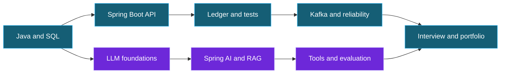
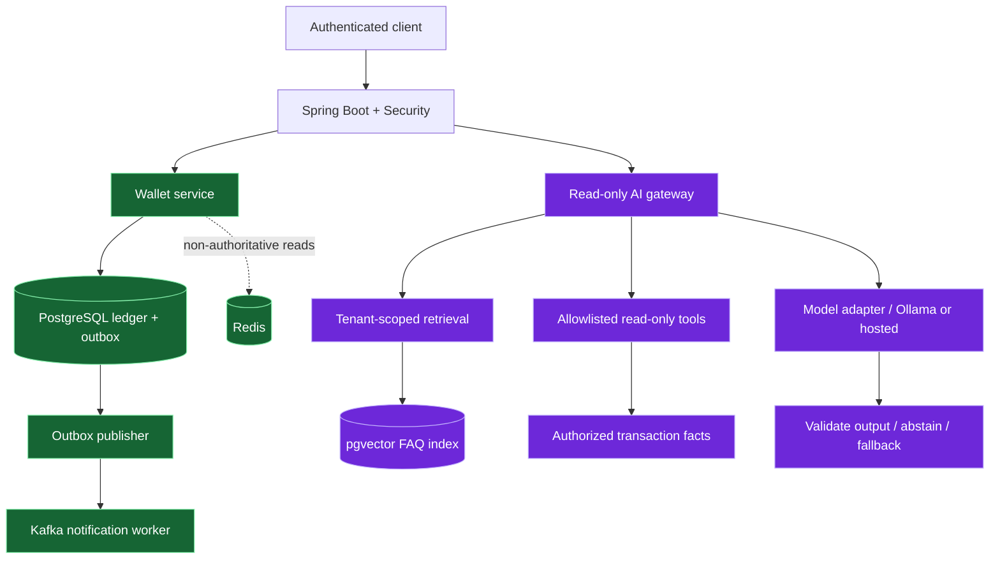

<div align="center">


# 🎬 AI-Integrated Backend Engineer 2027 — YouTube Learning Hub

### Java 21 · Spring Boot · PostgreSQL · Distributed Systems · Applied AI


   

[](https://github.com/Abhishek-09-Tomar)
[](https://leetcode.com/u/Abhishek_Tomar_99/)
[](https://codeforces.com/profile/Abhishek_Tomar)

 

**A watch → build → test → ship learning journal by Abhishek Tomar**

_Build systems that remain correct under concurrency, retries and infrastructure failures — and add AI without compromising trust._

[About](#about) • [Start here](#start) • [Course library](#courses) • [Daily plan](#daily) • [DSA](#dsa) • [Projects](#projects)

[Labs](#labs) • [Interviews](#interviews) • [Progress](#progress) • [Docs](#docs) • [Profiles](#profiles)

</div>

---

<a id="about"></a>

## 👨‍💻 01 / About me & mission

I am **Abhishek Tomar**, a final-year B.Tech Computer Science and Engineering student at **Galgotias University, Greater Noida, India (2023–2027)**. My goal is to become an interview-ready **Java Backend Engineer / AI Application Engineer / Software Development Engineer** who can build, test, debug and deploy reliable services. My interview language is C++17/20; my backend specialization is Java 21 and Spring Boot with applied AI.

**Project Forge27** is my public proof-of-work journal. This YouTube guide complements the existing root roadmap; it is not a substitute for coding, tests, official documentation or hands-on projects.

[](https://github.com/Abhishek-09-Tomar/Project-Forge27)
[](https://www.youtube.com/)

<div align="center">

| 🗓 Core units | 🤖 AI activities | 🧪 Labs | 📝 MCQs | 🏁 Proof milestones |
| :-----------: | :--------------: | :-----: | :-----: | :-----------------: |
|      60       |        60        |   38    |   60    |         12          |

</div>

> [!IMPORTANT]
> These are **planned targets**, not completed achievements. The learning window is December 1, 2026–January 31, 2027 (62 calendar days, including 2 buffer days). Becoming job-ready requires independent practice and feedback; completing videos alone does not guarantee employment.

<a id="stack"></a>

## 🛠️ 02 / Engineering arsenal

<div align="center">

<a href="https://dev.java/learn/"></a>


   

</div>

| Layer                  | Tools and competencies                                                                                                      |
| ---------------------- | --------------------------------------------------------------------------------------------------------------------------- |
| ☕ Language & runtime  | Java 21, collections, generics, records, virtual threads, concurrency                                                       |
| 🌱 Backend             | Spring Boot, Spring Security, REST, OpenAPI, Maven, Actuator                                                                |
| 🗄️ Persistence         | PostgreSQL, SQL, JPA/Hibernate, Flyway, HikariCP                                                                            |
| ⚡ Distributed systems | Redis, Apache Kafka, transactional outbox, retries, DLT, idempotency                                                        |
| 🧪 Verification        | JUnit, Mockito, MockMvc, Testcontainers, k6                                                                                 |
| 🐳 Delivery            | Linux, Git, GitHub Actions, Docker, Compose, reverse proxy, TLS                                                             |
| 📈 Observability       | Micrometer, Prometheus, Grafana, structured logs, trace correlation                                                         |
| 🤖 Applied AI          | Spring AI, ChatClient, ModelGateway, Ollama, embeddings, pgvector, RAG, structured outputs, MCP, evaluation                 |
| 🛡️ AI reliability      | Tenant-scoped retrieval, allowlisted read-only tools, prompt injection regression, quotas, fallbacks, versioning, telemetry |
| 🧩 Design & interviews | SOLID, LLD, HLD, C++ DSA, SQL, Python API smoke tests                                                                       |

<a id="start"></a>

## ▶️ 03 / Start here — the main courses

<div align="center">

<a href="https://www.youtube.com/watch?v=31KTdfRH6nY"></a>
<a href="https://www.youtube.com/watch?v=FzLABAppJfM"></a>

**Spring Boot 3 (backend anchor) · Spring AI (AI anchor)**

<a href="https://www.youtube.com/watch?v=qw--VYLpxG4"></a>
<a href="https://www.youtube.com/watch?v=3c-iBn73dDE"></a>

**PostgreSQL foundations · Docker foundations**

</div>

### 🎯 Watch the relevant chapters, not every minute of every course

| Course                                                                                    | Watch plan                                                                                                                                                   |
| ----------------------------------------------------------------------------------------- | ------------------------------------------------------------------------------------------------------------------------------------------------------------ |
| [Java — Telusko](https://www.youtube.com/watch?v=q6z_UCBM5Ek)                             | Selected Java fundamentals only; full 63-hour roadmap is reference material, not a 1-day assignment.                                                         |
| [Spring Boot 3 — Dan Vega / freeCodeCamp](https://www.youtube.com/watch?v=31KTdfRH6nY)    | 00:19:25 project; 00:49:44 REST; 01:33:12 database; 02:24:12 REST clients; 02:44:55 tests.                                                                   |
| [Spring AI — Dan Vega](https://www.youtube.com/watch?v=FzLABAppJfM)                       | Spread the workshop across days 8–37; jump to 02:32:30 for RAG and 03:52:30 for local Ollama. Use chapters for model API, structured outputs, tools and MCP. |
| [Docker — TechWorld with Nana](https://www.youtube.com/watch?v=3c-iBn73dDE)               | 00:42:02 commands; 00:57:15 debugging; 01:29:49 Compose; 01:42:02 Dockerfile; 02:27:26 volumes.                                                              |
| [DSA — Striver](https://www.youtube.com/playlist?list=PLgUwDviBIf0oF6QL8m22w1hIDC1vJ_BHz) | Learn one pattern at a time, then solve independently in C++. Do not binge the entire playlist.                                                              |



> [!NOTE]
> Course links were researched on November 24, 2026. Direct video and playlist links are distinguished from creator video-course pages and targeted YouTube searches. Some URLs were found via creator/course listings rather than live playback; search links are intentionally not claimed as verified individual videos. Older tutorials teach useful concepts, but dependency versions and APIs must be checked against current docs. Public video access and service costs may change.

<a id="courses"></a>

## 🎥 04 / Complete video course library

**Legend:** ▶️ direct video · 📚 playlist · 🏫 creator course page (may include embedded lessons) · 🔎 targeted YouTube search (select a relevant result, not a specific verified video).

IDs are reused in the dated plan. The first course in a row is the primary study source; extra courses are supplementary. Watch selected sections only.

### 🧱 Foundations and DSA

| ID  | Course / instructor | What to study | Proof of learning |
| --- | ------------------- | ------------- | ----------------- |

| **F01** | ▶️ [Complete Java developer roadmap (63-hour course)](https://www.youtube.com/watch?v=q6z_UCBM5Ek) — Telusko | Java fundamentals, OOP, collections, generics, exceptions and modern Java. Select Java chapters only; do not watch the entire marathon. | Money value object + JUnit |

| **F02** | 📚 [Java playlist](https://www.youtube.com/playlist?list=PL6W8uoQQ2c63f469AyV78np0rbxRFppkx) — Concept && Coding | JVM, collections, HashMap, Java memory and concurrency; use for gaps, not a second full Java course. | Explain equals/hashCode and JVM memory |

| **F03** | 🏫 [Java concurrency & multithreading video series](https://www.jenkov.com/tutorials/java-concurrency/index.html) — Jakob Jenkov | Threads, happens-before, volatile, locks, executors, atomics, deadlocks. Follow video playlist linked by creator. | Bounded queue and deadlock regression |

| **F04** | ▶️ [Learn PostgreSQL — full course for beginners](https://www.youtube.com/watch?v=qw--VYLpxG4) — Amigoscode / freeCodeCamp | SELECT, joins, aggregation, constraints, schema; skip familiar SQL basics. | 10 SQL queries with verified results |

| **F05** | ▶️ [Database indexing explained with PostgreSQL](https://www.youtube.com/watch?v=-qNSXK7s7_w) — Hussein Nasser | Index selectivity, benefits and costs. | EXPLAIN ANALYZE before and after |

| **F06** | ▶️ [How to become a good backend engineer](https://www.youtube.com/watch?v=V3ZPPPKEipA) — Hussein Nasser | Protocols, servers, databases, proxies, caching, security. | Trace HTTP lifecycle |

| **F07** | 🔎 [Command line basics / Linux for developers](https://www.youtube.com/results?search_query=freeCodeCamp+command+line+basics+Linux+processes+signals+lsof+ss) — freeCodeCamp | Shell, processes, signals, ports, permissions; run Linux commands in WSL. | Port troubleshooting runbook |

| **F08** | ▶️ [Git and GitHub full beginner course](https://www.youtube.com/watch?v=zTjRZNkhiEU) — Hitesh Choudhary / freeCodeCamp | Commits, branches, conflicts, fetch, rebase, pull requests. | Merge a practice branch safely |

| **F09** | 📚 [Low-level design (LLD)](https://www.youtube.com/playlist?list=PL6W8uoQQ2c61X_9e6Net0WdYZidm7zooW) — Concept && Coding | SOLID, patterns and object modeling, parking lot, practice questions. | Design and test parking lot |

| **F10** | 📚 [High-level design (HLD)](https://www.youtube.com/playlist?list=PL6W8uoQQ2c63W58rpNFDwdrBnq5G3EfT7) — Concept && Coding | Capacity, CAP, replication, sharding, caching, system design. | Draw URL shortener and trade-offs |

| **F11** | 🔎 [Python essentials for backend scripting](https://www.youtube.com/results?search_query=freeCodeCamp+Python+for+beginners+requests+asyncio+tutorial) — freeCodeCamp | Functions, dictionaries, JSON, HTTP requests; asyncio basics only. | Python API smoke test |

| **F12** | 📚 [A2Z DSA course](https://www.youtube.com/playlist?list=PLgUwDviBIf0oF6QL8m22w1hIDC1vJ_BHz) — take U forward / Striver | C++ STL, patterns, arrays, trees, graphs, DP. Use assigned pattern lessons only. | Independent C++ problems |

### 🌱 Spring Boot and database engineering

| ID  | Course / instructor | What to study | Proof of learning |
| --- | ------------------- | ------------- | ----------------- |

| **B01** | ▶️ [Building web applications in Java with Spring Boot 3](https://www.youtube.com/watch?v=31KTdfRH6nY) — Dan Vega / freeCodeCamp | Project setup, REST, persistence, REST clients, tests. Main backend anchor. | Build task-management API |

| **B02** | 🔎 [Spring dependency injection and bean lifecycle](https://www.youtube.com/results?search_query=Dan+Vega+Spring+Boot+dependency+injection+beans+lifecycle+scopes+constructor+injection) — Dan Vega / Spring | Constructor injection, scopes, auto-configuration, profiles. | Mockable service |

| **B03** | 🔎 [Spring Boot validation, pagination, OpenAPI](https://www.youtube.com/results?search_query=Spring+Boot+3+bean+validation+pagination+springdoc+OpenAPI+REST+API+tutorial) — Dan Vega / Spring | DTOs, validation, error handling, page bounds, documentation. | Contract tests and OpenAPI |

| **B04** | 🔎 [Hibernate and Spring Data JPA performance](https://www.youtube.com/results?search_query=Vlad+Mihalcea+Hibernate+JPA+N%2B1+fetch+join+batching+transaction+performance) — Vlad Mihalcea / Java Persistence | Entity mappings, dirty checking, fetch strategies, transactions. | Reproduce and fix N+1 |

| **B05** | 🔎 [PostgreSQL transactions, isolation and query plans](https://www.youtube.com/results?search_query=Hussein+Nasser+PostgreSQL+EXPLAIN+isolation+levels+database+locks+composite+indexes) — Hussein Nasser | CTE/windows supplement, isolation, locking, indexes and EXPLAIN. | Query plans and concurrency tests |

| **B06** | 🔎 [Flyway database migrations with Spring Boot 3](https://www.youtube.com/results?search_query=Spring+Boot+3+Flyway+PostgreSQL+database+migrations+tutorial) — Spring / Flyway | Versioned migration and startup regression. | Migration test |

| **B07** | 🔎 [Connection pooling, HikariCP and timeouts](https://www.youtube.com/results?search_query=HikariCP+Spring+Boot+connection+pool+sizing+timeout+Hussein+Nasser) — Hussein Nasser / Spring | Pool size, queueing, timeouts, slow queries. | Bounded-load comparison |

| **B08** | ▶️ [How to implement JWT with Spring Boot 3 Security](https://www.youtube.com/watch?v=KxqlJblhzfI) — Amigoscode | SecurityFilterChain, JWT and authorization. Supplement refresh rotation and revocation using Spring Security docs. | Login, expiry, role and tenant tests |

| **B09** | ▶️ [Spring Boot Testcontainers — integration testing](https://www.youtube.com/watch?v=erp-7MCK5BU) — Dan Vega | PostgreSQL containers, controller and repository tests. | CI integration tests |

| **B10** | 🔎 [JUnit 5, Mockito, MockMvc](https://www.youtube.com/results?search_query=Spring+Boot+3+JUnit+5+Mockito+MockMvc+unit+testing+tutorial+Amigoscode) — Amigoscode / Spring | Unit vs integration tests, mocks, validation and security tests. | Testing pyramid |

### 💳 Ledger, caching and deployment

| ID  | Course / instructor | What to study | Proof of learning |
| --- | ------------------- | ------------- | ----------------- |

| **L01** | 🔎 [Double-entry ledger design and payment correctness](https://www.youtube.com/results?search_query=double+entry+ledger+engineering+Modern+Treasury+payment+system+design+accounting) — Modern Treasury / ByteByteGo | Journal entries, precision, immutable history, balances. No real-money integration. | Synthetic ledger invariant tests |

| **L02** | 🔎 [Idempotency, atomicity, transaction locks](https://www.youtube.com/results?search_query=backend+engineering+idempotency+keys+payment+database+transactions+row+locking+retries+ByteByteGo) — Hussein Nasser / ByteByteGo | Idempotency, deterministic lock order, unknown outcomes, reconciliation. | Concurrent transfer and replay test |

| **L03** | ▶️ [Redis crash course](https://www.youtube.com/watch?v=jgpVdJB2sKQ) — Web Dev Simplified | Watch commands and TTL; Node.js example is optional. Implement using Java. | Cache non-authoritative reads |

| **L04** | 🔎 [Cache-aside, Redis Lua and rate limiting](https://www.youtube.com/results?search_query=Redis+Spring+Boot+cache+aside+invalidation+token+bucket+Lua+rate+limiter) — Redis / Spring / ByteByteGo | Cache invalidation, token bucket, atomic scripts and expiry. | Burst and cache isolation tests |

| **L05** | 🏫 [Getting started with k6 performance testing](https://grafana.com/docs/learning-hub/k6-performance-testing/) — Grafana Labs | Load scripts, workload, thresholds and interpretation. Use creator learning hub; supplement with YouTube below. | Save p50/p95/p99/errors/RPS |

| **L06** | ▶️ [Docker tutorial for beginners](https://www.youtube.com/watch?v=3c-iBn73dDE) — TechWorld with Nana | Dockerfile, Compose, networks/volumes and image builds. | Reproducible multi-service Compose |

| **L07** | 🏫 [GitHub Actions tutorial — CI/CD pipeline](https://www.techworld-with-nana.com/guides/github-actions-tutorial) — TechWorld with Nana | Creator guide with video chapters; adapt Gradle example to Maven. | Build, test and tag pipeline |

| **L08** | 🔎 [Reverse proxy, HTTPS and staging deployment](https://www.youtube.com/results?search_query=NGINX+reverse+proxy+HTTPS+Docker+Compose+Spring+Boot+deployment+tutorial) — NGINX / TechWorld with Nana | TLS termination, secrets, health and rollout. | Local HTTPS or documented staging |

### 📡 Distributed systems and production reliability

| ID  | Course / instructor | What to study | Proof of learning |
| --- | ------------------- | ------------- | ----------------- |

| **D01** | 🏫 [Apache Kafka 101](https://developer.confluent.io/courses/) — Confluent Developer | Select Apache Kafka 101 and Spring for Apache Kafka course; local broker rather than paid cloud. | Producer and consumer worker |

| **D02** | 🔎 [Spring Kafka producer and consumer](https://www.youtube.com/results?search_query=Confluent+Spring+for+Apache+Kafka+101+KafkaTemplate+KafkaListener+Spring+Boot) — Confluent / Amigoscode | Topics, partitions, offsets, groups, delivery semantics. | Event publish and consume |

| **D03** | ▶️ [Transactional outbox and inbox patterns](https://www.youtube.com/watch?v=Ce7U0nI-MMo) — Aleksandr Gromov | Outbox, inbox, crash recovery, duplicate delivery. | Recover after Kafka outage |

| **D04** | 🔎 [Retry, dead-letter topics and schema evolution](https://www.youtube.com/results?search_query=Spring+Kafka+retry+dead+letter+topic+DefaultErrorHandler+schema+evolution+Confluent) — Spring / Confluent | Bounded retries, replay, versioned events. | Poison message DLT test |

| **D05** | 🔎 [Prometheus and Grafana monitoring](https://www.youtube.com/results?search_query=TechWorld+with+Nana+Prometheus+monitoring+full+tutorial+Grafana+Spring+Boot+Micrometer) — TechWorld with Nana / Grafana Labs | Scrape metrics, RED, latency percentiles and saturation. | Grafana dashboard |

| **D06** | 🔎 [Distributed tracing and structured logging](https://www.youtube.com/results?search_query=Spring+Boot+3+Micrometer+tracing+OpenTelemetry+Kafka+correlation+ID+structured+logging) — Spring / OpenTelemetry | HTTP, DB, Kafka correlation and sanitized logs. | Trace one request |

| **D07** | 🔎 [JVM debugging with jcmd, JFR, heap and thread dumps](https://www.youtube.com/results?search_query=Java+JVM+debugging+jcmd+heap+dump+thread+dump+JFR+VisualVM+deadlock+tutorial) — Java / JDK experts | GC, memory retention, thread contention and evidence-led RCA. | Reproduce and fix memory or thread issue |

| **D08** | 🔎 [Resilience, backpressure and fault injection](https://www.youtube.com/results?search_query=distributed+systems+timeout+retry+backoff+circuit+breaker+failure+injection+database+pool+exhaustion) — ByteByteGo / Hussein Nasser | Bounded retry and controlled degradation. | Fault drill report |

| **D09** | 🔎 [API security and tenant isolation](https://www.youtube.com/results?search_query=OWASP+API+security+top+10+Spring+Boot+broken+object+level+authorization+tenant+isolation) — OWASP / Spring | Ownership checks, resource limits, secret handling and dependency scans. | Authorization regression matrix |

| **D10** | 🔎 [k6 load testing tutorial](https://www.youtube.com/results?search_query=Grafana+k6+getting+started+load+testing+thresholds+p95+tutorial) — Grafana Labs | Workload, error rate, thresholds, performance evidence. | Reproducible load report |

### 🤖 Applied AI and LLM engineering

| ID  | Course / instructor | What to study | Proof of learning |
| --- | ------------------- | ------------- | ----------------- |

| **A01** | ▶️ [Intro to large language models (1-hour talk)](https://www.youtube.com/watch?v=zjkBMFhNj_g) — Andrej Karpathy | Tokens, inference, model limitations; conceptual introduction, not current API reference. | Model limitations notes |

| **A02** | ▶️ [AI for Java Developers — Spring AI workshop](https://www.youtube.com/watch?v=FzLABAppJfM) — Dan Vega | Main AI anchor (~5.5h); ChatClient, prompting, structured outputs, RAG, Ollama, tools, MCP. Watch by topic. | ModelGateway + read-only assistant |

| **A03** | ▶️ [Code Smarter, Not Harder: AI-powered development](https://www.youtube.com/watch?v=koYCcvPvaY0) — Dan Vega / Spring I/O | AI-assisted coding workflow; independently test suggestions. | Accepted/rejected suggestion log |

| **A04** | ▶️ [Modular RAG Architectures with Java and Spring AI](https://www.youtube.com/watch?v=yQQEnXRMvUA) — Thomas Vitale / Spring I/O | Retrieval pipeline, ingestion, modular design. | Tenant-safe RAG architecture |

| **A05** | ▶️ [Model Context Protocol (MCP)](https://www.youtube.com/watch?v=z9H-qgbJNHI) — Spring AI tutorial | Tool discovery and MCP integration. Use current specification and compatible Spring AI release. | Synthetic read-only MCP tool |

| **A06** | 🔎 [Spring AI structured output and ChatClient](https://www.youtube.com/results?search_query=Dan+Vega+Spring+AI+ChatClient+structured+output+BeanOutputConverter+tutorial) — Dan Vega / Spring | Validate structured responses with explicit schema and independent facts. | Malformed JSON and refusal regression |

| **A07** | 🔎 [Ollama local inference and Spring AI](https://www.youtube.com/results?search_query=Dan+Vega+Spring+AI+Ollama+local+models+ChatClient+tutorial) — Spring / Ollama | Local model, configuration, timeout, fake provider fallback. | Local or mock inference demo |

| **A08** | 🔎 [Spring AI embeddings and pgvector](https://www.youtube.com/results?search_query=Spring+AI+pgvector+vector+store+embeddings+RAG+PostgreSQL+tutorial) — Spring / PostgreSQL | Chunking, metadata, vector similarity, exact search, HNSW and filtering. | Recall@k and tenant tests |

| **A09** | 🔎 [RAG evaluation and abstention](https://www.youtube.com/results?search_query=RAG+evaluation+recall+at+k+groundedness+abstention+evaluation+dataset+tutorial) — Spring / AI engineers | Frozen queries, supported claims, unknown queries, latency; no judge-only claims. | 30+ labeled evaluation examples |

| **A10** | 🔎 [LLM prompt injection and tool security](https://www.youtube.com/results?search_query=OWASP+GenAI+security+prompt+injection+excessive+agency+sensitive+information+disclosure+talk) — OWASP GenAI Security Project | Treat retrieved data as untrusted; enforce policy in application code. | Negative cases and no write access |

| **A11** | 🔎 [Spring AI observability, quotas and resilience](https://www.youtube.com/results?search_query=Spring+AI+Micrometer+observability+token+usage+latency+resilience+timeout+model+gateway) — Spring / OpenTelemetry | Measure tokens, latency and errors; no raw prompt logging. | Failure and quota drill |

| **A12** | 🔎 [Agent workflows, tool budgets and human approval](https://www.youtube.com/results?search_query=Spring+AI+agentic+patterns+bounded+workflows+tool+calling+human+approval+Spring+I%2FO) — Spring / AI engineers | Bounded tool steps, deadline, auth, stop conditions. | Design-only approval flow |

### 🎤 Design and interviews

| ID  | Course / instructor | What to study | Proof of learning |
| --- | ------------------- | ------------- | ----------------- |

| **I01** | 🔎 [Java machine coding — limiter, booking, Splitwise, cache, elevator, pub-sub](https://www.youtube.com/results?search_query=Concept+and+Coding+low+level+design+rate+limiter+booking+Splitwise+LRU+elevator+pub+sub+Java) — Concept && Coding | Use LLD playlist F09 as primary, then named exercises. | Six timed implementations |

| **I02** | 🔎 [System design interview examples](https://www.youtube.com/results?search_query=ByteByteGo+Gaurav+Sen+system+design+URL+shortener+chat+nearby+drivers) — ByteByteGo / Gaurav Sen | Capacity, keys, fanout, location indexing, failures. | Three whiteboard designs |

| **I03** | 🔎 [Software engineering mock interview](https://www.youtube.com/results?search_query=software+engineering+mock+interview+coding+system+design+backend+engineer+new+grad) — Exponent / interviewing.io | Communication, problem clarification, trade-offs, testing. | Two recorded or peer mocks |

| **I04** | 🔎 [DBMS, operating systems and computer networks](https://www.youtube.com/results?search_query=Gate+Smashers+DBMS+OS+computer+networks+interview+revision) — Gate Smashers / Neso Academy | ACID, normalization, indexes, processes, memory, DNS, HTTP and TCP. | Recall notes and MCQs |

### 🧭 How to cover gaps without playlist hopping

For niche items such as PostgreSQL row-lock ordering, Flyway migration testing, HikariCP exhaustion, tenant-scoped retrieval, idempotency fingerprints and frozen evaluation datasets, a single course rarely covers the whole requirement. Use the day-specific videos below, official docs, and the actual lab. Search for the exact concept only if the linked lesson does not cover it.

**Version guard:** Java 21 + Spring Boot 3.x remain the baseline from my roadmap. Pick a compatible Spring AI release from the official compatibility guidance; do not copy Boot 4 / Spring AI 2.x dependencies into a Boot 3 project. Use deterministic fake models in CI. No need to pay for an LLM API; local models or labeled mocks are valid for development, but report which you actually used.

<a id="daily"></a>

## 📆 05 / 60-day watch → build plan

Every row contains the original roadmap concept, artifact and parallel AI work. The video selection is a new study recommendation. Mark core and AI boxes independently, only after evidence exists. Use links in each row to jump directly to relevant lessons or targeted searches.

### 🔵 Phase 01 — Foundation sprint (01 Dec 2026 – 07 Dec 2026)

Java, concurrency, SQL, Linux, networking and design.

<details>
<summary><strong>Open days 01–07 · 7 core units + 7 AI activities</strong></summary>

#### Day 01 · 01 Dec 2026 — Java 21 fundamentals

- [ ] ⚙️ **Core:** Records, sealed classes, generics, equals/hashCode, collections. **Watch:** [F01](https://www.youtube.com/watch?v=q6z_UCBM5Ek) · [F02](https://www.youtube.com/playlist?list=PL6W8uoQQ2c63f469AyV78np0rbxRFppkx).
  - **Build / evidence:** Implement immutable Money value object with tests.
- [ ] 🤖 **AI — AI workflow baseline:** Ask a model to critique your Money object after writing it yourself; verify every suggestion with javac and JUnit. **Watch / review:** [A03](https://www.youtube.com/watch?v=koYCcvPvaY0).
  - **Evidence:** Record one accepted and one rejected suggestion with evidence.

#### Day 02 · 02 Dec 2026 — Concurrency

- [ ] ⚙️ **Core:** volatile vs atomicity, locks, executor, virtual threads. **Watch:** [F03](https://www.jenkov.com/tutorials/java-concurrency/index.html).
  - **Build / evidence:** Implement bounded producer-consumer queue; reproduce/fix deadlock.
- [ ] 🤖 **AI — Concurrency pair programming:** Ask for interleavings and a minimal reproducible deadlock; inspect the proposed lock order yourself. **Watch / review:** [A03](https://www.youtube.com/watch?v=koYCcvPvaY0).
  - **Evidence:** Run a bounded stress test and document the actual thread dump.

#### Day 03 · 03 Dec 2026 — Advanced PostgreSQL

- [ ] ⚙️ **Core:** CTEs, windows, isolation, indexes, EXPLAIN. **Watch:** [F04](https://www.youtube.com/watch?v=qw--VYLpxG4) · [B05](https://www.youtube.com/results?search_query=Hussein+Nasser+PostgreSQL+EXPLAIN+isolation+levels+database+locks+composite+indexes).
  - **Build / evidence:** Write 10 SQL queries and compare query plans.
- [ ] 🤖 **AI — AI-assisted SQL:** Generate alternative window queries on a synthetic schema; compare EXPLAIN ANALYZE and result sets. **Watch / review:** [A03](https://www.youtube.com/watch?v=koYCcvPvaY0).
  - **Evidence:** Show identical results and measured plans, not model guesses.

#### Day 04 · 04 Dec 2026 — Linux and OS

- [ ] ⚙️ **Core:** processes, file descriptors, signals, memory, ss, lsof. **Watch:** [F07](https://www.youtube.com/results?search_query=freeCodeCamp+command+line+basics+Linux+processes+signals+lsof+ss).
  - **Build / evidence:** Diagnose a process holding a port; write runbook.
- [ ] 🤖 **AI — Log analysis:** Sanitize process logs; ask AI for three hypotheses ranked by evidence. **Watch / review:** [A03](https://www.youtube.com/watch?v=koYCcvPvaY0).
  - **Evidence:** Verify using ss/lsof/journalctl and write a confirmed RCA.

#### Day 05 · 05 Dec 2026 — Networking

- [ ] ⚙️ **Core:** DNS, TCP, TLS, HTTP versions, proxies. **Watch:** [F06](https://www.youtube.com/watch?v=V3ZPPPKEipA) · [L08](https://www.youtube.com/results?search_query=NGINX+reverse+proxy+HTTPS+Docker+Compose+Spring+Boot+deployment+tutorial).
  - **Build / evidence:** Trace an HTTP request through reverse proxy with curl.
- [ ] 🤖 **AI — Network troubleshooting:** Ask AI to propose a diagnostic tree for a failing TLS connection. **Watch / review:** [A03](https://www.youtube.com/watch?v=koYCcvPvaY0).
  - **Evidence:** Check curl verbose output and distinguish DNS, TCP and certificate errors.

#### Day 06 · 06 Dec 2026 — System design

- [ ] ⚙️ **Core:** queues, consistency, caching, sharding, capacity. **Watch:** [F10](https://www.youtube.com/playlist?list=PL6W8uoQQ2c63W58rpNFDwdrBnq5G3EfT7) · [F06](https://www.youtube.com/watch?v=V3ZPPPKEipA).
  - **Build / evidence:** Draw a URL shortener with bottlenecks and tradeoffs.
- [ ] 🤖 **AI — Design critique:** Use AI as an adversarial architecture reviewer for your URL shortener. **Watch / review:** [A03](https://www.youtube.com/watch?v=koYCcvPvaY0).
  - **Evidence:** Write two ADRs with explicit workload assumptions and alternatives.

#### Day 07 · 07 Dec 2026 — LLD and Python refresh

- [ ] ⚙️ **Core:** SOLID, patterns, Python requests/asyncio. **Watch:** [F09](https://www.youtube.com/playlist?list=PL6W8uoQQ2c61X_9e6Net0WdYZidm7zooW) · [F11](https://www.youtube.com/results?search_query=freeCodeCamp+Python+for+beginners+requests+asyncio+tutorial).
  - **Build / evidence:** Implement parking lot in Java and a Python API smoke test.
- [ ] 🤖 **AI — Prompting and context:** Practice task, context, constraints, examples and output contracts; have AI review your LLD without solving first. **Watch / review:** [A03](https://www.youtube.com/watch?v=koYCcvPvaY0).
  - **Evidence:** Compare two prompts against a fixed rubric; explain what improved.

</details>

### 🟢 Phase 02 — Spring & database (08 Dec 2026 – 20 Dec 2026)

Production REST service, persistence, auth and testing.

<details>
<summary><strong>Open days 08–20 · 13 core units + 13 AI activities</strong></summary>

#### Day 08 · 08 Dec 2026 — Spring Boot skeleton

- [ ] ⚙️ **Core:** Maven, profiles, auto-config, actuator. **Watch:** [B01](https://www.youtube.com/watch?v=31KTdfRH6nY).
  - **Build / evidence:** Create task API skeleton, health endpoint and README.
- [ ] 🤖 **AI — LLM fundamentals:** Study tokens, context window, sampling, hallucination and inference; run a small local model if hardware permits. **Watch / review:** [A01](https://www.youtube.com/watch?v=zjkBMFhNj_g) · [A07](https://www.youtube.com/results?search_query=Dan+Vega+Spring+AI+Ollama+local+models+ChatClient+tutorial).
  - **Evidence:** Document model/version, latency and one incorrect response; otherwise use a mock.

#### Day 09 · 09 Dec 2026 — REST contracts

- [ ] ⚙️ **Core:** DTOs, records, HTTP semantics, errors. **Watch:** [B01](https://www.youtube.com/watch?v=31KTdfRH6nY) · [B03](https://www.youtube.com/results?search_query=Spring+Boot+3+bean+validation+pagination+springdoc+OpenAPI+REST+API+tutorial).
  - **Build / evidence:** Design CRUD endpoints, consistent validation and errors.
- [ ] 🤖 **AI — Model API contract:** Design POST /ai/explain with bounded input and structured error responses; inspect Ollama chat request/response. **Watch / review:** [A02](https://www.youtube.com/watch?v=FzLABAppJfM) · [A06](https://www.youtube.com/results?search_query=Dan+Vega+Spring+AI+ChatClient+structured+output+BeanOutputConverter+tutorial).
  - **Evidence:** Save an OpenAPI contract and a curl smoke test or recorded fixture.

#### Day 10 · 10 Dec 2026 — Dependency injection

- [ ] ⚙️ **Core:** bean scopes, lifecycle, constructor injection. **Watch:** [B02](https://www.youtube.com/results?search_query=Dan+Vega+Spring+Boot+dependency+injection+beans+lifecycle+scopes+constructor+injection) · [B01](https://www.youtube.com/watch?v=31KTdfRH6nY).
  - **Build / evidence:** Refactor service for mocking and testability.
- [ ] 🤖 **AI — Spring AI adapter:** Introduce a ModelGateway interface and Spring AI ChatClient implementation using a compatible release train. **Watch / review:** [A02](https://www.youtube.com/watch?v=FzLABAppJfM).
  - **Evidence:** Unit-test service with a fake gateway; model integration remains replaceable.

#### Day 11 · 11 Dec 2026 — Validation & paging

- [ ] ⚙️ **Core:** Bean Validation, sorting, pagination. **Watch:** [B03](https://www.youtube.com/results?search_query=Spring+Boot+3+bean+validation+pagination+springdoc+OpenAPI+REST+API+tutorial).
  - **Build / evidence:** Add request validation and safe pagination.
- [ ] 🤖 **AI — Structured outputs:** Map model output to an Explanation record; validate enum, lengths and required fields. **Watch / review:** [A06](https://www.youtube.com/results?search_query=Dan+Vega+Spring+AI+ChatClient+structured+output+BeanOutputConverter+tutorial).
  - **Evidence:** Test malformed JSON, refusal, extra fields and invalid business values.

#### Day 12 · 12 Dec 2026 — API documentation

- [ ] ⚙️ **Core:** OpenAPI, versioning, idempotent HTTP. **Watch:** [B03](https://www.youtube.com/results?search_query=Spring+Boot+3+bean+validation+pagination+springdoc+OpenAPI+REST+API+tutorial).
  - **Build / evidence:** Publish OpenAPI; run curl contract checks.
- [ ] 🤖 **AI — Prompt registry:** Version prompt templates alongside OpenAPI; separate trusted instructions from untrusted data. **Watch / review:** [A02](https://www.youtube.com/watch?v=FzLABAppJfM) · [A06](https://www.youtube.com/results?search_query=Dan+Vega+Spring+AI+ChatClient+structured+output+BeanOutputConverter+tutorial).
  - **Evidence:** Commit a prompt version and regression fixtures for two variants.

#### Day 13 · 13 Dec 2026 — JPA model

- [ ] ⚙️ **Core:** entities, transactions, dirty checking. **Watch:** [B04](https://www.youtube.com/results?search_query=Vlad+Mihalcea+Hibernate+JPA+N%2B1+fetch+join+batching+transaction+performance).
  - **Build / evidence:** Map tenant/task/audit entities with constraints.
- [ ] 🤖 **AI — Data boundaries:** Create synthetic wallet support documents with tenant, document ID and version; keep account PII out. **Watch / review:** [A08](https://www.youtube.com/results?search_query=Spring+AI+pgvector+vector+store+embeddings+RAG+PostgreSQL+tutorial) · [A10](https://www.youtube.com/results?search_query=OWASP+GenAI+security+prompt+injection+excessive+agency+sensitive+information+disclosure+talk).
  - **Evidence:** Write a data-flow diagram and classify every data field.

#### Day 14 · 14 Dec 2026 — Hibernate performance

- [ ] ⚙️ **Core:** N+1, fetch strategies, batching. **Watch:** [B04](https://www.youtube.com/results?search_query=Vlad+Mihalcea+Hibernate+JPA+N%2B1+fetch+join+batching+transaction+performance).
  - **Build / evidence:** Reproduce N+1 and fix with query verification.
- [ ] 🤖 **AI — Embeddings:** Compare exact keyword retrieval with embedding similarity; understand vector dimension and model version. **Watch / review:** [A08](https://www.youtube.com/results?search_query=Spring+AI+pgvector+vector+store+embeddings+RAG+PostgreSQL+tutorial).
  - **Evidence:** Create five queries, expected document IDs and a baseline retrieval score.

#### Day 15 · 15 Dec 2026 — SQL indexing

- [ ] ⚙️ **Core:** composite indexes, selectivity, query plans. **Watch:** [F05](https://www.youtube.com/watch?v=-qNSXK7s7_w) · [B05](https://www.youtube.com/results?search_query=Hussein+Nasser+PostgreSQL+EXPLAIN+isolation+levels+database+locks+composite+indexes).
  - **Build / evidence:** Seed realistic data and benchmark 3 queries.
- [ ] 🤖 **AI — PostgreSQL vector search:** Create a separate pgvector table; compare exact search and an optional HNSW index on synthetic data. **Watch / review:** [A08](https://www.youtube.com/results?search_query=Spring+AI+pgvector+vector+store+embeddings+RAG+PostgreSQL+tutorial).
  - **Evidence:** Record recall@k and query plans; use tenant filters before results leave the service.

#### Day 16 · 16 Dec 2026 — Migrations

- [ ] ⚙️ **Core:** Flyway, schema evolution, rollback strategy. **Watch:** [B06](https://www.youtube.com/results?search_query=Spring+Boot+3+Flyway+PostgreSQL+database+migrations+tutorial).
  - **Build / evidence:** Create repeatable startup migration test.
- [ ] 🤖 **AI — Document ingestion:** Chunk public FAQ text, attach metadata, deduplicate by hash and version embedding migrations. **Watch / review:** [A04](https://www.youtube.com/watch?v=yQQEnXRMvUA) · [A08](https://www.youtube.com/results?search_query=Spring+AI+pgvector+vector+store+embeddings+RAG+PostgreSQL+tutorial).
  - **Evidence:** Reingestion is idempotent and old versions are removable.

#### Day 17 · 17 Dec 2026 — Connection pools

- [ ] ⚙️ **Core:** HikariCP, timeout, limits, slow queries. **Watch:** [B07](https://www.youtube.com/results?search_query=HikariCP+Spring+Boot+connection+pool+sizing+timeout+Hussein+Nasser).
  - **Build / evidence:** Tune pool under bounded load with observations.
- [ ] 🤖 **AI — Model client resilience:** Configure timeouts, bounded concurrency and backpressure around inference. **Watch / review:** [A11](https://www.youtube.com/results?search_query=Spring+AI+Micrometer+observability+token+usage+latency+resilience+timeout+model+gateway).
  - **Evidence:** Fake a slow provider; health and ordinary API traffic remain responsive.

#### Day 18 · 18 Dec 2026 — Authentication

- [ ] ⚙️ **Core:** password hashing, JWT validation, refresh rotation. **Watch:** [B08](https://www.youtube.com/watch?v=KxqlJblhzfI).
  - **Build / evidence:** Implement login, expiry and revoked refresh flow.
- [ ] 🤖 **AI — AI identity and secrets:** Use server-managed credentials and scoped application auth; never put provider keys in client JS. **Watch / review:** [A10](https://www.youtube.com/results?search_query=OWASP+GenAI+security+prompt+injection+excessive+agency+sensitive+information+disclosure+talk).
  - **Evidence:** Unauthorized requests fail; CI checks synthetic secret patterns.

#### Day 19 · 19 Dec 2026 — Authorization

- [ ] ⚙️ **Core:** RBAC, tenant isolation, ownership. **Watch:** [B08](https://www.youtube.com/watch?v=KxqlJblhzfI) · [D09](https://www.youtube.com/results?search_query=OWASP+API+security+top+10+Spring+Boot+broken+object+level+authorization+tenant+isolation).
  - **Build / evidence:** Prove tenant A cannot read tenant B data.
- [ ] 🤖 **AI — Tenant-safe RAG:** Enforce authorization in retrieval and tool execution using authenticated tenant context. **Watch / review:** [A08](https://www.youtube.com/results?search_query=Spring+AI+pgvector+vector+store+embeddings+RAG+PostgreSQL+tutorial) · [A10](https://www.youtube.com/results?search_query=OWASP+GenAI+security+prompt+injection+excessive+agency+sensitive+information+disclosure+talk).
  - **Evidence:** Cross-tenant search and citation tests return no foreign records.

#### Day 20 · 20 Dec 2026 — Testing pyramid

- [ ] ⚙️ **Core:** JUnit, Mockito, MockMvc, Testcontainers. **Watch:** [B01](https://www.youtube.com/watch?v=31KTdfRH6nY) · [B09](https://www.youtube.com/watch?v=erp-7MCK5BU) · [B10](https://www.youtube.com/results?search_query=Spring+Boot+3+JUnit+5+Mockito+MockMvc+unit+testing+tutorial+Amigoscode).
  - **Build / evidence:** Run unit + Postgres integration tests in CI.
- [ ] 🤖 **AI — AI testing pyramid:** Add fixtures for timeouts, refusal, malformed JSON and injection; use fake model in CI. **Watch / review:** [A06](https://www.youtube.com/results?search_query=Dan+Vega+Spring+AI+ChatClient+structured+output+BeanOutputConverter+tutorial) · [A10](https://www.youtube.com/results?search_query=OWASP+GenAI+security+prompt+injection+excessive+agency+sensitive+information+disclosure+talk).
  - **Evidence:** Deterministic unit/integration suite passes without internet.

</details>

### 🟠 Phase 03 — Ledger & deployment (21 Dec 2026 – 30 Dec 2026)

Correct money movement, contention, cache and release.

<details>
<summary><strong>Open days 21–30 · 10 core units + 10 AI activities</strong></summary>

#### Day 21 · 21 Dec 2026 — Ledger schema

- [ ] ⚙️ **Core:** double-entry invariants, decimal precision. **Watch:** [L01](https://www.youtube.com/results?search_query=double+entry+ledger+engineering+Modern+Treasury+payment+system+design+accounting).
  - **Build / evidence:** Build immutable journal, entries and balance query.
- [ ] 🤖 **AI — AI boundary for fintech:** Design a read-only ledger explanation service. LLM never decides balance or authorizes transfers. **Watch / review:** [A10](https://www.youtube.com/results?search_query=OWASP+GenAI+security+prompt+injection+excessive+agency+sensitive+information+disclosure+talk).
  - **Evidence:** Document trust boundary and verify no write-capable model tools exist.

#### Day 22 · 22 Dec 2026 — Atomic transfers

- [ ] ⚙️ **Core:** DB transactions, balances, rollback. **Watch:** [B05](https://www.youtube.com/results?search_query=Hussein+Nasser+PostgreSQL+EXPLAIN+isolation+levels+database+locks+composite+indexes) · [L01](https://www.youtube.com/results?search_query=double+entry+ledger+engineering+Modern+Treasury+payment+system+design+accounting).
  - **Build / evidence:** Transfer funds atomically; prove sum(entries)=0.
- [ ] 🤖 **AI — Safe transaction explanation:** Format deterministic SQL-derived transaction facts and ask AI to explain them in plain language. **Watch / review:** [A06](https://www.youtube.com/results?search_query=Dan+Vega+Spring+AI+ChatClient+structured+output+BeanOutputConverter+tutorial).
  - **Evidence:** All amounts and IDs come from verified facts; invalid output falls back to a template.

#### Day 23 · 23 Dec 2026 — Concurrency correctness

- [ ] ⚙️ **Core:** row locking, deterministic ordering. **Watch:** [F03](https://www.jenkov.com/tutorials/java-concurrency/index.html) · [B05](https://www.youtube.com/results?search_query=Hussein+Nasser+PostgreSQL+EXPLAIN+isolation+levels+database+locks+composite+indexes) · [L02](https://www.youtube.com/results?search_query=backend+engineering+idempotency+keys+payment+database+transactions+row+locking+retries+ByteByteGo).
  - **Build / evidence:** Hammer shared wallet; confirm no negative balances.
- [ ] 🤖 **AI — AI concurrency review:** Ask model to review transaction interleavings and identify lost updates; compare with actual tests. **Watch / review:** [A03](https://www.youtube.com/watch?v=koYCcvPvaY0).
  - **Evidence:** Run simultaneous transfers with AI service disabled; invariants still hold.

#### Day 24 · 24 Dec 2026 — Idempotent transfers

- [ ] ⚙️ **Core:** unique keys, payload fingerprints, DB persistence. **Watch:** [L02](https://www.youtube.com/results?search_query=backend+engineering+idempotency+keys+payment+database+transactions+row+locking+retries+ByteByteGo).
  - **Build / evidence:** Retry identical transfer; return same outcome.
- [ ] 🤖 **AI — AI request deduplication:** Design a tenant-scoped cache key including prompt/model/document versions; separate it from transfer idempotency. **Watch / review:** [L04](https://www.youtube.com/results?search_query=Redis+Spring+Boot+cache+aside+invalidation+token+bucket+Lua+rate+limiter) · [A10](https://www.youtube.com/results?search_query=OWASP+GenAI+security+prompt+injection+excessive+agency+sensitive+information+disclosure+talk).
  - **Evidence:** Test no cross-tenant cache hit; retries never duplicate a ledger write.

#### Day 25 · 25 Dec 2026 — Failure recovery

- [ ] ⚙️ **Core:** timeouts, unknown outcomes, reconciliation. **Watch:** [L02](https://www.youtube.com/results?search_query=backend+engineering+idempotency+keys+payment+database+transactions+row+locking+retries+ByteByteGo) · [D08](https://www.youtube.com/results?search_query=distributed+systems+timeout+retry+backoff+circuit+breaker+failure+injection+database+pool+exhaustion).
  - **Build / evidence:** Simulate request timeout after commit and safely retry.
- [ ] 🤖 **AI — Model outage fallback:** Simulate timeout and provider errors; return a clearly labeled deterministic explanation. **Watch / review:** [A11](https://www.youtube.com/results?search_query=Spring+AI+Micrometer+observability+token+usage+latency+resilience+timeout+model+gateway).
  - **Evidence:** Core ledger remains available, with no partial state change.

#### Day 26 · 26 Dec 2026 — Redis use cases

- [ ] ⚙️ **Core:** cache-aside, TTL, invalidation. **Watch:** [L03](https://www.youtube.com/watch?v=jgpVdJB2sKQ) · [L04](https://www.youtube.com/results?search_query=Redis+Spring+Boot+cache+aside+invalidation+token+bucket+Lua+rate+limiter).
  - **Build / evidence:** Cache non-authoritative reads and invalidate appropriately.
- [ ] 🤖 **AI — RAG endpoint:** Implement /ai/help with document retrieval, grounded context and document ID citations. **Watch / review:** [A02](https://www.youtube.com/watch?v=FzLABAppJfM) · [A04](https://www.youtube.com/watch?v=yQQEnXRMvUA).
  - **Evidence:** Reject unsupported claims or return an abstention; only allowed IDs appear.

#### Day 27 · 27 Dec 2026 — Rate limiting

- [ ] ⚙️ **Core:** token buckets, Redis Lua, fairness. **Watch:** [L04](https://www.youtube.com/results?search_query=Redis+Spring+Boot+cache+aside+invalidation+token+bucket+Lua+rate+limiter).
  - **Build / evidence:** Implement limits; verify bursts and expiry.
- [ ] 🤖 **AI — AI quotas:** Add per-tenant request and token budgets, maximum output and rate limiting. **Watch / review:** [A11](https://www.youtube.com/results?search_query=Spring+AI+Micrometer+observability+token+usage+latency+resilience+timeout+model+gateway).
  - **Evidence:** Exceed quota and verify controlled 429 or documented alternative.

#### Day 28 · 28 Dec 2026 — Performance

- [ ] ⚙️ **Core:** load profiles, p95/p99, bottlenecks. **Watch:** [L05](https://grafana.com/docs/learning-hub/k6-performance-testing/) · [D10](https://www.youtube.com/results?search_query=Grafana+k6+getting+started+load+testing+thresholds+p95+tutorial).
  - **Build / evidence:** Run k6 steady load; publish baseline and methodology.
- [ ] 🤖 **AI — AI performance baseline:** Measure time to first token, total latency, token counts and concurrency separately from ledger RPS. **Watch / review:** [A11](https://www.youtube.com/results?search_query=Spring+AI+Micrometer+observability+token+usage+latency+resilience+timeout+model+gateway).
  - **Evidence:** Report model/hardware and p50/p95; no fabricated benchmarks.

#### Day 29 · 29 Dec 2026 — Containers & TLS

- [ ] ⚙️ **Core:** multi-stage Docker, Compose, secrets, reverse proxy. **Watch:** [L06](https://www.youtube.com/watch?v=3c-iBn73dDE) · [L08](https://www.youtube.com/results?search_query=NGINX+reverse+proxy+HTTPS+Docker+Compose+Spring+Boot+deployment+tutorial).
  - **Build / evidence:** Deploy staging with HTTPS and health checks.
- [ ] 🤖 **AI — AI deployment boundary:** Run model locally or in private network; expose only authenticated gateway; keep model port private. **Watch / review:** [A07](https://www.youtube.com/results?search_query=Dan+Vega+Spring+AI+Ollama+local+models+ChatClient+tutorial) · [A10](https://www.youtube.com/results?search_query=OWASP+GenAI+security+prompt+injection+excessive+agency+sensitive+information+disclosure+talk).
  - **Evidence:** Docker config and threat model show no publicly exposed inference port.

#### Day 30 · 30 Dec 2026 — Release v1

- [ ] ⚙️ **Core:** CI, rollback, budget, portfolio. **Watch:** [L07](https://www.techworld-with-nana.com/guides/github-actions-tutorial).
  - **Build / evidence:** Tag v1.0, publish reproducible demo and resume evidence.
- [ ] 🤖 **AI — AI release v1:** Demo wallet plus read-only AI help, or mock-backed demo if model unavailable. **Watch / review:** [A02](https://www.youtube.com/watch?v=FzLABAppJfM).
  - **Evidence:** README lists real vs mocked features, privacy policy and reproducible steps.

</details>

### 🟣 Phase 04 — Distributed reliability (31 Dec 2026 – 17 Jan 2027)

Kafka, outbox, observability, debugging and chaos.

<details>
<summary><strong>Open days 31–48 · 18 core units + 18 AI activities</strong></summary>

#### Day 31 · 31 Dec 2026 — Kafka fundamentals

- [ ] ⚙️ **Core:** topics, partitions, offsets, consumer groups. **Watch:** [D01](https://developer.confluent.io/courses/) · [D02](https://www.youtube.com/results?search_query=Confluent+Spring+for+Apache+Kafka+101+KafkaTemplate+KafkaListener+Spring+Boot).
  - **Build / evidence:** Consume notification event in separate worker.
- [ ] 🤖 **AI — Async AI workloads:** Design Kafka jobs for document indexing, not core money writes. **Watch / review:** [A04](https://www.youtube.com/watch?v=yQQEnXRMvUA).
  - **Evidence:** Version job schema and handle duplicate job delivery.

#### Day 32 · 01 Jan 2027 — Outbox schema

- [ ] ⚙️ **Core:** transactional event persistence. **Watch:** [D03](https://www.youtube.com/watch?v=Ce7U0nI-MMo).
  - **Build / evidence:** Write transfer + outbox record in same DB transaction.
- [ ] 🤖 **AI — AI indexing outbox:** Record document updates and indexing intent in one transaction. **Watch / review:** [D03](https://www.youtube.com/watch?v=Ce7U0nI-MMo) · [A04](https://www.youtube.com/watch?v=yQQEnXRMvUA).
  - **Evidence:** Crash after commit and recover without losing indexing intent.

#### Day 33 · 02 Jan 2027 — Outbox publisher

- [ ] ⚙️ **Core:** polling or CDC, retry, duplicates. **Watch:** [D03](https://www.youtube.com/watch?v=Ce7U0nI-MMo) · [D04](https://www.youtube.com/results?search_query=Spring+Kafka+retry+dead+letter+topic+DefaultErrorHandler+schema+evolution+Confluent).
  - **Build / evidence:** Publish pending events; recover after crash.
- [ ] 🤖 **AI — Indexing worker:** Implement bounded batch worker with retry and embedding model metadata. **Watch / review:** [A04](https://www.youtube.com/watch?v=yQQEnXRMvUA).
  - **Evidence:** Repeated work produces the same logical index state.

#### Day 34 · 03 Jan 2027 — Consumer correctness

- [ ] ⚙️ **Core:** at-least-once delivery, deduplication. **Watch:** [D02](https://www.youtube.com/results?search_query=Confluent+Spring+for+Apache+Kafka+101+KafkaTemplate+KafkaListener+Spring+Boot) · [D03](https://www.youtube.com/watch?v=Ce7U0nI-MMo).
  - **Build / evidence:** Ensure duplicate event does not duplicate notification.
- [ ] 🤖 **AI — Stale document handling:** Invalidate old chunks and scope retrieval to active versions. **Watch / review:** [A08](https://www.youtube.com/results?search_query=Spring+AI+pgvector+vector+store+embeddings+RAG+PostgreSQL+tutorial).
  - **Evidence:** Search after update or delete excludes stale content.

#### Day 35 · 04 Jan 2027 — Retries & DLT

- [ ] ⚙️ **Core:** poison messages, backoff, replay. **Watch:** [D04](https://www.youtube.com/results?search_query=Spring+Kafka+retry+dead+letter+topic+DefaultErrorHandler+schema+evolution+Confluent) · [D08](https://www.youtube.com/results?search_query=distributed+systems+timeout+retry+backoff+circuit+breaker+failure+injection+database+pool+exhaustion).
  - **Build / evidence:** Route poison message to DLT and replay intentionally.
- [ ] 🤖 **AI — Provider retry policy:** Classify 429, timeout, 5xx, invalid request and refusal; set bounded retry budget. **Watch / review:** [A11](https://www.youtube.com/results?search_query=Spring+AI+Micrometer+observability+token+usage+latency+resilience+timeout+model+gateway).
  - **Evidence:** Fake provider demonstrates no retry storm and dead-letter handling.

#### Day 36 · 05 Jan 2027 — Event contracts

- [ ] ⚙️ **Core:** schema evolution, correlation IDs. **Watch:** [D04](https://www.youtube.com/results?search_query=Spring+Kafka+retry+dead+letter+topic+DefaultErrorHandler+schema+evolution+Confluent).
  - **Build / evidence:** Version event schema and test backwards compatibility.
- [ ] 🤖 **AI — Prompt and model versions:** Version evaluation dataset, prompt, model ID and embedding model with release artifacts. **Watch / review:** [A09](https://www.youtube.com/results?search_query=RAG+evaluation+recall+at+k+groundedness+abstention+evaluation+dataset+tutorial) · [A04](https://www.youtube.com/watch?v=yQQEnXRMvUA).
  - **Evidence:** One rollback restores a known configuration; incompatible vectors require reindexing.

#### Day 37 · 06 Jan 2027 — Event-driven integration

- [ ] ⚙️ **Core:** eventual consistency, ordering. **Watch:** [D02](https://www.youtube.com/results?search_query=Confluent+Spring+for+Apache+Kafka+101+KafkaTemplate+KafkaListener+Spring+Boot) · [D03](https://www.youtube.com/watch?v=Ce7U0nI-MMo).
  - **Build / evidence:** Demonstrate event lag without corrupting ledger.
- [ ] 🤖 **AI — Tool calling:** Define allowlisted read-only tools getTransactionStatus and searchHelp; validate parameters and auth in Java. **Watch / review:** [A02](https://www.youtube.com/watch?v=FzLABAppJfM) · [A05](https://www.youtube.com/watch?v=z9H-qgbJNHI).
  - **Evidence:** Unauthorized ID and unknown tool calls fail before execution.

#### Day 38 · 07 Jan 2027 — Metrics

- [ ] ⚙️ **Core:** Micrometer, Prometheus, RED metrics. **Watch:** [D05](https://www.youtube.com/results?search_query=TechWorld+with+Nana+Prometheus+monitoring+full+tutorial+Grafana+Spring+Boot+Micrometer).
  - **Build / evidence:** Expose rate, errors, duration and database pool metrics.
- [ ] 🤖 **AI — AI observability:** Instrument model request count, errors, tokens and latency; avoid raw prompt logging by default. **Watch / review:** [A11](https://www.youtube.com/results?search_query=Spring+AI+Micrometer+observability+token+usage+latency+resilience+timeout+model+gateway).
  - **Evidence:** Dashboard metrics use bounded cardinality and redact synthetic secrets.

#### Day 39 · 08 Jan 2027 — Dashboards

- [ ] ⚙️ **Core:** Grafana, p95/p99, SLOs. **Watch:** [D05](https://www.youtube.com/results?search_query=TechWorld+with+Nana+Prometheus+monitoring+full+tutorial+Grafana+Spring+Boot+Micrometer).
  - **Build / evidence:** Create latency/error/saturation dashboard.
- [ ] 🤖 **AI — Evaluation dashboard:** Build 30+ labeled queries including answerable, unanswerable, cross-tenant and adversarial examples. **Watch / review:** [A09](https://www.youtube.com/results?search_query=RAG+evaluation+recall+at+k+groundedness+abstention+evaluation+dataset+tutorial).
  - **Evidence:** Record recall@k, groundedness rubric, abstention and latency; explain limitations.

#### Day 40 · 09 Jan 2027 — Logging & traces

- [ ] ⚙️ **Core:** structured logs, MDC, trace correlation. **Watch:** [D06](https://www.youtube.com/results?search_query=Spring+Boot+3+Micrometer+tracing+OpenTelemetry+Kafka+correlation+ID+structured+logging).
  - **Build / evidence:** Follow one request across HTTP, DB and Kafka.
- [ ] 🤖 **AI — Tracing AI requests:** Correlate API, retrieval and model spans; use request IDs and sanitized attributes. **Watch / review:** [A11](https://www.youtube.com/results?search_query=Spring+AI+Micrometer+observability+token+usage+latency+resilience+timeout+model+gateway).
  - **Evidence:** One trace pinpoints slow retrieval versus inference without storing raw PII.

#### Day 41 · 10 Jan 2027 — Memory debugging

- [ ] ⚙️ **Core:** heap dump, GC, MAT/VisualVM. **Watch:** [D07](https://www.youtube.com/results?search_query=Java+JVM+debugging+jcmd+heap+dump+thread+dump+JFR+VisualVM+deadlock+tutorial).
  - **Build / evidence:** Reproduce memory retention and document root cause.
- [ ] 🤖 **AI — Memory pressure:** Profile large prompts, buffering and many simultaneous requests with heap metrics. **Watch / review:** [A11](https://www.youtube.com/results?search_query=Spring+AI+Micrometer+observability+token+usage+latency+resilience+timeout+model+gateway).
  - **Evidence:** Cap payload size and demonstrate reduced retained objects.

#### Day 42 · 11 Jan 2027 — Thread debugging

- [ ] ⚙️ **Core:** jcmd, thread dumps, deadlocks. **Watch:** [D07](https://www.youtube.com/results?search_query=Java+JVM+debugging+jcmd+heap+dump+thread+dump+JFR+VisualVM+deadlock+tutorial) · [F03](https://www.jenkov.com/tutorials/java-concurrency/index.html).
  - **Build / evidence:** Capture deadlock and remediate with proof.
- [ ] 🤖 **AI — Thread and cancellation:** Simulate stalled inference and disconnected streaming clients. **Watch / review:** [A11](https://www.youtube.com/results?search_query=Spring+AI+Micrometer+observability+token+usage+latency+resilience+timeout+model+gateway).
  - **Evidence:** Observe cancellation, bounded executor saturation and no leaked tasks.

#### Day 43 · 12 Jan 2027 — Fault injection

- [ ] ⚙️ **Core:** Redis unavailability and fallbacks. **Watch:** [D08](https://www.youtube.com/results?search_query=distributed+systems+timeout+retry+backoff+circuit+breaker+failure+injection+database+pool+exhaustion) · [L03](https://www.youtube.com/watch?v=jgpVdJB2sKQ).
  - **Build / evidence:** Kill Redis; preserve ledger correctness.
- [ ] 🤖 **AI — Prompt injection defense:** Treat retrieved text as untrusted; test direct/indirect injection in synthetic docs. **Watch / review:** [A10](https://www.youtube.com/results?search_query=OWASP+GenAI+security+prompt+injection+excessive+agency+sensitive+information+disclosure+talk).
  - **Evidence:** Model cannot bypass authorization or invoke non-allowlisted tools.

#### Day 44 · 13 Jan 2027 — Kafka outage

- [ ] ⚙️ **Core:** outbox persistence and catch-up. **Watch:** [D03](https://www.youtube.com/watch?v=Ce7U0nI-MMo) · [D08](https://www.youtube.com/results?search_query=distributed+systems+timeout+retry+backoff+circuit+breaker+failure+injection+database+pool+exhaustion).
  - **Build / evidence:** Stop Kafka during transfers, restore and drain outbox.
- [ ] 🤖 **AI — Provider outage drill:** Disable inference provider mid-load and measure fallback and recovery. **Watch / review:** [A11](https://www.youtube.com/results?search_query=Spring+AI+Micrometer+observability+token+usage+latency+resilience+timeout+model+gateway).
  - **Evidence:** Ledger p95 and correctness remain within your declared target.

#### Day 45 · 14 Jan 2027 — DB degradation

- [ ] ⚙️ **Core:** timeouts, retry policy, pool exhaustion. **Watch:** [B07](https://www.youtube.com/results?search_query=HikariCP+Spring+Boot+connection+pool+sizing+timeout+Hussein+Nasser) · [D08](https://www.youtube.com/results?search_query=distributed+systems+timeout+retry+backoff+circuit+breaker+failure+injection+database+pool+exhaustion).
  - **Build / evidence:** Prove controlled error handling under DB slowdown.
- [ ] 🤖 **AI — Vector database outage:** Simulate unavailable vector store; do not invent a factual answer. **Watch / review:** [A11](https://www.youtube.com/results?search_query=Spring+AI+Micrometer+observability+token+usage+latency+resilience+timeout+model+gateway) · [A09](https://www.youtube.com/results?search_query=RAG+evaluation+recall+at+k+groundedness+abstention+evaluation+dataset+tutorial).
  - **Evidence:** Endpoint returns explicit degraded/unknown response; ledger is unaffected.

#### Day 46 · 15 Jan 2027 — Large-table optimization

- [ ] ⚙️ **Core:** indexes, partitioning tradeoffs. **Watch:** [F05](https://www.youtube.com/watch?v=-qNSXK7s7_w) · [B05](https://www.youtube.com/results?search_query=Hussein+Nasser+PostgreSQL+EXPLAIN+isolation+levels+database+locks+composite+indexes).
  - **Build / evidence:** Explain query plans before/after optimization.
- [ ] 🤖 **AI — Retrieval tuning:** Sweep chunk size, top-k and similarity threshold against frozen queries; compare lexical baseline. **Watch / review:** [A08](https://www.youtube.com/results?search_query=Spring+AI+pgvector+vector+store+embeddings+RAG+PostgreSQL+tutorial) · [A09](https://www.youtube.com/results?search_query=RAG+evaluation+recall+at+k+groundedness+abstention+evaluation+dataset+tutorial).
  - **Evidence:** Report recall, latency and answer quality trade-offs; keep held-out data separate.

#### Day 47 · 16 Jan 2027 — Security hardening

- [ ] ⚙️ **Core:** secrets, OWASP APIs, input limits, audits. **Watch:** [D09](https://www.youtube.com/results?search_query=OWASP+API+security+top+10+Spring+Boot+broken+object+level+authorization+tenant+isolation).
  - **Build / evidence:** Run authorization regression and dependency scan.
- [ ] 🤖 **AI — AI threat model:** Review OWASP GenAI risks, output validation, sensitive disclosure, model supply chain and quotas. **Watch / review:** [A10](https://www.youtube.com/results?search_query=OWASP+GenAI+security+prompt+injection+excessive+agency+sensitive+information+disclosure+talk).
  - **Evidence:** Add security regression checks and document residual risks.

#### Day 48 · 17 Jan 2027 — Final production evidence

- [ ] ⚙️ **Core:** chaos reports, load profile, RCA. **Watch:** [D10](https://www.youtube.com/results?search_query=Grafana+k6+getting+started+load+testing+thresholds+p95+tutorial) · [D08](https://www.youtube.com/results?search_query=distributed+systems+timeout+retry+backoff+circuit+breaker+failure+injection+database+pool+exhaustion).
  - **Build / evidence:** Publish reproducible benchmark + incident report.
- [ ] 🤖 **AI — AI release v2:** Compare baseline vs revised retrieval and prompts; measure quality and operating cost or local compute. **Watch / review:** [A09](https://www.youtube.com/results?search_query=RAG+evaluation+recall+at+k+groundedness+abstention+evaluation+dataset+tutorial) · [A11](https://www.youtube.com/results?search_query=Spring+AI+Micrometer+observability+token+usage+latency+resilience+timeout+model+gateway).
  - **Evidence:** Publish evaluation report, failure cases, architecture and demo with synthetic data.

</details>

### 🔷 Phase 05 — Interview & portfolio (18 Jan 2027 – 29 Jan 2027)

LLD machine coding, HLD and evidence-backed interviews.

<details>
<summary><strong>Open days 49–60 · 12 core units + 12 AI activities</strong></summary>

#### Day 49 · 18 Jan 2027 — LLD: limiter

- [ ] ⚙️ **Core:** thread-safe token bucket and sliding window. **Watch:** [F09](https://www.youtube.com/playlist?list=PL6W8uoQQ2c61X_9e6Net0WdYZidm7zooW) · [I01](https://www.youtube.com/results?search_query=Concept+and+Coding+low+level+design+rate+limiter+booking+Splitwise+LRU+elevator+pub+sub+Java).
  - **Build / evidence:** Code limiter from blank file in 75 minutes.
- [ ] 🤖 **AI — AI code-review drill:** Write limiter unaided for 45 minutes; ask AI to find boundary cases after time ends. **Watch / review:** [A03](https://www.youtube.com/watch?v=koYCcvPvaY0).
  - **Evidence:** Use tests to validate each finding; log time saved and errors introduced.

#### Day 50 · 19 Jan 2027 — LLD: booking

- [ ] ⚙️ **Core:** seat reservation, expiry and contention. **Watch:** [F09](https://www.youtube.com/playlist?list=PL6W8uoQQ2c61X_9e6Net0WdYZidm7zooW) · [I01](https://www.youtube.com/results?search_query=Concept+and+Coding+low+level+design+rate+limiter+booking+Splitwise+LRU+elevator+pub+sub+Java).
  - **Build / evidence:** Code reservation flow with conflict tests.
- [ ] 🤖 **AI — Agent workflow design:** Model a bounded booking assistant with read-only lookup and human approval for writes (design only). **Watch / review:** [A12](https://www.youtube.com/results?search_query=Spring+AI+agentic+patterns+bounded+workflows+tool+calling+human+approval+Spring+I%2FO).
  - **Evidence:** Show approval state machine, timeouts, audit trail and denial path.

#### Day 51 · 20 Jan 2027 — LLD: expenses

- [ ] ⚙️ **Core:** split and debt minimization. **Watch:** [F09](https://www.youtube.com/playlist?list=PL6W8uoQQ2c61X_9e6Net0WdYZidm7zooW) · [I01](https://www.youtube.com/results?search_query=Concept+and+Coding+low+level+design+rate+limiter+booking+Splitwise+LRU+elevator+pub+sub+Java).
  - **Build / evidence:** Code Splitwise with edge-case tests.
- [ ] 🤖 **AI — MCP fundamentals:** Study tool discovery, transport and schema; expose a synthetic read-only help tool via Java MCP SDK or Spring AI. **Watch / review:** [A05](https://www.youtube.com/watch?v=z9H-qgbJNHI).
  - **Evidence:** Inspect capability list; authentication and tenant checks remain server-side.

#### Day 52 · 21 Jan 2027 — LLD: cache

- [ ] ⚙️ **Core:** LRU/LFU and concurrency. **Watch:** [F09](https://www.youtube.com/playlist?list=PL6W8uoQQ2c61X_9e6Net0WdYZidm7zooW) · [I01](https://www.youtube.com/results?search_query=Concept+and+Coding+low+level+design+rate+limiter+booking+Splitwise+LRU+elevator+pub+sub+Java).
  - **Build / evidence:** Code O(1) LRU with tests.
- [ ] 🤖 **AI — Cache correctness for LLMs:** Compare prompt cache, exact response cache and semantic cache; do not cache sensitive user responses across tenants. **Watch / review:** [L04](https://www.youtube.com/results?search_query=Redis+Spring+Boot+cache+aside+invalidation+token+bucket+Lua+rate+limiter) · [A11](https://www.youtube.com/results?search_query=Spring+AI+Micrometer+observability+token+usage+latency+resilience+timeout+model+gateway).
  - **Evidence:** Test invalidation on prompt/model/doc version change.

#### Day 53 · 22 Jan 2027 — LLD: elevators

- [ ] ⚙️ **Core:** scheduling/state transitions. **Watch:** [F09](https://www.youtube.com/playlist?list=PL6W8uoQQ2c61X_9e6Net0WdYZidm7zooW) · [I01](https://www.youtube.com/results?search_query=Concept+and+Coding+low+level+design+rate+limiter+booking+Splitwise+LRU+elevator+pub+sub+Java).
  - **Build / evidence:** Code elevator state machine and tests.
- [ ] 🤖 **AI — Agent budgets:** Design a bounded tool loop with max steps, deadline, per-tool policy and stop reason. **Watch / review:** [A12](https://www.youtube.com/results?search_query=Spring+AI+agentic+patterns+bounded+workflows+tool+calling+human+approval+Spring+I%2FO).
  - **Evidence:** Simulate repeated tool requests and prove termination.

#### Day 54 · 23 Jan 2027 — LLD: pub-sub

- [ ] ⚙️ **Core:** topics, consumers, delivery. **Watch:** [F09](https://www.youtube.com/playlist?list=PL6W8uoQQ2c61X_9e6Net0WdYZidm7zooW) · [I01](https://www.youtube.com/results?search_query=Concept+and+Coding+low+level+design+rate+limiter+booking+Splitwise+LRU+elevator+pub+sub+Java).
  - **Build / evidence:** Code in-memory pub-sub with shutdown tests.
- [ ] 🤖 **AI — Evaluation automation:** Create CI gate using fixtures and optional manually triggered local inference tests. **Watch / review:** [A09](https://www.youtube.com/results?search_query=RAG+evaluation+recall+at+k+groundedness+abstention+evaluation+dataset+tutorial).
  - **Evidence:** Fail on deterministic regression; separately report stochastic eval variance.

#### Day 55 · 24 Jan 2027 — HLD: URL shortener

- [ ] ⚙️ **Core:** keys, storage, cache, scale. **Watch:** [F10](https://www.youtube.com/playlist?list=PL6W8uoQQ2c63W58rpNFDwdrBnq5G3EfT7) · [I02](https://www.youtube.com/results?search_query=ByteByteGo+Gaurav+Sen+system+design+URL+shortener+chat+nearby+drivers).
  - **Build / evidence:** Present capacity estimates and failure analysis.
- [ ] 🤖 **AI — AI HLD: knowledge assistant:** Whiteboard gateway, retrieval, reranking, inference, telemetry and failure domains. **Watch / review:** [A04](https://www.youtube.com/watch?v=yQQEnXRMvUA) · [A09](https://www.youtube.com/results?search_query=RAG+evaluation+recall+at+k+groundedness+abstention+evaluation+dataset+tutorial).
  - **Evidence:** Capacity estimate, latency budget, security boundaries and fallback are explicit.

#### Day 56 · 25 Jan 2027 — HLD: messaging

- [ ] ⚙️ **Core:** ordering, fanout, delivery semantics. **Watch:** [F10](https://www.youtube.com/playlist?list=PL6W8uoQQ2c63W58rpNFDwdrBnq5G3EfT7) · [I02](https://www.youtube.com/results?search_query=ByteByteGo+Gaurav+Sen+system+design+URL+shortener+chat+nearby+drivers).
  - **Build / evidence:** Design notification/chat service tradeoffs.
- [ ] 🤖 **AI — AI HLD: model gateway:** Design multi-provider adapter, routing, quotas, circuit breakers, versioning and data residency. **Watch / review:** [A11](https://www.youtube.com/results?search_query=Spring+AI+Micrometer+observability+token+usage+latency+resilience+timeout+model+gateway) · [A07](https://www.youtube.com/results?search_query=Dan+Vega+Spring+AI+Ollama+local+models+ChatClient+tutorial).
  - **Evidence:** Compare local vs hosted options and cost/latency/quality trade-offs.

#### Day 57 · 26 Jan 2027 — HLD: location

- [ ] ⚙️ **Core:** geospatial indexing and freshness. **Watch:** [F10](https://www.youtube.com/playlist?list=PL6W8uoQQ2c63W58rpNFDwdrBnq5G3EfT7) · [I02](https://www.youtube.com/results?search_query=ByteByteGo+Gaurav+Sen+system+design+URL+shortener+chat+nearby+drivers).
  - **Build / evidence:** Design nearby-drivers service under constraints.
- [ ] 🤖 **AI — AI HLD: safe agent:** Design read-only tools, scoped identity, human approvals, audit and bounded retries. **Watch / review:** [A12](https://www.youtube.com/results?search_query=Spring+AI+agentic+patterns+bounded+workflows+tool+calling+human+approval+Spring+I%2FO) · [A10](https://www.youtube.com/results?search_query=OWASP+GenAI+security+prompt+injection+excessive+agency+sensitive+information+disclosure+talk).
  - **Evidence:** Identify trust boundaries and demonstrate fail-closed behavior in a sequence diagram.

#### Day 58 · 27 Jan 2027 — Mock interview I

- [ ] ⚙️ **Core:** DSA + SQL + coding. **Watch:** [F12](https://www.youtube.com/playlist?list=PLgUwDviBIf0oF6QL8m22w1hIDC1vJ_BHz) · [F04](https://www.youtube.com/watch?v=qw--VYLpxG4) · [I03](https://www.youtube.com/results?search_query=software+engineering+mock+interview+coding+system+design+backend+engineer+new+grad).
  - **Build / evidence:** Complete timed interview and write gap analysis.
- [ ] 🤖 **AI — AI mock interview:** Use mentor to ask one question at a time, withholding solutions until you answer. **Watch / review:** [A02](https://www.youtube.com/watch?v=FzLABAppJfM) · [A09](https://www.youtube.com/results?search_query=RAG+evaluation+recall+at+k+groundedness+abstention+evaluation+dataset+tutorial).
  - **Evidence:** Explain RAG, embeddings, idempotency, and how you tested failure modes without AI help.

#### Day 59 · 28 Jan 2027 — Mock interview II

- [ ] ⚙️ **Core:** system design + incident debugging. **Watch:** [I03](https://www.youtube.com/results?search_query=software+engineering+mock+interview+coding+system+design+backend+engineer+new+grad) · [D07](https://www.youtube.com/results?search_query=Java+JVM+debugging+jcmd+heap+dump+thread+dump+JFR+VisualVM+deadlock+tutorial) · [I02](https://www.youtube.com/results?search_query=ByteByteGo+Gaurav+Sen+system+design+URL+shortener+chat+nearby+drivers).
  - **Build / evidence:** Present whiteboard and defend tradeoffs.
- [ ] 🤖 **AI — AI debugging interview:** Ask mentor for a synthetic incident involving slow inference, leaked context or wrong retrieval. **Watch / review:** [A11](https://www.youtube.com/results?search_query=Spring+AI+Micrometer+observability+token+usage+latency+resilience+timeout+model+gateway) · [A09](https://www.youtube.com/results?search_query=RAG+evaluation+recall+at+k+groundedness+abstention+evaluation+dataset+tutorial).
  - **Evidence:** Diagnose with evidence; propose a test and rollback, then verify independently.

#### Day 60 · 29 Jan 2027 — Portfolio audit

- [ ] ⚙️ **Core:** resume claims, demo, docs and next 90 days. **Watch:** [I03](https://www.youtube.com/results?search_query=software+engineering+mock+interview+coding+system+design+backend+engineer+new+grad) · [F08](https://www.youtube.com/watch?v=zTjRZNkhiEU).
  - **Build / evidence:** Verify all numbers; ship final README and plan.
- [ ] 🤖 **AI — AI portfolio audit:** Document AI-assisted decisions and actual AI features; show before/after eval results and costs. **Watch / review:** [A09](https://www.youtube.com/results?search_query=RAG+evaluation+recall+at+k+groundedness+abstention+evaluation+dataset+tutorial) · [A10](https://www.youtube.com/results?search_query=OWASP+GenAI+security+prompt+injection+excessive+agency+sensitive+information+disclosure+talk).
  - **Evidence:** Ship tagged release, reproducible test commands, sanitized demo and honest resume claims.

</details>

### 🏁 Buffer and final audit — January 30–31, 2027

- [ ] **Jan 30:** Finish incomplete mandatory artifacts; rerun full regression suite; resolve security and reliability blockers; review weak DSA patterns.
- [ ] **Jan 31:** Audit README, release tag, demo, resume bullets and evaluation report; check evidence links; identify gaps and plan the next 90 days.

### ⏰ Daily study time (intensive option)

| Block                |                      Time | Method                                                      |
| -------------------- | ------------------------: | ----------------------------------------------------------- |
| DSA + SQL            |                    2h 30m | 30m video/recall + 120m solving and SQL                     |
| Backend              |                        5h | 60–90m targeted video + 3.5–4h build/test/debug             |
| System design        |                    1h 30m | 30m concepts + 60m diagrams or machine coding               |
| Review, applications |                        1h | Evidence, Git commits, interview explanations, applications |
| Parallel AI          | 30–60m extra, if feasible | Relevant AI lesson and one artifact                         |

The original roadmap treats 10 hours/day as a stretch schedule. The sustainable alternative is about 3.5 hours core (45m concepts, 90m building, 45m debugging/testing, 30m recall); add AI only if time permits or extend the schedule. Do not sacrifice sleep or skip tests to finish videos. **Aim to spend at least twice as much time implementing as watching.**

<a id="dsa"></a>

## 🧠 06 / DSA, SQL and CS interview track

**Primary:** [Striver A2Z videos](https://www.youtube.com/playlist?list=PLgUwDviBIf0oF6QL8m22w1hIDC1vJ_BHz) · [A2Z sheet](https://takeuforward.org/prep-hub/strivers-a2z-dsa-sheet?open=none) · [LeetCode Top Interview 150](https://leetcode.com/studyplan/top-interview-150/). Target 1–2 independently attempted problems per learning day (60–120 attempts as a planning range, not a guarantee). Prioritize retention over count.

| Days  | DSA (C++17/20)                                    | SQL / fundamentals                                 |
| ----- | ------------------------------------------------- | -------------------------------------------------- |
| 01–07 | STL, Big-O, arrays, hashing, strings              | SELECT, JOIN, GROUP BY, Linux and networking       |
| 08–14 | Two pointers, sliding window, prefix sum, sorting | Subqueries, CTEs, window functions                 |
| 15–21 | Binary search, linked lists, stacks and queues    | Indexes, query plans, DB constraints, transactions |
| 22–28 | Recursion, backtracking, trees/BST                | ACID, isolation, locks and deadlocks               |
| 29–35 | Heaps, greedy, graph BFS/DFS                      | Cache and event delivery semantics                 |
| 36–42 | Topological sort, union-find, shortest paths      | OS threads, memory, TCP/HTTP/TLS                   |
| 43–49 | Dynamic programming, mixed patterns               | Security, retries, query performance               |
| 50–60 | Timed mixed sets, weak-topic revision             | SQL interview drills and project explanations      |

For every problem: understand constraints → attempt → brute/better/optimal (where meaningful) → complete runnable C++ code → dry run → edge cases → complexity → revisit. Use [Codeforces](https://codeforces.com/) only for optional practice, not as a prerequisite for this backend sprint.

- [ ] Review OOP, DBMS, OS and CN using [targeted CS revision videos](https://www.youtube.com/results?search_query=Gate+Smashers+DBMS+OS+computer+networks+interview+revision).
- [ ] Solve SQL independently on PostgreSQL, not only in a video.
- [ ] Prepare Java collections, memory model, `equals/hashCode`, concurrency and exceptions for technical interviews.

<a id="projects"></a>

## 🏗️ 07 / Project-based learning

### Project 01 — Task Management API (days 8–20)

**Planned:** REST CRUD, DTO validation, pagination, JPA, Flyway, PostgreSQL, auth/RBAC, tenant isolation and CI tests. Follow B01–B10; rebuild with my own schema rather than cloning tutorial code.

### Project 02 — Wallet Intelligence Service (days 21–48)

**Flagship planned project:** a synthetic fintech backend with an immutable double-entry ledger, atomic transfers, idempotency, Kafka/outbox, Redis for non-authoritative reads, and a separate read-only assistant. No live funds or financial decision-making by a model.



- [ ] Day 20: fake-model tests and PostgreSQL integration CI.
- [ ] Day 30: v1 release with reproducible demo; label mocks and real features.
- [ ] Day 37: tenant-safe, allowlisted read-only tools; no model write access.
- [ ] Day 48: v2 evaluation, failure drill and benchmark evidence.
- [ ] Day 60: final portfolio audit and truthful resume bullets.

### Project 03 — Interview design portfolio (days 49–60)

Six Java LLD implementations (limiter, booking, Splitwise, cache, elevator, pub-sub) and three HLD cases (URL shortener, messaging, nearby drivers). Add AI-specific designs for knowledge assistant, model gateway and bounded read-only agents. These are practice systems, not deployed products unless separately proven.

> [!CAUTION]
> Ledger correctness and authorization are deterministic application responsibilities. Model output is untrusted; validate schema, verify source facts, enforce tenant scope and tool permissions in Java, and provide a fallback. Keep model and vector-store failures off the money-transfer critical path.

<a id="labs"></a>

## 🧪 08 / Hands-on labs and verification

All 38 labs from my command center. Each acceptance criterion is a target; attach actual evidence in the repo.

<details>
<summary><strong>Open 38 lab checklists</strong></summary>

- [ ] **Lab 01 — Atomic wallet transfer** (Coding / Ledger): Implement POST /transfers using BigDecimal, a transaction, ordered locks, 2 ledger entries, and insufficient-funds checks. **Pass:** Two simultaneous transfers never overspend; journal balances; retries do not duplicate.

- [ ] **Lab 02 — Bounded blocking queue** (Coding / Java): Implement a generic capacity-N queue using ReentrantLock + Condition or wait/notify. **Pass:** Blocking put/take, no lost signals, interrupt handling, shutdown policy.

- [ ] **Lab 03 — Thread-safe LRU** (Coding / Java): Implement O(1) get/put LRU cache with HashMap + doubly linked list, then synchronize correctly. **Pass:** Capacity 0/1, overwrite, eviction order, 20-thread contention tests.

- [ ] **Lab 04 — SQL window reports** (Coding / SQL): Write per-account running balance and top-3 transactions per tenant using window functions. **Pass:** Result matches fixture including ties and empty accounts.

- [ ] **Lab 05 — Find N+1** (Debugging / Spring): One API endpoint lists 100 orders and performs 101 SQL queries. Diagnose and fix. **Pass:** Capture query count, compare before/after, avoid unintended cartesian explosion.

- [ ] **Lab 06 — Deadlock reproduction** (Debugging / Ledger): Two transfers lock account A/B in opposite order. Capture Java thread dump and DB locks. **Pass:** Reproduce the failure; impose deterministic ordering and rerun test.

- [ ] **Lab 07 — Connection pool exhaustion** (Debugging / Production): Requests hang under load with Hikari active=max. Isolate slow queries, leaks, or pool sizing. **Pass:** Attach pool metrics, evidence, root cause, and bounded remediation.

- [ ] **Lab 08 — Memory growth** (Debugging / Production): A request cache keeps references forever. Reproduce heap growth and inspect a dump. **Pass:** Document retaining path, fix eviction, compare memory usage.

- [ ] **Lab 09 — Unit transfer rules** (Testing / Ledger): Test insufficient funds, self-transfer, invalid amounts and immutable ledger entries. **Pass:** All tests deterministic and fast.

- [ ] **Lab 10 — Integration + Testcontainers** (Testing / SQL): Start PostgreSQL container; apply migrations and verify transaction rollback on partial failure. **Pass:** Rollback leaves zero partial ledger entries.

- [ ] **Lab 11 — Concurrency contention** (Testing / Ledger): Fire 500 simultaneous transfer attempts from one bounded-balance wallet. **Pass:** No negative balances or double spending; record success/failure counts.

- [ ] **Lab 12 — Idempotency replay** (Testing / Ledger): Replay same key and payload 50 times; then same key with altered payload. **Pass:** Same final transfer result for repeats; altered payload rejected.

- [ ] **Lab 13 — Authorization matrix** (Testing / Security): Verify anonymous, user, admin and foreign-tenant access to every endpoint. **Pass:** No cross-tenant reads or writes, including guessed IDs.

- [ ] **Lab 14 — Outbox recovery** (Testing / Kafka): Commit transfers while Kafka is down and then restore it. **Pass:** No missing business events; consumer side effects deduplicated.

- [ ] **Lab 15 — k6 performance baseline** (Testing / Production): Measure 1, 10, 50 and 100 virtual-user profiles with realistic payloads. **Pass:** Save p50/p95/p99/errors/RPS plus machine specs.

- [ ] **Lab 16 — System design critique** (Design / Architecture): Design notification delivery; compare polling, queues and streaming. **Pass:** Provide SLO, capacity math, failure modes and consistency tradeoffs.

- [ ] **Lab 17 — Provider adapter** (Coding / AI foundations): Implement ModelGateway with Spring AI ChatClient or a direct HTTP adapter; fake it in unit tests. **Pass:** Success, refusal, timeout and invalid response map to typed outcomes; no secrets in source.

- [ ] **Lab 18 — Prompt version registry** (Coding / AI foundations): Build two prompt variants with typed inputs and a version identifier; commit fixtures. **Pass:** Version appears in evaluation metadata; untrusted document text remains data.

- [ ] **Lab 19 — Structured explanation API** (Coding / Spring AI): Build a read-only transaction explanation endpoint using verified SQL facts and validated JSON output. **Pass:** Invalid numbers or IDs are rejected; fallback is deterministic.

- [ ] **Lab 20 — Synthetic document ingester** (Coding / RAG & vectors): Chunk and hash public FAQs; store tenant, document ID, version and embedding metadata. **Pass:** Repeated ingestion has no duplicates; update/delete removes stale results.

- [ ] **Lab 21 — Vector search and lexical baseline** (Coding / RAG & vectors): Implement pgvector similarity search and basic keyword search; compare on labeled queries. **Pass:** Correct tenant filter, recall@k and latency report; benchmark exact before approximate.

- [ ] **Lab 22 — Grounded RAG service** (Coding / RAG & vectors): Build help endpoint retrieving allowed docs with citations and abstention. **Pass:** Only retrieved authorized document IDs can be cited; unknown questions are handled.

- [ ] **Lab 23 — Read-only tool dispatcher** (Coding / Tools & agents): Expose getTransactionStatus and searchHelp with strict typed input and authenticated caller. **Pass:** Unknown tools and foreign IDs denied; no write tools registered.

- [ ] **Lab 24 — MCP read-only service** (Coding / Tools & agents): Expose synthetic FAQ lookup using compatible Java MCP SDK/Spring AI version. **Pass:** Tool schema visible in local inspector; auth and bounded parameters enforced.

- [ ] **Lab 25 — Streaming or async inference** (Coding / AI reliability): Implement SSE or an async job endpoint with cancellation and bounded executor. **Pass:** Disconnect releases work where supported; timeout and capacity limits tested.

- [ ] **Lab 26 — Hallucinated library method** (Debugging / AI-assisted engineering): Ask AI for Java client code, compile it, check versioned docs and repair incompatible APIs. **Pass:** Reproducible failure and fixed compilation; note rejected suggestion.

- [ ] **Lab 27 — Incorrect retrieval** (Debugging / RAG & vectors): Introduce stale document or wrong metadata, then diagnose missing citations. **Pass:** Root cause isolated using retrieval trace; regression fixture catches it.

- [ ] **Lab 28 — Malformed response incident** (Debugging / Spring AI): Use a fake model returning truncated JSON, unknown fields and invalid enum. **Pass:** Typed failure, no 500 leak, fallback response and regression tests.

- [ ] **Lab 29 — Slow inference RCA** (Debugging / AI reliability): Add artificial latency and inspect metrics, executor and request traces. **Pass:** Identify bottleneck; measure before/after mitigation under same workload.

- [ ] **Lab 30 — Prompt injection regression** (Testing / AI security): Insert hostile instructions into synthetic FAQ text and user messages. **Pass:** Application permissions and tool policy remain enforced even if output follows injected text.

- [ ] **Lab 31 — Cross-tenant RAG and tools** (Testing / AI security): Create two tenant fixtures and query guessed IDs and similar content. **Pass:** Zero foreign docs, citations or tool results across negative cases.

- [ ] **Lab 32 — Model outage and rate limit** (Testing / AI reliability): Mock timeout, 429 and 503 while exercising core wallet transfers. **Pass:** Retries bounded; ledger invariants unchanged; explicit degraded response.

- [ ] **Lab 33 — Frozen evaluation dataset** (Testing / AI evals): Build at least 30 labeled examples; score recall@k, supported claims, abstention and latency. **Pass:** Versioned dataset and reproducible report including failures, not just happy paths.

- [ ] **Lab 34 — AI cost and load baseline** (Testing / AI reliability): Run bounded load with synthetic inputs; record token counts and p95 latency, or local compute. **Pass:** Report model/hardware, error rate, workload and assumptions; no invented costs.

- [ ] **Lab 35 — Agent trust boundaries** (Design / Tools & agents): Draw bounded read-only tool loop with max steps, deadline and explicit approval design for hypothetical writes. **Pass:** Threat model demonstrates independent policy checks and stop conditions.

- [ ] **Lab 36 — AI-assisted code review** (Design / AI-assisted engineering): Write feature before asking AI; review suggestions for API hallucinations and security bugs. **Pass:** Evidence log has accepted/rejected changes and failing-then-passing tests.

- [ ] **Lab 37 — Model gateway architecture** (Design / AI reliability): Compare local and hosted inference, data classification, fallback, versioning, quotas and observability. **Pass:** ADR includes budget, failure modes, privacy and provider compatibility.

- [ ] **Lab 38 — AI release gate** (Testing / AI evals): Create deterministic CI with optional separately triggered real-model evals. **Pass:** Fail on contract/security regression; report probabilistic quality separately.

</details>

<a id="interviews"></a>

## 💼 09 / Job readiness and interviews

| Area        | Exit criteria                                                                                               |
| ----------- | ----------------------------------------------------------------------------------------------------------- |
| Coding      | Solve unfamiliar C++ DSA and implement Java code without AI assistance                                      |
| Backend     | Design API contracts, explain transaction boundaries, JPA and indexing                                      |
| Reliability | Demonstrate outbox, duplicate handling, concurrency, bounded retries and fault recovery                     |
| Applied AI  | Explain tokens, embeddings, RAG, grounding, abstention, tool calling and MCP; demonstrate actual evaluation |
| Security    | Explain auth vs authorization, tenant isolation, prompt injection and secret handling                       |
| Production  | Reproduce local demo, CI, monitoring, workload metrics and incident RCA                                     |
| Hiring      | One-page role-specific resume, two mock interviews, ongoing targeted applications                           |

- [ ] Day 58: timed DSA, SQL and coding mock; no AI during attempt.
- [ ] Day 59: system design and incident debugging mock; write gap analysis.
- [ ] Day 60: project deep dive and portfolio audit. Prepare STAR stories using actual work.
- [ ] Apply throughout the sprint to suitable graduate/internship roles; don't wait until January 31.

### 📌 After the sprint (only after the core is stable)

Deepen AWS deployment/IAM, infrastructure as code, Kubernetes, Python service development and advanced system design as required by target job descriptions. This is not a separate requirement for the 60-day sprint. Learn them from [AWS Events](https://www.youtube.com/@AWSEventsChannel), [TechWorld with Nana](https://www.youtube.com/@TechWorldwithNana), and [freeCodeCamp](https://www.youtube.com/@freecodecamp) when ready. No need to train a foundation model for AI application/backend roles.

<a id="progress"></a>

## 📊 10 / Progress dashboard

| Phase | Core actual | AI actual |
| ----- | :---------: | :-------: |

| Foundation sprint | 0/7 | 0/7 |

| Spring & database | 0/13 | 0/13 |

| Ledger & deployment | 0/10 | 0/10 |

| Distributed reliability | 0/18 | 0/18 |

| Interview & portfolio | 0/12 | 0/12 |

| Metric                        |       Actual |               Target |
| ----------------------------- | -----------: | -------------------: |
| Core learning units           |            0 |                   60 |
| Parallel AI activities        |            0 |                   60 |
| Labs passed                   |            0 |                   38 |
| MCQs reviewed                 |            0 | 60 (20 core + 40 AI) |
| Proof milestones              |            0 |                   12 |
| Mock interviews               |            0 |                    2 |
| Frozen AI evaluation examples | Not measured |                  30+ |

_Initial sprint baseline; update manually with evidence. Existing practice outside this sprint is not counted here._

### 📋 Evidence gates

- [ ] GitHub repository with architecture diagram and setup steps

- [ ] CI pipeline passes unit + Testcontainers integration tests

- [ ] Double-entry posting invariant and retry test evidence

- [ ] Tenant isolation/authorization regression matrix

- [ ] Reproducible load-test report with p95/p99, errors and hardware

- [ ] Outbox crash/restart recovery demonstration

- [ ] Incident RCA with heap/thread dump evidence

- [ ] Versioned release, sanitized demo and truthful resume bullets

- [ ] AI read-only service with versioned prompts and fake-model tests

- [ ] Tenant-safe RAG with frozen evaluation dataset and citation checks

- [ ] Prompt injection, tool authorization, quota and fallback regression evidence

- [ ] AI quality/latency report with real model or explicitly labeled mock

### Daily log template

```markdown
# Day XX — YYYY-MM-DD

- Video / chapter / minutes:
- Core concept learned:
- Core artifact and test evidence:
- AI activity and proof:
- C++ problem / SQL query:
- Bug, root cause and fix:
- Accepted / rejected AI suggestion and why:
- Commit / PR / demo link:
- Tomorrow's priority:
```

### 🧠 MCQs and interactive learning

Use the original command center for all 60 questions (20 core + 40 AI), the eight mentor modes and four deterministic AI playground exercises. The playground is a simulation of retrieval, schema validation, evaluation and tool authorization, not actual model inference. Browser progress is local; export backups without credentials. In the repository the HTML is under [`04-backend-engineering/roadmap/Backend_Engineer_60_Day_Interactive_Roadmap.html`](../../04-backend-engineering/roadmap/Backend_Engineer_60_Day_Interactive_Roadmap.html); open the downloaded file locally to use its scripts (GitHub source preview does not execute them).

<a id="docs"></a>

## 📚 11 / Documentation companion — all 45 roadmap resources

YouTube is the main teaching medium; official docs are the source of truth for setup and version-sensitive APIs. The following entries come from the uploaded command center. Some have free reading material but may require compute, account or paid API calls for certain exercises.

<details>
<summary><strong>Open official and supporting reference library</strong></summary>

| Category | Resource | Use |
| -------- | -------- | --- |

| Java | [Dev.java — official learning center](https://dev.java/learn/) | Modern language, collections, concurrency |

| Java | [Java 21 API documentation](https://docs.oracle.com/en/java/javase/21/docs/api/) | Precise standard library reference |

| Spring | [Spring guides](https://spring.io/guides) | Guided, runnable Spring applications |

| Spring | [Spring Boot reference](https://docs.spring.io/spring-boot/reference/) | Official configuration, security/testing entry points |

| Spring | [Spring Security reference](https://docs.spring.io/spring-security/reference/) | Authentication and authorization patterns |

| Database | [PostgreSQL tutorial](https://www.postgresql.org/docs/current/tutorial.html) | SQL and relational fundamentals |

| Database | [PostgreSQL EXPLAIN](https://www.postgresql.org/docs/current/using-explain.html) | Interpret query plans |

| Database | [SQLBolt](https://sqlbolt.com/) | Interactive SQL practice |

| Database | [LeetCode SQL 50](https://leetcode.com/studyplan/top-sql-50/) | SQL exercises; free access may be limited |

| Testing | [JUnit 5 user guide](https://junit.org/junit5/docs/current/user-guide/) | Unit and parameterized tests |

| Testing | [Spring Boot testing docs](https://docs.spring.io/spring-boot/reference/testing/spring-boot-applications.html) | Spring app test slices and integration |

| Testing | [Testcontainers guides](https://testcontainers.com/guides/) | Real DB tests with containers |

| Testing | [Grafana k6 quickstart](https://grafana.com/docs/k6/latest/examples/get-started-with-k6/) | Load tests, thresholds and metrics |

| DevOps | [Docker getting started](https://docs.docker.com/get-started/) | Containers and Compose |

| DevOps | [GitHub Actions docs](https://docs.github.com/en/actions) | CI workflows |

| DevOps | [Linux Journey](https://linuxjourney.com/) | Free Linux fundamentals |

| Distributed | [Apache Kafka documentation](https://kafka.apache.org/documentation/) | Producers, groups, delivery and operations |

| Distributed | [Redis documentation](https://redis.io/docs/latest/) | Caching, commands and Lua |

| Observability | [Prometheus docs](https://prometheus.io/docs/introduction/overview/) | Metrics and alerting |

| Observability | [Grafana docs](https://grafana.com/docs/grafana/latest/) | Dashboards and alerting |

| Architecture | [System Design Primer](https://github.com/donnemartin/system-design-primer) | Free architecture interview preparation |

| Architecture | [roadmap.sh backend](https://roadmap.sh/backend) | Visual skills map |

| Architecture | [Microsoft system design patterns](https://learn.microsoft.com/en-us/azure/architecture/patterns/) | Reliability and distributed patterns |

| Security | [OWASP API Security Top 10](https://owasp.org/API-Security/) | API-specific threat modeling |

| Practice | [Exercism Java track](https://exercism.org/tracks/java) | Community practice and mentoring |

| Practice | [NeetCode practice roadmap](https://neetcode.io/roadmap) | DSA patterns; some content paid |

| Practice | [GitHub Skills](https://skills.github.com/) | GitHub workflows and version control |

| AI fundamentals | [Hugging Face LLM Course](https://huggingface.co/learn/llm-course/chapter1/1) | Free foundational course; focus on tokens, transformers and embeddings. |

| AI fundamentals | [Hugging Face Open-Source AI Cookbook](https://huggingface.co/learn/cookbook/index) | Free worked examples; some notebooks require compute. |

| Spring AI | [Spring AI project & compatibility](https://spring.io/projects/spring-ai) | Start here to choose a compatible Spring Boot and Spring AI release train; do not blindly use latest major. |

| Spring AI | [Spring AI reference](https://docs.spring.io/spring-ai/reference/index.html) | Official model adapters, ChatClient, memory, evaluation and tools; choose your installed version. |

| Spring AI | [ChatClient API](https://docs.spring.io/spring-ai/reference/api/chatclient.html) | Fluent model API, prompts and response handling. |

| RAG & vectors | [Spring AI RAG reference](https://docs.spring.io/spring-ai/reference/api/retrieval-augmented-generation.html) | Retrieval patterns and advisors. |

| RAG & vectors | [pgvector](https://github.com/pgvector/pgvector) | Free PostgreSQL vector extension; exact/approximate search and indexing. |

| AI fundamentals | [Ollama API](https://docs.ollama.com/api) | Local inference APIs; model download, hardware and license requirements vary. |

| AI fundamentals | [Ollama FAQ](https://github.com/ollama/ollama/blob/main/docs/faq.mdx) | Local server setup, origin configuration and privacy options. |

| AI security | [OWASP GenAI Security Project — 2026 Top 10](https://genai.owasp.org/top-10-for-llm-applications-2026/) | Prioritize injection, data disclosure, excessive agency and output handling. |

| Tools & agents | [MCP Java SDK](https://java.sdk.modelcontextprotocol.io/) | Implement interoperable Java tools; use version-matched docs. |

| Tools & agents | [Spring AI tool calling](https://docs.spring.io/spring-ai/reference/api/tools.html) | Understand tool schema, dispatch and control loop. |

| Tools & agents | [Hugging Face Agents Course](https://huggingface.co/learn/agents-course) | Free course material; adapt concepts to Java and bounded agents. |

| AI evals | [OpenAI evaluation learning resources](https://developers.openai.com/learn/evals) | Free guidance and examples; hosted API execution can incur charges. |

| AI evals | [Evaluation best practices](https://developers.openai.com/api/docs/guides/evaluation-best-practices) | Design task-specific datasets and graders; apply with local models too. |

| Spring AI | [Structured outputs guide](https://developers.openai.com/api/docs/guides/structured-outputs) | Learn schema-constrained output and refusal handling; hosted calls may cost money. |

| AI reliability | [OpenTelemetry GenAI semantic conventions](https://github.com/open-telemetry/semantic-conventions-genai) | Trace model/retrieval operations; conventions evolve, avoid payload logging. |

| AI reliability | [OpenAI scaling learning resources](https://developers.openai.com/learn/scaling) | Free guidance on latency, cost, rate limits and production reliability; hosted use may cost money. |

</details>

### 🔗 Course research references

- [Dan Vega's course catalog](https://www.danvega.dev/courses/) and [freeCodeCamp Spring Boot course page](https://www.freecodecamp.org/news/learn-app-development-with-spring-boot-3)
- [Spring AI community video directory](https://github.com/spring-ai-community/awesome-spring-ai) (source for Spring I/O talks and MCP tutorial)
- [freeCodeCamp PostgreSQL course page](https://www.freecodecamp.org/news/postgresql-full-course)
- [Jakob Jenkov's concurrency series](https://www.jenkov.com/tutorials/java-concurrency/index.html)
- [Concept && Coding creator playlist announcement](https://www.linkedin.com/posts/jainshrayansh_softwareengineer-activity-7152683986211737600-FrHX)
- [Striver's A2Z course sheet](https://takeuforward.org/prep-hub/strivers-a2z-dsa-sheet?open=none)
- [Transactional outbox conference talk listing](https://confpad.io/conferences/voxxed-days-thessaloniki-2024/guaranteed-messages-delivery-challenges-of-transactional-outbox-and-inbox-patterns)

Video playback, future availability and all provider claims are not guaranteed. External graphic providers may occasionally fail; text links are the fallback.

<a id="profiles"></a>

## 🌐 12 / My profiles and engineering activity

<div align="center">

[](https://github.com/Abhishek-09-Tomar)
[](https://leetcode.com/u/Abhishek_Tomar_99/)
[](https://codeforces.com/profile/Abhishek_Tomar)
[](https://www.linkedin.com/in/abhishek-tomar-7aa29127b/)
[](https://codolio.com/profile/iamagoodboy)


_Live cards are third-party images, not proof of sprint completion; profile links are authoritative._

</div>

---

## 🧭 Engineering rules

1. Watch a lesson only when it unblocks a concrete task.
2. Build from scratch and test boundaries before claiming completion.
3. Use AI as a reviewer after making an independent attempt; validate suggestions with tests and official docs.
4. Do not publish secrets, private data, real financial records or invented performance claims.
5. Keep all planned work distinct from delivered work; prefer a small complete system to unfinished tutorial clones.

<div align="center">

### Maintained by Abhishek Tomar

**Learn deeply. Build correctly. Ship with evidence.**


</div>
